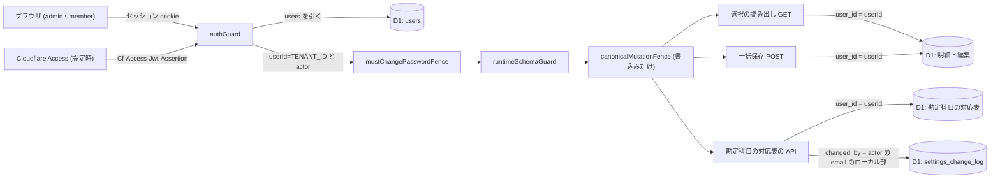

# Architecture overview

明細仕分けの一括保存で使う 3 種類の経路 (選択の読み出し・一括保存・勘定科目の対応表の読み出し・追加・削除) を、既存のセッション認証と利用者の区切りの配下に置く。本書は、主体の決め方と認可の制約を持つ。経路ごとの認証・認可の正本は `specs/spec-classify-bulk-save.md` (以下 spec) の API契約 と「認証・認可」の節で、`system-spec/auth.md` は承認時の入力である。入力の検証・件数と本文の上限・フェンス・変更の履歴は `architecture/classify-bulk-save-security.md` が持ち、本書は複製しない。行番号は HEAD a63d35c で 2026-10-01 に現物を開いて確かめた値。

本書が新しく決めるのは次の 5 点。

1. 選択の読み出し (新設) と勘定科目の対応表の API (新設) を、一括保存と同じく guard の後に載る route に置く。認証の方式と資格情報は変えない。
2. 3 種類の経路はどれも、authGuard が決めた `c.get('userId')` を読むだけで、利用者の判定を経路の中で書き直さない。
3. 他の利用者の行は、存在しない行と同じ形で返す。選択の読み出しは missing、一括保存は明細単位の not_found、勘定科目の対応表は『見つからない』。
4. テナントのキー (userId) と操作者 (actor) を分けて使う。勘定科目の対応表の変更履歴の更新者は actor から取る。
5. 選択の読み出しの母集団を、一括保存の引き直しと同じ「利用者自身の全明細」にして、認可の範囲を 2 つの経路で 1 つにする。

## Context and drivers

- 前サイクルとの関係: 前サイクルの `architecture/classify-auth.md` は、/classify の新経路を既存の guard の内側に置き、利用者 id をセッションからだけ取る形を定めた。本書はその文書を書き換えず、次のように引き継ぎ、変える。
  1. 引き継ぐ: 新しい経路を authGuard → mustChangePasswordFence → runtimeSchemaGuard → canonicalMutationFence の内側に置き、利用者 id を本文・URL から受けない (classify-auth.md §Cross-cutting contracts の Identity/access、§Architecture decisions の qa-classify-auth-web-001 の 2 行)。
  2. 引き継ぐ: 所有していない行を存在しないものとして扱い、一括保存では明細単位の not_found にして要求全体を止めない (classify-auth.md §Identity and authorization の Tenant/resource ownership enforcement)。前サイクルでは agent の推定だったが、今回は要件の土台 G5 として利用者が文面を承認した (根拠: 00 G5 / auth.md §To-Be / qa-classify-bulk-decision-072)。
  3. 変える: 下書きの扱い。前サイクルは下書きを localStorage に閉じてサーバへ送らないとした (classify-auth.md §System context and boundaries、§Architecture decisions の qa-classify-decision-004 の行)。今回は下書きを一括保存の要求に入れて送る。ブラウザに置くことと、サーバに下書きとして保存しないことは変えない (根拠: 00 C2)。
  4. 変える: 存在を明かさない対象を、txId から行の key と txId の両方へ広げる。選択の読み出しでは 404 ではなく応答の missing に入れる (根拠: auth.md §確定内容 / qa-classify-bulk-auth-web-001 の 2026-09-30T21:16:05Z の訂正)。
  5. 足す: 勘定科目の対応表の読み出し・追加・削除を同じ guard の配下に置き、利用者自身の行だけを扱う。前サイクルにこの資源は無い (根拠: 00 I8 / auth.md §To-Be)。
  6. 足す: テナントのキーと操作者を分けて書く。前サイクルは「テナントは TENANT_ID の単一」と観測しただけで、操作者を扱っていない (classify-auth.md §Context and drivers)。
- Business/technical context〔観測 qa-classify-bulk-auth-web-evidence-001、現物 2026-10-01〕:
  - `packages/api/src/index.ts` のミドルウェアは次の順に掛かる: :111 authGuard → :113 mustChangePasswordFence → :114 runtimeSchemaGuard → :115 canonicalMutationFence。
  - classifyRoute は :128、classifyBulkRoute は :129、settingsScreenRoute は :131、settingsRoute は :132 で載る。認証の要らない authRoute・aiAgentRoute・improvementAgentRoute は :102-107 で、guard より前に載る。
  - セッション cookie は `packages/api/src/auth.ts:129-131` で httpOnly・secure・SameSite=Strict として発行し、:138 の clearSession で消す。
  - verifySession は、users.status が active でない利用者 (:172) と、session_generation が合わない cookie (:173) を通さない。
  - authGuard (auth.ts:245-281) は、Cloudflare Access の経路とセッションの経路のどちらでも、userId に `TENANT_ID = 'default'` (:36) を、actor に SessionActor (:38-43 の id・email・role・mustChangePassword) を入れる。
  - auth.ts:31-35 のコメントは「明細・取引・カテゴリへ所有者列を足さない設計のため、誰が操作したかは actor として別に持つ」と書く。userId は全利用者で同じ値で、利用者を特定しない。
  - 拒否は、401 unauthorized (定数は :242)、403 password_change_required (:287-306)、403 forbidden (adminGuard、:309-317) のいずれもログを出さずに返す。
  - 一括保存は `packages/api/src/routes/classify-bulk.ts:87` で userId を取り、:93-96 で本人の Dataset と取引先の記憶だけを読む。母集団に無い txId は :121-127 で not_found『明細が見つかりません』になる。
  - classify-bulk.ts:39 の route の型は `Variables: { userId: string }` だけで、actor を読めない。
  - 選択の読み出しの経路は無い。`/transactions` の GET は classify.ts:253 (一覧)、classify.ts:610 (分割)、classify-bulk.ts:212 (履歴) の 3 本だけ。
  - 勘定科目の対応表の表・経路は無い。設定の変更履歴 settings_change_log (`packages/api/src/db/schema.ts:411-431`) は changed_by を NOT NULL で持つ。
  - 設定画面の保存は changed_by に `settingsActorFromEmail(c.get('actor').email)` を書く (`packages/api/src/routes/settings-screen.ts:528`、`routes/settings.ts:268`・:777)。この関数は email のローカル部を返す (`packages/core/src/settings-screen.ts:85`)。route の型は `Variables: AuthVariables` (settings-screen.ts:51)。
  - 明細の変更履歴 tx_history (schema.ts:1108-1128) は操作者の列を持たない。
- Quality attribute priorities:
  - G5 を最優先にする。選択の読み出し・一括保存・勘定科目の対応表の読み書きは、認証済みの利用者自身の行だけを扱う (根拠: 00 G5・S5 / auth.md §To-Be / qa-classify-bulk-decision-072)。
  - 上流の指針は OWASP ASVS (認証) と OWASP API Security Top 10 2023 の API1:2023 (オブジェクト単位の認可、出典 owasp-api-bola) (根拠: auth.md §上流指針)。
  - 設計知識は Secure by Design の『既定で拒否し、境界で一度だけ判定する』を当てる (根拠: auth.md §本章での適用)。
- Constraints:
  - これらの操作のために新しい資格情報・トークン・API キーを発行しない。既存のセッション cookie だけで通す (根拠: auth.md §上流指針)。
  - 対象は web だけ (根拠: auth.md §カテゴリ別収集状態 / qa-classify-bulk-decision-067)。
  - 既存の表に列を足さない。表の追加は勘定科目の対応表の 1 つに限る (根拠: 00 C2)。
  - secrets は `packages/api/.dev.vars` と Cloudflare の secret にだけ置く。public リポジトリなので値をコミットしない (AGENTS.md)。

## Goals and non-goals

- Goals:
  - G5: 3 種類の経路を authGuard・mustChangePasswordFence の配下に置き、未認証は 401、一時パスワードのままの利用者は 403 にする (根拠: 00 G5・O6 / auth.md §上流指針 / qa-classify-bulk-auth-web-001)。
  - G5: 利用者は `c.get('userId')` からだけ取り、本文・クエリ・ヘッダから受けない。3 種類の経路はどれも userId を検索条件に含める (根拠: auth.md §本章での適用 / qa-classify-bulk-auth-web-evidence-001)。
  - G5: 他の利用者の行の key・txId・勘定科目の対応表の行は、存在を明かさず『見つからない』として扱う (根拠: 00 G5 / auth.md §To-Be / qa-classify-bulk-decision-072)。
  - G5: 選択の読み出しの母集団は利用者自身の全明細で、一括保存がサーバで明細を引き直す母集団と同じにする (根拠: auth.md §確定内容 / qa-classify-bulk-backend-web-008 (1))。
  - G5・G2: 勘定科目の対応表の変更を設定の変更履歴に残し、更新者を actor から取る (根拠: 00 G5・I8 / auth.md §To-Be / qa-classify-bulk-decision-049)。
- Non-goals:
  - 認証方式・cookie の属性と期限・パスワード変更の流れを変えること。
  - admin と member で操作を分ける権限の設計。3 種類の経路に adminGuard は掛けない。
  - 下書きをサーバに保存すること (根拠: 00 C2)。
  - 認証・認可の拒否ログを足すこと。章 auth.md はこれを求めておらず、本サイクルの範囲に無い。
  - モバイル・タブレット・デスクトップ専用アプリの認証 (根拠: qa-classify-bulk-decision-067)。

## System context and boundaries

- Users/external systems:
  - ログインした利用者 (admin・member)。全員が同じ TENANT_ID のデータを見る。
  - Cloudflare Access (ACCESS_AUD と ACCESS_TEAM_DOMAIN を設定したときだけ使う)。Access の email は users の行と照らし、users を認可の正本にする。
- Trust/deployment/data boundaries:
  - 信頼の境界は `/api/*` の入口の guard にある。身元は cookie か Access の JWT から引いた users の行からだけ決まる。
  - 本文の一括指定と下書き、クエリの keys は、身元と所有を決める材料にしない。下書きはブラウザ (信頼の境界の外) から届く入力として扱い、その検証は security 文書に従う。
  - D1 は Worker の後ろにあり、ブラウザから直接は届かない。
- Context diagram:

## Container and component view

| Container/Component | Responsibility | Interface | Data owner | Deployment unit |
|---|---|---|---|---|
| authGuard (既存 auth.ts:245) | cookie か Access の JWT から users を引き、userId と actor を設定する。通らなければ 401 | Hono middleware (index.ts:111) | users (D1) | Worker |
| mustChangePasswordFence (既存 auth.ts:287) | 一時パスワードのままの利用者の要求を 403 password_change_required で止める | Hono middleware (index.ts:113) | なし | Worker |
| runtimeSchemaGuard・canonicalMutationFence (既存 index.ts:114-115) | 認可の判定は持たない。フェンスへの登録は security 文書が持つ | Hono middleware | lease の表 (D1) | Worker |
| 選択の読み出し (新設、GET /api/transactions/selected) | keys を利用者自身の全明細から引き、他の利用者の key と消えた key を missing に入れる | Hono route (guard の後に載る route に置く。どの route に置くかは spec の API契約 と backend 文書が持つ) | 明細・編集 (D1) | Worker |
| 一括保存 (既存 classify-bulk.ts:86 を拡張) | userId で Dataset を引き直し、母集団に無い txId を明細単位の not_found にする | POST /api/transactions/bulk | 編集・履歴 (D1) | Worker |
| 勘定科目の対応表の API (新設) | 読み出し・追加・削除を userId で絞る。他の利用者の行は見つからない扱い。変更履歴に actor を書く | Hono route (path は章に無く、spec の API契約 が実装に委ねる) | 勘定科目の対応表・settings_change_log (D1) | Worker |
| settings_change_log (既存 schema.ts:411) | 変更の更新者 changed_by を持つ。種類の制約の作り直しは `architecture/classify-bulk-save-database.md` が持つ | D1 の表 | D1 | D1 |

## Cross-cutting contracts

規範は [spec-classify-bulk-save](../specs/spec-classify-bulk-save.md) に従う。

- 認証・所有者・操作者: spec「認証・認可」。
- 入力・応答・エラー・存在を明かさない応答の形: spec「API契約」「ビジネスルールと検証」。
- 401・403 の後の画面の扱い (401 は既存のログイン切れの扱い、403 は文言を出し再試行を出さない): spec「UI・状態遷移」「エラー・例外・回復」。
- 勘定科目の対応表の列・初期の 5 行・変更履歴の種類: spec「データモデル」。
- 検証: spec「テストと受入条件」。

本書は構造と採用理由を持ち、契約表を複製しない。入力の上限と 400・413 の分け方は `architecture/classify-bulk-save-security.md` が持つ。

## Subtype architecture

- Frontend: N/A: 画面のログインと cookie の扱いを変えない。401 と 403 の後の表示は `architecture/classify-bulk-save-frontend.md` が持つ。
- Backend: N/A: 選択の読み出しと一括保存の処理の順・batch・値の解決は `architecture/classify-bulk-save-backend.md` が持つ。本書は guard と所有者の検査の条件だけを持つ。
- Infrastructure: N/A: secret・binding・Worker の構成を増やさない (`architecture/classify-bulk-save-infrastructure.md`)。
- Data: N/A: 勘定科目の対応表の列・索引・初期の 5 行と、settings_change_log の種類の制約の作り直しは `architecture/classify-bulk-save-database.md` が持つ。
- Security: 下記 Security architecture を合成する。

### Security architecture

#### Assets, actors and threat model

- Protected assets/data classification:
  - セッション cookie と Access の JWT: 資格情報に当たる、最も機微な資産。
  - 明細の編集 (区分・カテゴリ・所有者・支払い方法・メモ) と、行の key・txId: 家計と事業の取引内容。
  - 勘定科目の対応表の行: 事業の明細の提案を変える設定。
  - settings_change_log の changed_by: 誰が対応表を変えたかの証跡。
- Actors/adversaries/abuse cases:
  - 未認証の第三者が 3 種類の経路を直接叩く → authGuard が 401 を返す。
  - 一時パスワードのままの利用者 (初期パスワードが漏れた場合を含む) → mustChangePasswordFence が 403 を返す。
  - 停止した利用者の cookie が残っている → verifySession (auth.ts:172) が通さず 401 になる。
  - ログインした利用者が、他の利用者の行の key・txId・対応表の行を推測して読む・書く (BOLA) → userId の条件で結果に現れず、存在しない行と同じ形で返る。
  - 応答の違いから他の利用者の行の有無を推測する → missing・not_found・『見つからない』を存在しない行と同じ形にし、403 を使わない。
  - 本文・クエリ・ヘッダで user_id や actor を偽る → 読まないので効かない。
  - 別サイトからの CSRF → SameSite=Strict の cookie は別サイトから始まった要求に付かない (auth.ts:129-131)。Origin の検査 (importOriginGuard、index.ts:117-118) は取込だけに掛かり、本変更で広げない。章は CSRF の追加の対策を定めない。
- Trust boundaries/data flows:
  - 身元の流れは cookie / JWT → users の行 → `c.set('userId')`・`c.set('actor')` の一方向だけ。
  - route は `c.get` からだけ身元を読む。

#### Identity and authorization

- Authentication/session/federation:
  - 方式は変えない。新しい資格情報・トークン・API キーを発行しない (根拠: auth.md §上流指針 authentication)。
  - Access の経路もセッションの経路も userId と actor を設定するので、対応表の変更履歴の changed_by はどちらの経路でも埋まる。
- Authorization model and deny-by-default rules:
  - 既定で拒否する。`/api/*` の全てに authGuard が掛かる。新しい経路は guard の後に載る既存の route (index.ts:128-133 のいずれか) に足し、guard より前に載る例外の route (:102-107) には入れない。新しい route インスタンスを guard の前にマウントしない。
  - mustChangePasswordFence はパスの表を持たず、全ての `/api/*` に掛かる (auth.ts:287-306)。配下に置けば足り、表に登録する作業は無い。
  - adminGuard (auth.ts:309) は掛けず、admin・member のどちらでも呼べる。章は role で分けず、既存の設定画面の保存 (settings-screen.ts) にも adminGuard は無い。adminGuard を使うのは admin-users.ts:54 だけ。
  - 利用者の判定は境界で一度だけ行う。ハンドラは authGuard が決めた userId を読むだけで、経路の中で書き直さない (根拠: auth.md §本章での適用)。
- Tenant/resource ownership enforcement:
  - 選択の読み出し: keys を最初の ':' で行の種類 (mf・cash・split) と id に分け、`user_id = c.get('userId')` の明細から引く。見つからない key は、他の利用者の key・消えた key・存在しない key・形の違う key・200 字を超える key のどれでも同じく missing に入れ、rows に出さない (根拠: auth.md §確定内容 / qa-classify-bulk-backend-web-008 (2)・qa-classify-bulk-backend-web-009 (2)(4))。
  - 母集団は利用者自身の全明細で、期間・絞り込み・ページ・並べ替えを掛けない (根拠: qa-classify-bulk-backend-web-008 (1))。
  - 一括保存: 本人の Dataset を `loadDataset(db, userId)` で引き直し (classify-bulk.ts:93)、母集団に無い txId を明細単位の not_found にする。他の明細は保存を続ける (根拠: 00 G5 / qa-classify-bulk-auth-web-001)。
  - 一括保存の書き込み (json_each で束ねた文) の条件にも user_id を入れる。束ね方は `architecture/classify-bulk-save-backend.md` が持つ。
  - 勘定科目の対応表: 読み出し・追加・削除の条件に user_id を入れる。他の利用者の行の削除は、存在しない行の削除と同じ応答にする。状態コードと code は spec の API契約 が持つ (根拠: 00 G5 / auth.md §To-Be / qa-classify-bulk-decision-049)。
  - 操作者: 対応表の変更履歴の changed_by は `settingsActorFromEmail(c.get('actor').email)` で埋め、本文から受けない。既存の設定画面の前例 (settings-screen.ts:528) に揃える。対応表の route の型には AuthVariables を入れる (前例 settings-screen.ts:51)。
  - userId は全利用者で同じ TENANT_ID なので、本番で「他の利用者の行」は生じない。所有の検査は、利用者の区切りの導入後も userId で閉じるための構造として置き、テストで user_id を付け替えて確かめる。

#### Data and secret protection

- Encryption in transit/at rest/key ownership:
  - 通信は HTTPS だけ。cookie の secure 属性がそれを前提にする。
  - 保存時の暗号化は D1 の管理に委ねる。新しい鍵は無い。
- Secret source/rotation/redaction:
  - SESSION_SECRET は Cloudflare の secret とローカルの `.dev.vars` (git の対象外、`.gitignore:38-40`) にだけ置く。
  - 3 種類の経路は資格情報を受けず、応答にも含めない。
  - changed_by には email の全体ではなくローカル部を書く (settings-screen.ts:85 の既存の規則)。
- Retention/deletion/privacy requests:
  - 下書きはブラウザに置き、要求で送るが、サーバに下書きとして保存しない (根拠: 00 C2 / security.md §本章での適用)。
  - settings_change_log の保持は無期限 (schema.ts:411 のコメント)。本書は変えない。

#### Application and supply-chain controls

- Input/output validation and injection defenses:
  - 身元に関わる入力は受けない。
  - 条件式は Drizzle の bound parameter で組み、文字列を連結しない。
  - 件数・重複・値の範囲・本文の大きさの検証は `architecture/classify-bulk-save-security.md` が持つ。認可の検査 (userId の条件) は検証より後に掛かるので、検証で落ちた要求は所有を問わず同じ 400・413 になる。
- Dependency/artifact provenance/signing/SBOM:
  - 依存を足さない。認証は既存の hono と Web Crypto で行う。
  - 署名と SBOM は N/A: 配布物を第三者へ渡さない個人利用の Worker で、本変更は依存を増やさないため。
- CI/CD branch/review/environment protections:
  - 既存の ci.yml と `pnpm verify:full` を通してから merge する。
  - 実データをコミットしない規則と guard-real-data.sh は security 文書の Application and supply-chain controls に従う。

#### Detection and response

- Audit events/security telemetry/alerts:
  - 勘定科目の対応表の変更は settings_change_log に、changed_by (操作者)・changed_at・before/after で残る (根拠: 00 G5 / qa-classify-bulk-decision-049)。
  - 一括保存の変更は tx_history に source=bulk と op_id で残る。tx_history は操作者の列を持たず、列は足せない (00 C2)。「誰が」の扱いは Risks and verification に書く。
  - 認証・認可の拒否ログと警報は N/A: 章が求めておらず、個人利用のため置かない。
- Incident response/revocation/recovery:
  - 端末を失った、cookie が漏れた: admin が利用者を停止する。次の要求から 401 になる (auth.ts:172)。
  - 全員を締め出す必要があるとき: SESSION_SECRET を入れ替える。全セッションが無効になる。
  - 誤った一括保存: 明細の履歴と既存の取り消しで戻す。古いものは夜間バックアップ (R2、30 日保持、index.ts:193) から戻す。
- Vulnerability handling and SLA:
  - 認証まわりの依存の脆弱性は、CI の `pnpm audit --prod --audit-level high` (`.github/workflows/ci.yml:52`) が示し、次の変更で上げる。
  - SLA は N/A: 個人利用で、対応の期限を約束する相手がいないため。

#### Security verification

- SAST/SCA/secret scan/authz/abuse/penetration tests:
  - SAST・SCA・公開文書の検査は `architecture/classify-bulk-save-security.md` の Security verification に従う。認証に固有の静的解析は足さない。
  - authz は API の統合テストで次を確かめる (根拠: 00 O6 / auth.md §受入条件)。
    - 3 種類の経路それぞれで、cookie が無ければ 401、一時パスワードのままなら 403 password_change_required。
    - 行の user_id を別の値へ付け替えた明細の key を選択の読み出しに渡すと missing に入り、rows に出ない。存在しない key と同じ形である。
    - 同じく付け替えた明細の txId を一括保存に渡すと、その明細だけが not_found になり、他の明細は保存される。
    - 付け替えた対応表の行は、読み出しに出ず、削除が存在しない行と同じ応答になる。
    - 付け替えの作り方は `packages/api/src/improvement-screen.integration.test.ts:4-5` の前例に従う。
  - abuse は次を確かめる。
    - 本文とクエリに user_id や actor を入れても、読み出しの母集団と書き込みの user_id が変わらない。
    - 対応表の変更で書かれた changed_by が、セッションの actor の email のローカル部と一致する。
  - 既存の `packages/api/src/classify-bulk.integration.test.ts` に一括保存の付け替えの場合を足す。選択の読み出しと対応表のテストの置き場所は実装時に決める (auth.md §受入条件 が委ねる)。
  - ペネトレーションテストは N/A: 個人利用で外部の診断を入れる予定が無い。上の authz と abuse のテストで代える。

## Architecture decisions

| ADR | Decision | Alternatives | Trade-on rationale | Consequences |
|---|---|---|---|---|
| CB-AUTH-01 | 3 種類の経路を guard の後に載る既存の route に置き、認証方式と資格情報を変えない (根拠: auth.md §上流指針 / qa-classify-bulk-auth-web-001) | 新しい route を別にマウントする / API キーを足す | マウントの位置を誤って guard の外へ出る余地を作らない。新しい資格情報は保管と失効の手間を増やす | 401 と 403 を 3 種類の経路それぞれのテストで固定する |
| CB-AUTH-02 | ハンドラは authGuard が決めた userId を読むだけで、利用者の判定を書き直さない (根拠: auth.md §本章での適用) | 経路ごとに本文の user_id と照らす | 判定を境界の 1 か所に置けば、経路が増えても漏れない | 本文・クエリの user_id は無視される |
| CB-AUTH-03 | 他の利用者の行を存在しない行と同じ形で返す。選択の読み出しは missing、一括保存は not_found、対応表は『見つからない』(根拠: 00 G5 / qa-classify-bulk-auth-web-001 の訂正 / qa-classify-bulk-backend-web-008 (2)) | 403 を返す / 選択の読み出しを要求全体の 404 にする | 応答の差から存在を推測させない (API1:2023)。選択の 1 件の欠けで全体を止めない | テストで user_id を付け替えて確かめる |
| CB-AUTH-04 | 選択の読み出しの母集団を利用者自身の全明細とし、一括保存の引き直しと同じにする (根拠: qa-classify-bulk-backend-web-008 (1)) | 表示中の絞り込み・期間に限る | 選択が表示に左右されず (G3)、認可の範囲が 2 つの経路で 1 つになる | 母集団を引く処理を 2 つの経路で共有する (backend 文書) |
| CB-AUTH-05 | テナントのキーと操作者を分け、対応表の変更履歴の changed_by を actor から取る (根拠: 00 G5・I8 / qa-classify-bulk-decision-049、形は既存の前例 settings-screen.ts:528) | changed_by に userId を書く / 本文で操作者を受ける | userId は全員 'default' で誰かを表せない。本文の値は偽れる | 対応表の route の型に AuthVariables が要る |
| CB-AUTH-06 | adminGuard を掛けず、admin・member のどちらでも 3 種類の経路を呼べる (根拠: 00 G5、現物 admin-users.ts:54) | 対応表の変更を admin に限る | 章は role で分けない。既存の設定画面の保存も role で分けていない | role による拒否の分岐とテストは無い |
| CB-AUTH-07 | mustChangePasswordFence に手を入れない (現物 auth.ts:287-306) | 3 種類の経路を対象の表へ登録する | 現物に表が無く、すでに全 `/api/*` に掛かっている | 配下にあることを 403 のテストで確かめる |

## Delivery, migration and rollback

- Build/deploy topology: 既存の Worker のまま。認証の構成・secret・binding は変えない。
- Migration sequence: 次の順に入れる。
  1. 勘定科目の対応表の表と settings_change_log の作り直しの migration を入れる (database 文書。破壊的な migration は PR で承認する)。
  2. 対応表の API を、AuthVariables を持つ route として guard の後に足す。
  3. 選択の読み出しを guard の後に載る route に足す。
  4. 一括保存の本文を一括指定と下書きに広げる。所有の検査 (userId での引き直し) は今の形を保つ。
  5. 付け替えのテストと 401・403 のテストを足す。
  - 本番は Migrate → Deploy の順 (spec 互換性・移行・リリース)。
- Rollback trigger/procedure:
  - 認証か所有のテストが落ちたら、実装を差し戻す。新しい経路が消え、セッションはそのまま使える。
  - 資格情報に触れないので、認証のデータの巻き戻しは要らない。対応表の表と変更履歴は残る (戻し方は database 文書)。

## Risks and verification

- Risk/assumption:
  - 一括保存の変更の「誰が」: 章 security.md の上流指針は「誰がいつどの明細のどの項目を一括で変えたかを辿れる」と書く。tx_history は操作者の列を持たず (schema.ts:1108-1128)、route は actor を読まない (classify-bulk.ts:39)。00 C2 は既存の表に列を足すことを禁じ、章は「誰が」を残す手段を定めない。本書は決めず、code_findings に挙げる。
  - 新しい利用者への初期の 5 行: 00 I8 は「新しい利用者の作成時にも入れる」と書く。利用者の作成 (`packages/api/src/users.ts:247` の prepareUserInvitation) は業務データの user_id を作らず、業務データは全員が TENANT_ID で共有する。作成のたびに TENANT_ID へ入れると既存の行と重なる。章はどの主体に入れるかを定めない。本書は決めず、code_findings に挙げる。投入の単位 (user_id) と、作成のたびに入れ直さないことは spec「API: 勘定科目の対応表」の Validation が、新しい持ち主へ入れる時機は spec の未決事項 7 が持つ。
  - 新しい route を guard の前に載せると、認証が効かない。401 のテストで落とす。
  - 選択の読み出しの keys はクエリ文字列で届くので、Workers の observability が URL を記録すると明細の id が platform のログに残る。onError (index.ts:151-181) は path だけを出す。この残り方は本書では変えない。
- Architecture fitness test:
  - 選択の読み出し・一括保存・対応表の API が、身元を `c.req` (本文・クエリ・ヘッダ) から読まない。
  - 対応表の route の型が AuthVariables を持ち、changed_by を actor から埋める。
  - 3 種類の経路が index.ts:111-115 の guard より後に載る route にある。
- Load/failure/security validation:
  - 上の Security verification のテストが緑であること。
  - 既存のログインと停止の回帰テストが緑であること。
  - `pnpm verify:full` が緑であること (根拠: 00 O7)。
