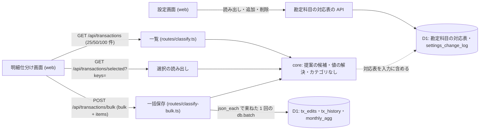

# Architecture overview

明細仕分け一括保存 — サーバが選択した明細を引き直して core で値を解決し、編集と履歴を json_each で束ねた 1 回の batch で書く。本書は backend の制約を持つ。エンドポイントごとの契約 (Request・Response・Error contract) の正本は `specs/spec-classify-bulk-save.md` (以下 spec) の API 契約で、`system-spec/backend.md` (以下 backend 章) と `system-spec/00-requirements-definition.md` (以下 00) は承認時の入力である。表・列・制約・migration・整合性は `architecture/classify-bulk-save-database.md` (以下 database 本書) が持ち、本書は名指して参照するだけにする。行番号は 2026-10-01 に HEAD a63d35c で確かめた値。

要件の土台 (00 の U1〜U9) は、利用者が承認 appr-foundation-classify-bulk-006 で今の文面のまま承認した (qa-classify-bulk-decision-068・qa-classify-bulk-decision-069・qa-classify-bulk-decision-070・qa-classify-bulk-decision-072・qa-classify-bulk-decision-074)。backend 章はその文面に揃えて確定した版である。章の中に残る旧い文言 (区分に合う組が無い明細を外す、表と migration を足さない) は後の決定と訂正で置き換わっており、本書は 00 と訂正後の決定に従う。

## Context and drivers

前サイクルとの関係: 前サイクルの `architecture/classify-backend.md` は、/classify の route の分け方 (一覧・編集・分割・ルールは `routes/classify.ts`、一括保存と履歴は `routes/classify-bulk.ts`)、明細の値を applyManualEditWithBase で今の編集に重ねること、canonicalMutationFence による取込との直列化、既存の由来 (取引先の記憶 → ルール → MF 中項目) とその信頼度、要確認の閾値 80 を定めた。本書はこれらを引き継ぎ、同書の次の 5 点を変える。同書は書き換えず、正本のまま残る。

1. 同書「Data and transaction behavior」の「明細の境界で batch を切り、失敗した batch の明細だけを失敗にする (部分成功)」→ 編集と履歴を json_each で束ねた 1 回の batch にし、全件が書かれるか何も書かれないかにする (根拠: 00 I2 / backend.md §To-Be G1 / qa-classify-bulk-delegated-001)。
2. 同書「API and service contracts」の一括保存の item (区分・カテゴリ・所有者・支払い方法の値だけを持つ) → 一括指定 (bulk) と各明細の下書き (draft) を受け、値はサーバが明細を引き直して core で解決する (根拠: 00 G3・I2 / qa-classify-bulk-decision-041・qa-classify-bulk-decision-043)。
3. 同節の Error taxonomy (一括保存の上限超過は 400、予算の超過は今の実装で write_failed) → 本文の上限で 413 payload_too_large、書く前に測る予算の超過で 413 too_many_classify_changes を返し、write_failed は batch そのものの失敗だけに使う (根拠: 00 O8 / qa-classify-bulk-decision-030・qa-classify-bulk-decision-057・qa-classify-bulk-decision-058)。
4. 同書 Cross-cutting の「`GET /transactions` への列の追加は加法的」の下で残した互換の全件 transactions → 応答から外し、表示件数を 25 / 50 / 100 にし、選択の中身は新しい読み出し API が返す (根拠: 00 G3・G4・I3 / backend.md §上流指針 data-access / qa-classify-bulk-decision-043・qa-classify-bulk-decision-074)。
5. 同書「Domain and module boundaries」の提案 (3 つの由来) → 最後の由来『MF の分類』と『MF の分類 (対応表)』(信頼度 60) を足し、勘定科目の対応表の読み出し・追加・削除の API を足す (根拠: 00 G2・I4・I8 / qa-classify-bulk-decision-042・qa-classify-bulk-decision-049)。

以下の既存実装の観測は開発着手前 (2026-10-01、HEAD a63d35c) の記録。現在の構造・契約は各設計節と spec を参照する。

- Business/technical context〔観測 qa-classify-bulk-backend-web-evidence-001、現物 2026-10-01〕:
  - 一括保存 `POST /api/transactions/bulk` (`packages/api/src/routes/classify-bulk.ts:86`):
    - item は値の欄だけを持ち (`:48-56`)、一括指定と下書きの欄が無い。件数は 1〜100 (`:46`、`:57`)。重複は 400 (`:91`)。
    - 明細ごとに `saveEditQueries(... source: 'bulk')` を呼んで文を作る (`:163-171`)。編集は `editWriteQueries` (`packages/api/src/store.ts:278-300`) の削除と挿入の 2 文で、json_each で束ねていない。
    - `chunkByItem(units, MAX_BATCH_STATEMENTS - 3)` (`:177`) で batch を複数に分け、失敗した batch の明細だけを write_failed にする (`:195-203`)。予算の超過 (`classify_bulk_query_budget`、`:191`) も write_failed に丸めている。
    - 提案は `classifySuggestion(tx, tx.c, data.rules, vendorMemories)` (`:155`) で、集計ルール (normRules) を渡していない。
    - `/api/transactions/bulk` に bodyLimit が無い (`packages/api/src/index.ts:94-101` は `/api/auth/*` の 16KB だけ)。
  - 一覧 `GET /api/transactions` (`packages/api/src/routes/classify.ts:253`): limit は 50 だけを受け (`:163`、`:196-199`)、応答に絞り込み後の全件 `transactions: matched` を互換として残している (`:381-389`)。
  - 単体編集の予算の検査: `planClassifyMutation` (`routes/classify.ts:98-114`) が集計の置き換えを含めて 50 文以下かと束ねた JSON の上限を測り、超えたら `mutationTooLarge` (`:116-121`、413 too_many_classify_changes) を返す。
  - D1 の上限の 50 が 4 か所にある: `MAX_BATCH_STATEMENTS` (`classify-bulk.ts:44`)、`CLASSIFY_BATCH_STATEMENTS` (`classify.ts:90`、`RULE_BATCH_STATEMENTS` は `:1070` でこれを指す)、`D1_FREE_QUERY_LIMIT` (`packages/api/src/import-lifecycle.ts:304`)、`SCHEDULED_D1_QUERY_LIMIT` (`packages/api/src/scheduled-maintenance-budget.ts:13`)。
  - 提案の由来: `MF_MID_CONFIDENCE = 70` (`packages/core/src/classify-status.ts:88`)、閾値 `REVIEW_CONFIDENCE_THRESHOLD = 80` (`:43`)。候補の算出は記憶 → ルール → MF 中項目で終わり (`:189`、`:247-256`)、MF の大項目・中項目をそのまま使う由来は無い。
  - `packages/core/src/overview.ts:199` と `:265` に RecommendationBasis と legacyBasisLabel が残る。
- Quality attribute priorities:
  1. 整合性: 一括保存で、編集・履歴・月次集計の一部だけが書かれた状態を作らない。同じ要求を送り直しても最終の状態が変わらない (00 O9)。
  2. 予算: 1 回の Worker 起動で D1 へ出すクエリを、batch の中の文も 1 本ずつ数えて 49 本以内に保つ (00 C4・O8)。
  3. 一貫性: 値の解決と提案の由来の順位を core の 1 か所に置き、一覧・選択の読み出し・一括保存・/review-queue で同じ結果にする (backend 章 §本章での適用)。
  4. 分離: 選択の読み出し・一括保存・勘定科目の対応表は、認証済みの利用者自身の行だけを扱う (00 G5)。
- Constraints:
  - Cloudflare Workers Free と D1。batch は 1 つのトランザクションとして実行される (出典 cloudflare-d1-batch 2026-06-22)。1 文の bound parameter は 100 まで、1 つの行と文字列は 2,000,000 bytes まで (出典 cloudflare-d1-json 2026-04-21)。束ねた JSON の bind は `D1_JSON_BIND_SAFE_BYTES` (1,900,000、`store.ts:1789`) で検査する。
  - core は依存ゼロの純関数。提案と値の解決は core に置き、api と web は写すだけにする (00 C1)。
  - 自動判定の規則 (閾値 80) と、既存の由来の順位と信頼度は変えない (00 範囲の対象外)。

## Goals and non-goals

- Goals:
  - G1: 一括保存を、提案が無い明細にも一括指定で使えるようにし、サーバが core の 1 つの解決関数で値を決める。batch の失敗は 2xx で保存対象の全件を write_failed にする (根拠: 00 G1 / qa-classify-bulk-decision-041・qa-classify-bulk-decision-057)。
  - G2: 提案の最後の由来を core の候補の算出に足し、事業の明細には勘定科目の対応表を引いて付ける。対応表の読み出し・追加・削除の API を足す (根拠: 00 G2 / qa-classify-bulk-decision-042・qa-classify-bulk-decision-040・qa-classify-bulk-decision-049)。
  - G3: 選択を行の key で受ける読み出し API を足し、一覧の応答から絞り込み後の全件を外す (根拠: 00 G3 / qa-classify-bulk-decision-043)。
  - G5 (章の serves_goals の外だが経路の制約として持つ): 上限・重複・値の制約を zod で検証し、本文を 256KB に抑え、変更をフェンスに通す (根拠: 00 G5 / qa-classify-bulk-decision-030)。
- Non-goals:
  - 選択の上限 50 件と一括保存の上限 100 件の変更 (00 範囲の対象外)。
  - 既存の由来の順位と信頼度、要確認の閾値 80 の変更。
  - 分割・ルール作成・ルール適用・削除と取消・保存フィルタの API の変更。
  - Workers Paid への移行、Queues・Durable Objects・夜間 job の追加 (qa-classify-bulk-delegated-001)。
  - 表・列・migration の中身 (database 本書が持つ)。

## System context and boundaries

- Users/external systems:
  - web の明細仕分け画面 (`architecture/classify-bulk-save-frontend.md`): 一覧・選択の読み出し・一括保存を呼ぶ。下書きはブラウザに置き、保存の要求に入れて送る (00 C2)。
  - web の設定画面: 勘定科目の対応表の読み出し・追加・削除を呼ぶ。
  - /review-queue と総収支 (`overview.ts`): 同じ core の提案を使う。本書の変更で提案の入力が増えるので、呼び出しを揃える。
  - 外部サービスは呼ばない。外部の LLM も使わない。
- Trust/deployment/data boundaries:
  - Worker 1 つと D1 1 つ。業務データのテナントのキーは `userId` で、認証後に `TENANT_ID` (`packages/api/src/auth.ts:36`、`:257`・`:276` で設定) が入る。操作者は actor として別に持つ。
  - 本書の API はすべて `userId` を条件に含めて引き、他の利用者の行は存在を明かさず『見つからない』とする (00 G5)。
- Context diagram:

## Container and component view

| Container/Component | Responsibility | Interface | Data owner | Deployment unit |
|---|---|---|---|---|
| core の値の解決関数 (名前は実装時に決める) | 一括指定・下書き・提案・今の値から、明細ごとの保存する値・外す理由・値の出所を返す。画面の resolveBulkItem と inputFromRow (`packages/web/src/pages/classify/view-model.ts`) を置き換える | 純関数 | packages/core | 同一 Worker と web |
| core の提案の候補 (`classify-status.ts`) | 既存の 3 つの由来の後ろに、最後の由来 (信頼度 60) を足す。根拠文 basisText と短い根拠文 basisLabel を候補を作る 1 か所で作る | 純関数 | packages/core | 同一 Worker と web |
| core の『カテゴリなし』(`categories.ts`) | 予約の値を 1 か所で定め、集計・分類の状態・候補の検査で未分類と同じに扱う判定を出す | 定数と純関数 | packages/core | 同一 Worker と web |
| core の設定の JSON (`settings-json.ts`) | kanjo-settings を版 2 にし、勘定科目の対応表を往復させる。版 1 は初期の 5 行で読む | 純関数 | packages/core | 同一 Worker と web |
| 一括保存 (`routes/classify-bulk.ts`) | 5 段 (検証 → 引き直し → 解決 → 予算 → 1 回の batch) で保存し、明細ごとの結果を返す | Hono route | packages/api | Worker |
| 一覧と選択の読み出し (`routes/classify.ts`) | 一覧は表示中のページの行と総件数だけを返す。選択の読み出しは行の key から一覧と同じ形の行を返す | Hono route | packages/api | Worker |
| 勘定科目の対応表の API (経路名と置き場所は実装時に決める (章 I8 が委ねる)) | 利用者ごとの対応表の読み出し・追加・削除。変更を設定の変更履歴に残す | Hono route | packages/api | Worker |
| 束ねた書き込みの関数 (`store.ts`・`classify-history.ts`) | 編集と履歴の文を json_each で明細数によらない本数にまとめる | 文の配列を返す関数 | packages/api | Worker |
| D1 の予算の定数 (api の 1 か所。名前は実装時に決める) | 1 起動の合計 (50 未満) と 1 回の batch の文 (50 以下) を別の名前で持つ | 定数と検査関数 | packages/api | Worker |
| 本文の上限 (`index.ts`) | `/api/transactions/bulk` に bodyLimit 256KB | Hono middleware | packages/api | Worker |

## Cross-cutting contracts

規範は [spec-classify-bulk-save](../specs/spec-classify-bulk-save.md) に従う。

- 認証・認可・分離: spec「認証・認可」。脅威と検証は `architecture/classify-bulk-save-security.md`。
- 入力・応答・エラー・冪等性: spec「API契約」「ビジネスルールと検証」「エラー・例外・回復」。
- 値の解決の順・『カテゴリなし』・提案の由来: spec「ビジネスルールと検証」。
- 表・列・migration・履歴の粒度: spec「データモデル」と database 本書。
- 検証: spec「テストと受入条件」。

本書は構造と採用理由を持ち、契約表を複製しない。

## Subtype architecture

- Frontend: N/A: 画面の状態・選択の保持・再試行の出し分けは `architecture/classify-bulk-save-frontend.md` が持つ。本書は画面が読む応答の形だけを持つ。
- Backend: 下記 Backend architecture を合成する。
- Infrastructure: N/A: Workers Free の上限と migration の適用の順は `architecture/classify-bulk-save-infrastructure.md` と共有する。本書は 1 要求のクエリの予算だけを持つ。
- Data: N/A: 表・列・制約・migration・整合性は database 本書が持つ。本書は文の組み立てと順だけを持つ。
- Security: N/A: 脅威モデルと他の利用者の行の扱いの検証は `architecture/classify-bulk-save-security.md` が持つ。本書は入力検証の置き場所を持つ。

### Backend architecture

#### Runtime and architecture pattern

- Runtime/framework/version: 既存の Cloudflare Workers + Hono + Drizzle (D1)。入力は zod 3.25.76 と @hono/zod-validator で検証する。packages/core は依存ゼロの TypeScript。
- Pattern: Clean Architecture の Dependency Rule。値の解決・提案の由来・『カテゴリなし』の扱いは入出力を持たない規則なので core に置き、route は入力の組み立てと書き込みだけを行う (根拠: backend.md §上流指針 application-architecture・§本章での適用)。
- 一括保存の 5 段 (根拠: backend.md §上流指針 application-architecture):
  1. zod で本文を検証する。要求全体の 400 はこの段だけで返す。
  2. userId で、選択した明細と勘定科目の対応表と提案の入力を引き直す。
  3. core の解決関数で、明細ごとに保存する値か外す理由を決め、applyManualEditWithBase で編集の値に組む。
  4. 書き込みの予算 (1 回の batch の文の数と束ねた JSON の大きさ) を、単体編集と同じ関数で測る。超えたら書く前に 413 too_many_classify_changes を返す。
  5. json_each で束ねた 1 回の batch で書く。
- Selection rationale and rejected alternatives (qa-classify-bulk-delegated-001):
  - 画面から小分けに順送りする案: 無料枠で動くが、途中で止まると一部だけが保存され、50 件で 10〜17 往復かかる。
  - サーバの上限を下げる案: 範囲外にした一括保存の上限の変更に当たる。
  - Workers Paid にする案: 月額の固定費がかかり、無料枠で動かす条件から外れる。
  - 画面が値を解決して送る今の形: 一覧の表示外の明細の値を画面が持たないと解決できず、選択が表示に左右される (00 G3)。

#### Domain and module boundaries

- Bounded contexts/modules:
  - 値の解決 (一括保存): 一括指定・下書き・提案・今の値から保存する値を決める。
  - 提案: 由来ごとの候補・信頼度・根拠文。
  - 勘定科目の対応表: 利用者が決めて持ち続ける MF の大項目 → 勘定科目の 1 組。
  - 選択: 行の key の解析と引き直し。
- Dependency direction: core ← api ← web の一方向。core は D1 と Hono の型を参照しない。対応表は api が D1 から引き、行の配列として core に渡す。
- 値の解決の規則 (根拠: 00 G1 / backend.md §To-Be G1 / qa-classify-bulk-backend-web-009 / qa-classify-bulk-delegated-003・qa-classify-bulk-delegated-004・qa-classify-bulk-decision-048):
  - 未整理の明細は、区分・カテゴリの組・所有者を 一括指定 → 下書き → 提案 の順で埋める。確定済みの明細は 一括指定 → 下書き → 今の値 の順で埋め、提案を使わない。
  - 支払い方法は状態によらず 一括指定 → 下書き → 今の値 で、今の値は保存済みの手動の値 (row.edit.paymentMethod)。無ければ送らない。
  - 区分とカテゴリは 1 組で決める。カテゴリ (大) を指定したらカテゴリ (中) も一括指定の値 (無ければ空)。区分だけを指定したときは、埋める値のうち区分が同じ最初の組を取り、どこにも無い明細は『カテゴリなし』で保存する。
  - カテゴリ (大) だけを指定し、明細の区分と系統が合わない明細は外す。理由は『指定したカテゴリ (大) が明細の区分に合いません』。
  - 確定済みで一括指定も下書きも無い明細は『変わる値がありません』で外し、未整理で何も無い明細は O1 のとおり外す。外した明細は失敗に数えない。
  - 画面とサーバは同じ関数を使う。画面は保存前の内訳を出し、サーバは同じ結果で書く。サーバの no_value と invalid_item は二重の防御で、通常は届かない。
- 提案の最後の由来 (根拠: 00 G2・I4 / qa-classify-bulk-decision-042・qa-classify-bulk-decision-051・qa-classify-bulk-decision-052・qa-classify-bulk-decision-050・qa-classify-bulk-decision-039・qa-classify-bulk-decision-028):
  - 記憶・ルール・MF 中項目の対応表のどれも無いときだけ候補に入れるので、既存の由来の候補と並ばない。信頼度は 60 (MF 中項目の 70 より下で、閾値 80 未満なので要確認)。区分と所有者は今の解決値をそのまま使う。
  - 個人の明細: MF の大項目・中項目をそのまま由来『MF の分類』で付け、根拠文は『MFの分類をそのまま提案』。
  - 事業の明細: 対応表で大項目から引いた勘定科目を、中項目は空のまま由来『MF の分類 (対応表)』で付け、根拠文に大項目と勘定科目の対応を書く。対応表に行の無い大項目には付けない。
  - 集計ルール (取引先) が当たる個人の明細は、ルールを当てた後の値を提案し、根拠文を集計ルールの名前にする。値が個人の候補に無ければ付けない。
  - 付けないもの: MF の大項目が空か『未分類』の明細 (個人・事業とも)、分割の内訳行。
- 提案の入力の一本化 (根拠: qa-classify-bulk-backend-web-009 (5)(6)):
  - ルール・取引先の記憶・集計ルール・勘定科目の対応表を 1 つの値にまとめて渡す。呼び出しは 6 か所 (`classify-row.ts` に 2、`routes/classify.ts`、`routes/classify-bulk.ts`、`overview.ts` に 2) で、1 か所でも漏れると一覧・一括保存・/review-queue の提案が食い違う。
  - basisLabel (『過去 10 件中 9 件』の形) は /review-queue の互換のために残し、候補を作る 1 か所で作る。legacyBasisLabel はそこへ移して消す。RecommendationBasis は SuggestionBasis の別名にする。

#### API and service contracts

- Protocol/style/versioning: 同一オリジンの REST (JSON)。版の番号は付けず、一覧の応答から項目を外すことは画面と同じ PR で行う。
- Request lifecycle: authGuard (401) → mustChangePasswordFence (403 password_change_required) → runtimeSchemaGuard (503 schema_unavailable) → canonicalMutationFence (変更系だけ、409 canonical_write_busy) → bodyLimit (一括保存だけ。本文の読み込みと zod の前に止め、登録の位置は実装時に決める (章 qa-classify-bulk-backend-web-010 (3) が委ねる)) → zod → route の段 → JSON。想定外の例外は onError の 500 internal。
- `POST /api/transactions/bulk` (拡張。根拠: 00 I2 / qa-classify-bulk-backend-web-010 / qa-classify-bulk-decision-058):
  - 要求: `{ bulk?: { cls?, big?, mid?, owner?, paymentMethod? }, items: Array of { txId, draft? } }`。値の欄を持つ旧い形の item も受ける。
  - 応答: `{ results, opId, saved, failed }`。results は明細ごとに `ok: true` と status (done か manual)、または `ok: false` と code (not_found / invalid_item / split_line_not_supported / no_value / write_failed) の 1 つの形 (backend 章 §本章での適用の API Design)。
  - 400 invalid_body は 3 種だけ: 件数の範囲外 (1〜100 件)、txId の重複、一括指定の値の範囲外。範囲外には、カテゴリ (中) だけの指定、区分とカテゴリ (大) の系統が合わない指定、『カテゴリなし』の予約の値の送信が入る。下書きの値の範囲外と、解決後に系統が合わない明細は、その明細だけ invalid_item にする。
  - 413 は 2 種で、どちらも明細ごとの結果を持たない。payload_too_large『リクエストが大きすぎます』(bodyLimit 256KB、`routes/tradeoff.ts`・`routes/balances.ts` と同じ code と文言) と、too_many_classify_changes『変更量が多すぎるため、対象を絞ってください』(書く前の予算の超過)。txId に個別の長さの上限は付けない。
  - batch が失敗したら 2xx で返し、保存対象の全件を write_failed にする。外した明細と明細単位の失敗は write_failed にしない。
- `GET /api/transactions/selected?keys=` (新設。根拠: 00 G3・I3 / qa-classify-bulk-backend-web-009 (2)(4)):
  - keys はカンマ区切りで 1〜50 件。応答は `{ rows, missing }` で、rows は一覧の行と同じ形。
  - 要求全体の 400 は件数の範囲外と key の重複だけ。形の違う key (mf:・cash:・split: のどれでも始まらない) と 200 字を超える key は missing に入れる。
  - key は最初の ':' で行の種類と id に分ける (cash:cash: の形があるため)。id は mf と cash では txId、split では内訳の lineId。母集団は利用者自身の全明細で、期間・絞り込み・ページを掛けない。GET なので bodyLimit とフェンスを掛けない。
- `GET /api/transactions` (変更。根拠: 00 G4 / backend.md §上流指針 data-access / qa-classify-bulk-backend-web-001・qa-classify-bulk-decision-074):
  - limit は 25 / 50 / 100 だけを受ける (既定値は spec の API 契約)。応答の rows・total・page・limit などは今のまま、互換の transactions (matched、`routes/classify.ts:381-389`) を外す。transactions を読む既存の API テストは rows へ移す。
- 勘定科目の対応表の読み出し・追加・削除 (新設。経路名は実装時に決める (章 I8 が委ねる)。根拠: 00 G2・G5・I8 / qa-classify-bulk-decision-049):
  - 行は MF の大項目と、勘定科目の一覧から選んだ対応先の 1 組。同じ大項目の 2 行目と一覧に無い対応先は 400、他の利用者の行は『見つからない』。変更は設定の変更履歴に残す。
- 既存の経路の変更 (根拠: 00 G5 / qa-classify-bulk-decision-045・qa-classify-bulk-decision-048):
  - `PUT /api/transactions/:txId/edit` (`routes/classify.ts:470`) は『カテゴリなし』の予約の値を 400 にする。
  - カテゴリの候補の作成と改名 (`routes/settings.ts:496`・`:527`) は、予約の値と同じ名前を 400 にする。

#### Data and transaction behavior

- Repository/data owner: 一括保存が書くのは tx_edits と tx_history と月次集計の派生だけ。対応表の API が書くのは対応表と settings_change_log だけ (表と列は database 本書)。
- 書き込みの batch の組み立て (根拠: 00 I2 / qa-classify-bulk-delegated-001 / backend.md §上流指針 application-architecture):
  - 編集の削除・編集の挿入・履歴の挿入を、それぞれ json_each を読む文にまとめ、明細数で文の本数を増やさない。前例は `aggregateReplacementQueries` (`store.ts:1937`) と `d1JsonPayload` (`store.ts:1799`)。
  - 同じ batch に、JSON snapshot の無効化 (`invalidateJsonSnapshotQuery`) と月次集計の置き換え 2 文を入れる。
  - 履歴は `historyEntries` (`classify-history.ts:56`) の差分の判定を明細ごとに使い、行を 1 つの JSON にまとめる。値が変わらない明細は行を作らない。
  - 文の正確な並びと本数は実装時に決める (章 §上流指針 application-architecture が 5 段だけを定める)。本数は予算のテストで固定する。
- Transaction/idempotency/concurrency:
  - 1 回の batch は 1 つのトランザクションで、全件が書かれるか何も書かれないか (cloudflare-d1-batch)。100 件でも途中まで保存された状態が残らない。
  - 冪等性 (根拠: 00 O9 / qa-classify-bulk-backend-web-010 (1) と訂正): 同じ要求を 2 回送ると、2 回目は確定済みとして 一括指定 → 下書き → 今の値 で同じ値になり、値 (更新時刻を除く)・done か manual か・月次集計が変わらず、履歴は 0 行。一括保存は取引先の記憶を書かない (disagreeOriginKey を渡さない) ので、提案と一致の判定も変わらない。POST はメソッドとして冪等でない (RFC 9110 §9.2.2) ので、画面は自動で送り直さない。
  - canonicalMutationFence が、同じテナントの一括保存と取込・復元を直列にする。一括保存の登録は `canonical-mutation-fence.ts:152` (tx_edits・tx_history)。
- Cache consistency/invalidation: サーバ側のキャッシュを持たない。提案と件数は要求のたびに導く。web の TanStack Query の読み直しは frontend 本書が持つ。

#### Async processing

- Queue/event/scheduler: N/A: キュー・イベント・スケジューラを足さない。一括保存は 1 回の要求の中で完結する (qa-classify-bulk-delegated-001)。
- Delivery/order/dedup/retry/DLQ: N/A: サーバは送り直さない。再試行は利用者の操作でだけ行い、write_failed の明細だけを送るか、直前の本文をそのまま送る (00 G1・I7)。重複の害は冪等性で防ぐ。

#### Security and resilience

- Authn/authz/input validation:
  - 既存の `/api/*` の認証とフェンスの配下に置く。認可の詳細は `architecture/classify-bulk-save-security.md`。
  - zod で上限 (選択 50・一括 100)・重複・一括指定の値 (既存の編集と同じ制約) を検証する。『カテゴリなし』の予約の値は一括指定と編集で 400 (00 G5)。
  - 引き直しは userId を条件に含める。他の利用者の txId と key は not_found と missing になり、存在を明かさない。
- Timeout/retry/circuit breaker/load shedding:
  - 本文は bodyLimit 256KB で読み込みの前に止める (qa-classify-bulk-decision-030)。256KB は 100 件 × (カテゴリ大・中 60 字ずつとメモ 200 字を UTF-8 の 3 バイトで数えた約 1KB ＋ txId ＋ JSON の記号) に余裕を持たせた値。
  - 予算は 2 つの名前で持つ (qa-classify-bulk-backend-web-009 (4))。1 起動の合計は 50 未満 (49 本以内、batch の中の文も数える)、1 回の batch の文は 50 以下。1 要求はおよそ 25 本 (qa-classify-bulk-delegated-001)。
  - 束ねた JSON の 2MB は月次集計の全行で決まるので、選択を減らしても下がらない場合がある。単体編集にもある既存の制約で、本サイクルでは変えない。
  - 既存の 50 の 4 か所は、予算の 2 つの名前へ寄せる。置き場所 (既存の `packages/api/src/d1-limits.ts` を含む) と名前は実装時に決める (章 qa-classify-bulk-backend-web-009 (4) が委ねる)。

#### Operations and verification

- Logs/metrics/traces/health/readiness: 新しい運用信号は足さない。エラーの応答に SQL・スタック・明細の値を含めない。予算の超過のログは件数だけを載せる (`QueryBudgetExceededError` の前例、`d1-limits.ts`)。
- Unit/contract/integration/load/failure tests:
  - core 単体: 値の解決の各規則 (未整理と確定済みの順、1 組の決め方、『カテゴリなし』、カテゴリ (大) だけの指定で外す理由、変わる値が無い行)、提案の最後の由来 (信頼度 60、個人と事業、対応表に無い大項目、空と『未分類』、集計ルール、既存の由来の順位と信頼度が変わらない) を固定する (00 O1・O3)。
  - API: 50 件・100 件の保存で D1 へのクエリが 49 本以内、batch の失敗で 2xx かつ全件 write_failed、予算の超過で 413 too_many_classify_changes (明細ごとの結果なし)、256KB 超で 413 payload_too_large (00 O6・O8)。
  - API: 同じ要求を 2 回送って、saved と status が同じ、値と月次集計が同じ、履歴の行数が増えない (00 O9)。
  - API: 選択の読み出しが表示外の明細を返し、一覧の応答に絞り込み後の全件が無い。他の利用者の key と txId が missing と not_found (00 O4・O6)。
  - API: 対応表の 401・400 (2 行目・一覧に無い対応先)・他の利用者の行・設定の変更履歴 (00 O3・O6)。

## Architecture decisions

| ADR | Decision | Alternatives | Trade-on rationale | Consequences |
|---|---|---|---|---|
| CBS-BE-01 | 編集と履歴を json_each で束ね、1 回の batch で書く (qa-classify-bulk-delegated-001) | 明細の境界で batch を分ける (前サイクル) / 画面から小分けに送る / 上限を下げる / Workers Paid | 文の本数が明細数で増えず、50 件も 100 件も 1 回で 49 本以内に収まる。1 回の batch なので途中まで書かれた状態が残らない | 明細ごとの部分成功が無くなり、batch の失敗で保存対象の全件が write_failed になる |
| CBS-BE-02 | サーバが明細を引き直し、core の 1 つの関数で値を解決する (qa-classify-bulk-decision-043・qa-classify-bulk-delegated-003・qa-classify-bulk-delegated-004) | 画面が解決した値を送る (今の形) | 選択が一覧の表示に左右されない。画面の内訳とサーバの結果が同じ関数から出る | 要求は一括指定と下書きを運ぶ。旧い形の item も受け続ける |
| CBS-BE-03 | batch の失敗は 2xx で保存対象の全件を write_failed にする (qa-classify-bulk-decision-057) | 5xx で要求全体を失敗にする | 明細ごとの結果の形を保ち、画面の再試行を write_failed の明細に限れる (qa-classify-bulk-decision-018) | write_failed は batch の失敗だけに使い、書く前に決まる失敗に丸めない |
| CBS-BE-04 | 413 を payload_too_large と too_many_classify_changes の 2 種にし、明細ごとの結果を持たない (qa-classify-bulk-decision-030・qa-classify-bulk-decision-058) | 新しい code bulk_too_large / write_failed に丸める | 既存の code と文言 (tradeoff.ts・balances.ts・単体編集) と揃い、画面の分岐が増えない。送り直しても結果が変わらないので再試行を出さない | 予算の検査は単体編集の planClassifyMutation と同じ関数を使う |
| CBS-BE-05 | 選択の読み出し API を足し、一覧の応答から matched を外す (qa-classify-bulk-decision-043) | 一覧に全件を残し、画面が選択を引く | 一覧の応答が表示件数に比例する大きさになり、表示外の選択も読める | 旧い全件 transactions を読む呼び出しとテストを移す |
| CBS-BE-06 | 提案の最後の由来を信頼度 60 で足し、他の由来が無いときだけ候補に入れる (qa-classify-bulk-decision-042・qa-classify-bulk-decision-051) | 最後の由来を足さない (今の形。取込直後の未整理は全件が提案なし) | 既存の由来の順位と信頼度を変えずに、取込直後の明細の多くへ提案を付けられる。閾値 80 未満なので要確認に入り、自動で確定されない | 取込直後の明細にも提案が付く |
| CBS-BE-07 | 事業の明細は勘定科目の対応表で引いた科目だけを提案する (qa-classify-bulk-decision-040・qa-classify-bulk-decision-050・qa-classify-bulk-decision-052) | 事業の明細には付けない / 中項目まで推測する | 科目を 1 つに決められる大項目だけに出し、税務判断をしない (00 C4) | 対応表に行の無い大項目の事業の明細は提案なしのまま |
| CBS-BE-08 | 提案の入力 (ルール・記憶・集計ルール・対応表) を 1 つの値にまとめて 6 か所へ渡す (qa-classify-bulk-backend-web-009) | 呼び出しごとに引数を足す | 1 か所の漏れで一覧・一括保存・/review-queue の提案が食い違うのを型で防ぐ | overview.ts の呼び出しも同じ値を受ける |
| CBS-BE-09 | D1 の予算を、1 起動の合計と 1 回の batch の文の 2 つの名前で api の 1 か所に持つ (qa-classify-bulk-backend-web-009 (4)) | 50 を各所に置く (今の形) | 意味と境界 (50 未満と 50 以下) が違う値を 1 つの名前で持つと、片方を変えた日に静かにずれる | 既存の 4 か所を寄せる。名前は実装時に決める |

## Delivery, migration and rollback

- Build/deploy topology: 既存の Worker と packages/core のビルド。新しい binding・Worker・データベースは無い。
- Migration sequence (同じ PR の中で次の順に入れる):
  1. database 本書の migration (対応表の表と初期 5 行、設定の変更履歴の種類の制約の作り直し) と schema の更新。
  2. core: 『カテゴリなし』の予約の値、提案の最後の由来と入力の一本化、値の解決関数、設定の JSON の版 2。
  3. api: D1 の予算の 2 つの名前、束ねた書き込みの関数、一括保存の 5 段、bodyLimit、選択の読み出し、一覧の limit と matched の除去、対応表の API、編集と候補の作成の 400。
  4. web: 選択の読み出しへの切り替えと、画面の解決関数を core の関数へ置き換えること (frontend 本書)。
  5. API・core のテスト (予算・冪等性・413・分離)。
  - 本番は Deploy が migration を Worker の配信より前に当てる。破壊的な migration の承認は database 本書の手順に従う。
- Rollback trigger/procedure:
  - 次のどれかで差し戻す: 一括保存のクエリが 49 本を超える、write_failed が batch の失敗以外で出る、選択の読み出しが他の利用者の行を返す、一覧の画面が壊れる。
  - 手順: Worker と web を同じ版で差し戻す。一覧から transactions を外した変更と画面の読み出しの切り替えは同時に戻す (片方だけを戻すと、旧い画面が全件を失う)。
  - データの差し戻しは要らない。一括保存が書くのは既存の表で、提案は保存しない。対応表の表は残し、旧い Worker は読まない (database 本書の Rollback)。

## Risks and verification

- Risk/assumption:
  - 束ねた JSON の 2MB は月次集計の全行で決まり、明細の数を減らしても 413 が続く場合がある。既存の制約で、本サイクルでは変えない。
  - 予算の見積りと実際の本数がずれると、本番で 1 起動の上限に当たる。見積りではなく、テストで実際のクエリを数えて固定する (`assertQueryBudget` の前例、`d1-limits.ts`)。
  - 提案の入力の一本化で 6 か所のどれかが漏れると、画面ごとに提案が食い違う。型で 1 つの値を必須にし、一覧・一括保存・/review-queue の提案の一致をテストで確かめる。
  - 共有テナント (`auth.ts:36`) のため、業務データの userId は全員 'default'。他の利用者の行の分離は、テナントのキーで引く今の形のまま検証する (security 本書)。
- Architecture fitness test:
  - api の route に、値の解決の順と提案の由来の順位の分岐が無い (core の関数を呼ぶだけ)。
  - `routes/classify-bulk.ts` に batch の呼び出しが 1 つだけで、chunkByItem が無い。
  - D1 の上限の 50 が api の 1 か所にだけある (grep で数える)。
  - 一覧の応答の型に transactions が無い。
  - legacyBasisLabel の参照が残らない。
- Load/failure/security validation:
  - 100 件の保存で、D1 へのクエリが 49 本以内、1 回の batch の文が 50 以下。
  - batch の途中の文を失敗させると、tx_edits・tx_history・monthly_agg のどれも変わらず、応答は 2xx で全件 write_failed。
  - 256KB を 1 バイト超える本文は zod の前に 413 になる。
  - 他の利用者の txId・key・対応表の行が、not_found・missing・『見つからない』になり、存在を明かさない。

## 実装で決めた名前 (SYS-CLASSIFY-BULK-P12)

本書が「実装時に決める」と委ねた名前と、実装が本書の記述から外れた点の記録。上の節は確定済みなので書き換えず、ここに足す。
要求と応答の形の正本は `specs/spec-classify-bulk-save.md` の API 契約で、本節はそこへの対応だけを持つ。

### 勘定科目の対応表の経路 (章 I8 が委ねた名前)

| 経路 | 応答 | 場所 |
|---|---|---|
| `GET /api/settings/tax-account-map` | 200 `{ rows: [{ categoryBig, taxAccount }] }`。行は `ORDER BY category_big` (SQLite の既定の BINARY 照合) の順。`Cache-Control: private, no-store` | `packages/api/src/routes/tax-account-map.ts` |
| `POST /api/settings/tax-account-map` | 200 `{ rows }` (追加後の全行)。201 にしないのは、応答が作った 1 行ではなく対応表の全体だから | 同上 |
| `DELETE /api/settings/tax-account-map/:categoryBig` | 200 `{ rows }`。行の識別子は大項目そのものを URL エンコードしたもの | 同上 |

追加と削除のエラー:

| 状態 | code | 文言・条件 |
|---|---|---|
| 400 | `invalid_request` | 本文の形の違い。`fields` に core の `taxAccountMapRowIssue` が返す欄ごとの理由を付ける (大項目は空・60 コードポイント超・制御文字・予約の値、対応先は勘定科目の一覧に無い) |
| 400 | `duplicate_category` | 『この大項目はすでに対応表にあります』。事前の検査をすり抜けて PK の UNIQUE 違反になった場合も同じ 400 にする |
| 400 | `too_many_rows` | 『対応表は 200 行までです』 |
| 404 | `not_found` | 『対応表の行が見つかりません』。他の利用者の行は user_id で引けないので、無い行と同じ応答になる (AC-25) |
| 413 | `payload_too_large` | 『保存する内容が大きすぎます。』。本文 16KB を超えると zod の前に止める (`settingsBodyLimit`) |

- 書き込みは 1 回の batch で、行・settings_change_log (origin `screen`、changed_by は操作者)・JSON snapshot の無効化・読み直しの SELECT を並べる。
- フェンスは対応表の追加と削除を consumers `['tax_account_map','settings_change_log']` で登録し、設定画面の保存・設定だけの復元・バックアップからの復元の consumers (`SETTINGS_SCREEN_CONSUMERS`) にも `tax_account_map` を足した (`packages/api/src/canonical-mutation-fence.ts`)。

### 一括保存と選択の読み出し

- 一括保存の bodyLimit の登録位置 (qa-classify-bulk-backend-web-010 (3) が委ねた点) は route の手前の `classifyBulkRoute.use('/transactions/bulk', settingsBodyLimit(BULK_BODY_MAX_BYTES, 'リクエストが大きすぎます'))` にした。設定画面と同じ部品で、本文の読み込みと zod の前に 413 `payload_too_large` を返す (`packages/api/src/routes/classify-bulk.ts`)。
  上限の `BULK_BODY_MAX_BYTES` (256KB) は同じファイルから export し、境界のテストも同じ名前を読む。テストに数字を写さないので、上限を変えてもテストが古い値で緑のまま残らない。
- 400 `invalid_body` の文言は 5 つに分けた: 形の違い『入力を確認してください』、txId の重複『同じ明細が複数回含まれています』、予約の値の一括指定、カテゴリ (中) だけの指定『カテゴリ (中) はカテゴリ (大) と一緒に指定してください』、区分と大項目の系統の違い『指定したカテゴリ (大) が指定した区分に合いません』。code は本書のとおり `invalid_body` の 1 つ。
- 選択の読み出しは `GET /api/transactions/selected` で、件数の上限は core の `SELECTION_MAX` (50) を zod が読む。上限の数字を api に持たない。

### 本書の記述から外れた点

| 本書の記述 | 実装 | 理由 |
|---|---|---|
| `PUT /api/transactions/:txId/edit` は『カテゴリなし』の予約の値を 400 にする | 今の値が予約の値の明細では、その値の送り返しを通す。新しく予約の値へ変えるときだけ 400 `reserved_category`。「今の値」は取込値・ルール・手動の上書きを解決した実効値 (`resolveTx` の結果) で、上書きの層だけを見ない | 一括保存で『カテゴリなし』にした明細を編集パネルで開き、区分や所有者だけを直して保存すると、カテゴリの欄は今の値のまま送られる。これを 400 にすると、カテゴリを選び直さない限り他の欄を直せない。上書きの層だけを見ると、取込値が『カテゴリなし』の明細 (上書きの層は空) で送り返しが 400 になる |
| カテゴリの候補の作成と改名は予約の値と同じ名前を 400 にする | 本書のとおり。code は `reserved_category` で、編集の経路と同じ値・同じ文言を `routes/classify.ts` の `reservedCategory` から使う | — |
| (本書に記述なし) ルール・分割の内訳・取引先の記憶・現金の記録の科目 | 予約の値『カテゴリなし』を 400 `invalid_category` にする (`routes/classify.ts` のルールと分割、`routes/vendor-memory.ts`、`routes/cash.ts`)。どれも core の `categoryAllowed` で検査し、送り返しの例外は持たない | 本書は予約の値を一括保存・個別の編集・候補の作成と改名の 3 つで書いている。ほかの窓口も科目を新しく受けるので、同じ値を保存できると集計で『未分類』に寄せる値がそこから入り込む |
| カテゴリの候補の作成と改名は予約の値と同じ名前を 400 にする | 「同じ名前」を、画面で見分けのつかない書き方まで広げた。書式の文字 (`\p{Cf}`) を除き、NFKC で正規化し、前後の空白を除いてから比べる (core の `isNoCategory`)。ゼロ幅の文字を挟んだもの、半角カナや分解した濁点で書いたもの、前後に全角の空白を付けたものも 400 `reserved_category`。『カテゴリ無し』のように見て違いが分かる書き方は予約の値ではない | 見分けのつかない書き方が候補になると、選んだ値は予約の値と同じに見えるのに、集計では別の大項目として数えられる |
| (本書に記述なし) 取込値に予約の値と同じ名前の大項目・中項目がある場合 | 候補の一覧に入れない (core の `buildScope` の add が、大項目と中項目の両方で捨てる) | 候補の検査は「候補の中に予約の値は無い」ことを前提に予約の値を弾く。この前提を候補を作る段で成り立たせないと、取込値に同じ名前があるだけで予約の値が候補として通る |
