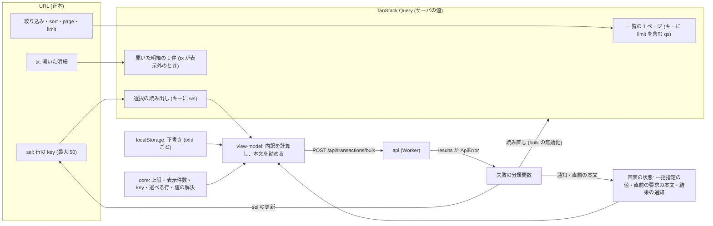

# Architecture overview

明細仕分け画面 (/classify) の一括保存と取引一覧について、状態とデータの流れを作り直す。本書は、状態の置き場所・取得とキャッシュ・送信と失敗の分類・保存前の内訳の計算・部品の境界の制約を持つ。正本は `specs/spec-classify-bulk-save.md` (以下 spec) の次の 4 節である: 「UI・状態遷移」の状態遷移、「API契約」、「エラー・例外・回復」、「互換性・移行・リリース」。`system-spec/frontend.md` (以下 frontend.md) と `system-spec/00-requirements-definition.md` (以下 00) は承認時の入力である。見た目・配置・文言・操作の流れ・アクセシビリティは `architecture/classify-bulk-save-ui-ux.md` (以下 ui-ux 文書) が持つ。行番号は 2026-10-01 に commit a63d35c の現物で確かめた値。

前サイクルの `specs/spec-classify-screen.md` と `architecture/classify-frontend.md` が定めたものは引き継ぐ。対象は、URL・TanStack Query・localStorage の 3 つの置き場所、端末の下書き、`api.ts` を通す呼び出し、画面専用の一括操作バーである。本書で変えるのは次の 6 点。

1. 一覧の要求の limit を URL から送る (25 / 50 / 100、ほかの値は 50 に直す)。一覧の応答の `transactions` (絞り込み後の全件) は読まない。
2. 選択の中身は、選択の読み出し (GET /api/transactions/selected) の Query から読む。一括操作バー・保存・失敗の表示・表示外の開いた明細は、この結果から引く。
3. 保存の要求を `{ bulk, items: [{ txId, draft }] }` の形にする。値の解決は core の 1 つの関数にまとめる。画面はその関数を、保存前の内訳の計算にだけ使う。
4. 要求全体の失敗を 1 つの関数で分け、文言・再試行の有無・読み直しをそこから引く。通信の失敗・5xx・409 の後に使うため、直前の要求の本文を持つ。
5. 再試行は write_failed の明細だけにする。画面で外した行は失敗に数えない。
6. 次の 4 つを core の 1 か所に置く: 選択の上限 50 件、表示件数、行の key の作成と解析、選べる行の判定。

## Context and drivers

**前サイクルとの関係**: `architecture/classify-frontend.md` を引き継ぎ、次の点を変える。前の文書は書き換えない。

- G5 (:66) の、3 つの置き場所を混ぜない原則は引き継ぐ。足すものは次の 2 つ。
  - Query: 選択の読み出し。
  - 画面の状態: 一括指定の値と直前の要求の本文。
- Routes (:115) の「選択は最大 50 件まで URL に載せる」は引き継ぐ。sel を、表示に左右されない選択の正本にする。上限は core の定数から引き、URL には limit を足す。
- 下書き (:128) は、キー (`kanjo:classify:draft:` に txId を続けたもの)・入力から 1 秒・30 日を引き継ぐ。一括保存では、各明細の下書きを要求の `items[].draft` に入れて送る。
- 呼び出し (:135) は引き継ぐ。一括指定と選択の読み出しの型と呼び出しを `packages/web/src/api.ts` に足し、画面から fetch を直接呼ばない。
- 一括操作バーを共通部品にしない方針 (:70) は引き継ぐ。
- G3 (:65) の「失敗した明細だけを選択に残して再送」は、write_failed の明細だけの再試行に絞る。
- Errors/resilience (:93) の「409 と 503 は PageState の表示に従う」は、一括保存については置き換える。
  - 失敗の種類ごとに、結果の通知 (role=alert) で出し分ける。
  - 通信の失敗・5xx・409 の後には『同じ内容で再試行』を出す。
- 一覧の「50 件ずつ読む」(:139) は、表示件数の選択 (25 / 50 / 100 件) に置き換える。

以下の既存実装の観測は、開発着手前 (2026-10-01) の記録である。現在の構造と契約は、各設計節と spec を参照する。

- Business/technical context〔観測 qa-classify-bulk-frontend-web-evidence-001、現物 2026-10-01〕:
  - 一覧の要求
    - limit=50 を固定で送る (`packages/web/src/pages/classify/ClassifyPage.tsx:72`)。ClassifyFilters (`view-model.ts:196-206`) と DEFAULT_FILTERS (:209-218) に limit が無い。
    - 一覧の Query は `['classify', key, qs]` で、keepPreviousData を使う (`ClassifyPage.tsx:90-94`)。
  - 選択の扱い
    - 保存の値は `allRows = data?.transactions ?? rows` (:106) から引く (:406-408)。絞り込み後の全件に無い選択は、解決の対象に入らず黙って落ちる。
    - 開いた明細 (:107) と失敗の表示 (:131) も、allRows から探す。
    - 失敗の表示の rowKey は、行が見つからないと txId に倒れる (:134)。行の key は `mf:` か `cash:` に txId を続けた形 (`packages/api/src/classify-row.ts:64`) なので、倒れた値を sel に入れても行と合わない。
  - 保存と再試行
    - 提案も下書きも無い行は、item: null の失敗になる (`ClassifyPage.tsx:409-423`)。items が空ならサーバを呼ばず、全件を失敗として通知する (:142-147)。
    - 再試行は `failure.item ?? []` を送る (:178)。item: null の分は空になり、押しても何も送らない。
    - 2xx の応答では、`!r.ok` を code を見ずに失敗とし (:155)、失敗の明細をすべて選択に残す (:164)。
    - catch (:167-174) は、status を分けずに全件を『通信できませんでした。同じ内容で再試行できます。』の失敗にする。一覧を読み直さず、直前の本文も持たない。
  - 値の解決が 2 つある。
    - resolveBulkItem (`view-model.ts:309-328`) は、状態を見ずに提案を使う (:312)。
    - inputFromRow (:98-109) は、未整理で提案があるときだけ提案を使う。
  - 定数と型
    - 選択の上限 50 が 2 か所にある (`TransactionTable.tsx:24` の MAX_SELECTION、`view-model.ts:272` の MAX_URL_SELECTION)。
    - ページ数は 50 で割る (`TransactionTable.tsx:51`)。
    - `packages/web/src/api.ts` には、一括指定の型と選択の読み出しの型が無い。ClassifyTransactionsResponse は `transactions` を持つ (:522)。
- Quality attribute priorities:
  1. 保存する値の正しさ: 画面は保存する値を決めない。値の最終の解決はサーバが core の関数で行う。画面は同じ関数で、内訳を先に出すだけにする (frontend.md §本章での適用、Clean Architecture の依存の向き)。
  2. 選択の一貫性: 選択の正本は URL の sel だけにし、表示 (絞り込み・ページ・並べ替え・期間・表示件数) から切り離す (00 G3)。
  3. 失敗からの回復: 書き込まれたか分からない失敗 (通信の失敗・5xx) では、読み直してから同じ本文を送れるようにする。送り直しても結果が変わらない失敗には、ボタンを出さない (00 G1)。
  4. 運ぶ量: 一覧は表示中のページだけを運ぶ (frontend.md §本章での適用、Information Design の『残す・落とす』)。初期 JS の予算 110KiB を保つ。
- Constraints:
  - 依存の向きは web → core。core は依存ゼロの純関数のまま。
  - `@tanstack/react-query` ^5.62.11 と `react-router-dom` ^7.18.2 (useSearchParams) のまま (`packages/web/package.json:32`・`:37`)。依存は足さない。
  - API の形は spec「API契約」に従う。
    - 選択の読み出しは 1〜50 件。重複は 400 invalid_query。
    - 一覧の limit は 25 / 50 / 100 だけを受け、ほかは 400 invalid_query。
  - 範囲は 00 の範囲のまま。選択の上限 50 件と一括の上限 100 件は変えない。

## Goals and non-goals

- Goals:
  - G3: 選択を表示に左右されないものにする〔決定 qa-classify-bulk-decision-043〕。
    - sel (行の key、最大 50 件) は、絞り込み・ページ・並べ替え・期間・表示件数を変えても保つ。
    - 選択の中身は、選択の読み出しの Query から読む。
  - G1: 一括指定と下書きを要求に詰めて送り、値の解決はサーバに任せる〔決定 qa-classify-bulk-decision-041・036、qa-classify-bulk-delegated-004〕。保存前の内訳は core の同じ関数で計算する (O1)。
  - G1: 失敗を 1 つの関数で分ける。再試行の対象は write_failed の明細だけにする (O2)〔決定 qa-classify-bulk-decision-018・054・055・056・057〕。
  - G4: 一覧の要求を、表示件数 (25 / 50 / 100 件) の 1 ページだけにする。ページ数は応答の limit で数える (O5 の DOM の観測点)〔決定 qa-classify-bulk-decision-044、frontend.md §確定内容 / qa-classify-bulk-frontend-web-003 (3)〕。
  - O7: 初期 JS 予算を含む既存の品質ゲートを、緑のまま保つ。
- Non-goals:
  - 見た目・文言・role の付け方 (ui-ux 文書)。
  - 値の解決の順・『カテゴリなし』の予約の値・D1 の書き込み (spec「ビジネスルールと検証」と `architecture/classify-bulk-save-backend.md`)。
  - 楽観更新。保存の後は、取り直した値だけで描く。
  - 自動の送り直し〔決定 qa-classify-bulk-decision-054〕。
  - 401 の扱いの変更。既存の AUTH_EVENT のまま〔frontend.md §確定内容 / qa-classify-bulk-frontend-web-005 の訂正〕。
  - 選択の上限と一括の上限の変更、絞り込み結果の全件を一度に選ぶ操作 (00 範囲外)。

## System context and boundaries

- Users/external systems:
  - 利用者 (SH1)・家族 (SH2): 同じ画面を同じ権限で使う。
  - API (spec「API契約」):
    - GET /api/transactions (変更): limit を受け、`transactions` を外す。
    - GET /api/transactions/selected (新設): keys を受け、`{ rows, missing }` を返す。
    - POST /api/transactions/bulk (拡張): `{ bulk?, items }` を受け、`{ results, opId, saved, failed }` を返す。
  - ブラウザ: URL の検索パラメータと localStorage。
- Trust/deployment/data boundaries:
  - サーバが正である。保存する値と、保存できるかどうかは、サーバが明細を引き直して core の解決関数で決める〔frontend.md §To-Be / Delta の I2〕。画面の内訳は見込みで、結果の正本は応答の results である。
  - 他の利用者の key は missing に入る。画面は、それを自分の消えた key と区別しない (spec「API契約」、`architecture/classify-bulk-save-security.md`)。
  - localStorage の下書きは端末だけにある。サーバは下書きを値の解決にだけ使い、保存しない (spec「API契約」の Request)。
- Context diagram: 状態の置き場所と、保存までの流れ。

## Container and component view

| Container/Component | Responsibility | Interface | Data owner | Deployment unit |
|---|---|---|---|---|
| ClassifyPage (既存を作り直す) | URL の解析、3 つの Query、保存の起動、結果の適用 (sel・通知・読み直し) | なし (画面の入口) | URL・Query・画面の状態 | web の lazy chunk (`packages/web/src/AuthenticatedApp.tsx:31-32`) |
| 選択の読み出しのフック (新設、`pages/classify/` の中) | sel の key で選択の読み出しを呼ぶ。0 件のときは呼ばない | 入力は sel。出力は rows・missing・今の sel に対する結果かどうか | Query | 同上 |
| view-model (既存の `view-model.ts` を作り直す) | 表示件数の正規化、保存前の内訳、要求の本文の組み立て、失敗の分類関数 | 純関数 | なし | 同上 |
| BulkActionBar・ResultNotices・TransactionTable (既存) | 表示と入力 (ui-ux 文書) | props: 選択の読み出しの結果、内訳、分類の結果 | なし | 同上 |
| draft.ts (既存) | 下書きの読み書き (txId ごと、30 日) | loadDraft (:22)・saveDraft (:39)・clearDraft (:49) | localStorage | 同上 |
| api.ts・api-client.ts (既存) | 型と呼び出し。ApiError (status・code・body、`api-client.ts:2`) と、401 の AUTH_EVENT (:18、:52-57) | api 関数 | なし | web |
| classification-invalidate.ts (既存) | 保存の後に無効化するキーを 1 か所に持つ | `invalidateClassificationQueries(qc, 'bulk')` (`components/classification-invalidate.ts:24`) | Query | web |
| core の画面用モジュール (新設) | 選択の上限 50、表示件数 25/50/100 と既定 50、行の key の作成と解析、選べる行の判定、値の解決関数 | 純関数と定数 | なし | `packages/core` (web と api が共有) |

- core の画面用モジュールのファイル名は実装時に決める (frontend.md §確定内容 / qa-classify-bulk-backend-web-008 (6) は置き場所を『core の 1 か所』とだけ定める)。前例は、画面ごとのモジュール (`packages/core/src/index.ts:20` の subs-screen、:31 の settings-screen、:49 の improvement-screen) である。

## Cross-cutting contracts

規範は [spec-classify-bulk-save](../specs/spec-classify-bulk-save.md) に従う。

- 選択・保存・結果の後の選択と読み直し: spec「UI・状態遷移」の状態遷移。
- 3 つの API の入力・応答・Error contract: spec「API契約」。
- 失敗の種類と回復: spec「エラー・例外・回復」。
- 値の解決の順と外す理由: spec「ビジネスルールと検証」。
- 移行の順と互換: spec「互換性・移行・リリース」。

本書は構造と採用理由を持ち、契約表を複製しない。

## Subtype architecture

- Frontend: 下記 Frontend architecture を合成する。
- Backend: N/A: 選択の読み出しの実装・一括保存の値の解決・予算・batch は `architecture/classify-bulk-save-backend.md` と spec「API契約」が持つ。本書は、画面が送る本文と、応答の扱いだけを持つ。
- Infrastructure: N/A: 配信と lazy chunk の構成を変えない。api・core・web を 1 つの PR で出すか分けて出すかは、実装時に決める (infrastructure.md §確定内容 が委ねる)。
- Data: N/A: 画面は D1 を読まない。端末の localStorage の下書きは既存のまま (Container 表の draft.ts)。D1 の側は `architecture/classify-bulk-save-database.md` が持つ。
- Security: N/A: 画面は既存の認証の配下にある。他の利用者の key を見つからない扱いにする制約は、`architecture/classify-bulk-save-security.md` が持つ。

### Frontend architecture

#### Rendering and application pattern

- Pattern: 既存の SPA の 1 画面で、lazy に読み込む (`AuthenticatedApp.tsx:31-32`)。画面の中は次の 3 層に分ける (frontend.md §上流指針の application-architecture、Clean Architecture の依存の規則)。
  - ClassifyPage: URL と Query を読み、view-model と表示の部品を使う。
  - view-model: 純関数。core だけを使う。
  - 表示の部品: view-model の結果を props で受ける。Query も URL も直接読まない。
- view-model の役割は、選択の読み出しで得た行の txId と、一括指定と、下書きを要求に詰めるところまでである。未整理と確定済みで埋める順が分かれる値の解決は、core の関数とサーバに任せる (frontend.md §本章での適用)。
- Framework/runtime and selection rationale: React 18・react-router 7・TanStack Query 5 のまま。
  - URL の読み書きは、useSearchParams と既存の setLocation (`ClassifyPage.tsx:119-123`、replace で履歴を積まない) を使う。出典は useSearchParams の公式文書 (frontend.md §最新ドキュメント出典の react-router-searchparams 8.4.0) である。依存の版は上げない。
- Browser/device support: 既存どおり。対象は Web だけ (00 範囲外の「専用アプリ」)。

#### Routes, screens and navigation

- Route/screen map: `/classify` (既存)。URL の検索パラメータは次のとおり。
  - 絞り込み・sort・page: 既存の parseFilters・filtersToParams (`view-model.ts:233-265`) のまま。
  - limit (新設): ClassifyFilters と DEFAULT_FILTERS に足す。
    - 25・50・100 以外の値は 50 に直す。直した値を一覧の要求に送るので、サーバの 400 invalid_query を画面から起こさない〔frontend.md §確定内容 / qa-classify-bulk-frontend-web-002 (3)〕。
    - 既定の 50 は、既存の filtersToParams の流儀 (既定と同じ値は URL に書かない、:252-253) に合わせる。
    - 25・50・100 と既定の 50 は、core の定数から引く〔frontend.md §確定内容 / qa-classify-bulk-backend-web-008 (6)〕。
    - 表示件数を変えたときに 1 ページ目へ戻す扱いは、ui-ux 文書の「Routes, screens and navigation」に従う。
  - sel: 行の key をカンマで区切って持つ。最大 50 件で、上限は core の定数から引く。
    - 解析 (`view-model.ts:275-289`) は、重複を除いて先頭から 50 件に切る今の形を保つ。
    - 接頭辞で key を捨てない。split: も残し、選べるかどうかは選択の読み出しの行から決める〔frontend.md §確定内容 / qa-classify-bulk-frontend-web-004 (2)、qa-classify-bulk-frontend-web-003 (1)〕。
  - tx: 開いた明細の行の key (既存)。
- Authentication guard/deep link/history:
  - 既存の認証後のシェルの配下に置く。sel・tx・limit を含む URL を開き直すと、同じ選択・同じ明細・同じ表示件数に戻る。
  - 開いた明細が表示中のページに無いときは、選択の読み出しでその 1 件を読む〔frontend.md §確定内容 / qa-classify-bulk-frontend-web-002 (4)〕。今の `allRows.find` (`ClassifyPage.tsx:107`) を置き換える。
  - 開いた明細の履歴の Query (:109-114) は、この行の id を使う。

#### Component and design-system boundaries

- Component hierarchy:
  - BulkActionBar に渡すのは、表示中の rows (`ClassifyPage.tsx:402`) ではなく、選択の読み出しの結果と内訳である〔frontend.md §上流指針の application-architecture〕。
  - TransactionTable は、表示中のページの行と、選べるかの判定の結果を受ける。全選択の 50 件の上限は core の定数から引き、`TransactionTable.tsx:24` の MAX_SELECTION を消す。
  - ResultNotices は、失敗の分類関数の結果 (文言・再試行の種類・件数) だけを受け、ApiError の status も応答の code も直接見ない。今は code を見ずに再試行を出している (`ResultNotices.tsx:70-74`)。
  - 一括指定欄は、編集パネルと同じ CategoryPicker と OwnerSelect を使う (見た目は ui-ux 文書)。
  - 一括操作バーは画面専用のまま (前サイクル `architecture/classify-frontend.md:70`)。
- Design tokens/reusable primitives: N/A: トークン・共通部品・role の付け方は、ui-ux 文書の「Component and design-system boundaries」が持つ。本書は部品に渡す値の境界だけを持つ。
- Accessibility standard: N/A: role=status と role=alert の出し分けは ui-ux 文書が持つ。本書の分類関数は、どちらの領域に出すかの種類を返す。

#### State and data flow

- Local/server/global state ownership:

| 状態 | 置き場所 | 寿命 | 根拠 |
|---|---|---|---|
| 絞り込み・sort・page・limit | URL | 共有・再読込で残る | 前サイクル G5、frontend.md §確定内容 / qa-classify-bulk-frontend-web-002 (3) |
| 選択 (行の key、最大 50 件) | URL の sel | 表示の変更で消さない | 00 G3、決定 qa-classify-bulk-decision-043 |
| 開いた明細 | URL の tx | 同上 | 既存 |
| 一覧の 1 ページ | Query `['classify', key, qs]` (qs に limit を含む) | 無効化まで | spec「API契約」の一覧のキャッシュ・ページング |
| 選択の中身 (rows・missing) | Query (キーに sel を含む) | 無効化まで | frontend.md §上流指針の application-architecture |
| 表示外の開いた明細 | Query (キーに tx を含む) | 同上 | frontend.md §確定内容 / qa-classify-bulk-frontend-web-002 (4) |
| 下書き | localStorage (txId ごと) | 30 日 | 前サイクル `architecture/classify-frontend.md:128` |
| 一括指定の値 | 画面の状態 | 画面を離れるまで | 章は置き場所を定めない。前サイクル G5 の区分では、URL は条件と選択、localStorage は明細ごとの下書きなので、どちらにも当たらない画面の状態に置く |
| 直前の要求の本文 | 画面の状態 | 次の保存か全件成功まで | frontend.md §上流指針、決定 qa-classify-bulk-decision-054・056 |
| 結果の通知 | 画面の状態 (既存の notice、`ClassifyPage.tsx:83`) | 閉じるか次の保存まで | 既存 |

- 選択の読み出しの Query:
  - キーは invalidateClassificationQueries の無効化の対象に入る形にする。今の SHARED_KEYS (`classification-invalidate.ts:11-21`) の `['classify']` の前方一致に入れるか、SHARED_KEYS に足す。キーの字面は実装時に決める (spec「API契約」の選択の読み出しのキャッシュ・ページング は、キーに選択を含めることだけを定める)。
  - sel が 0 件のときは要求しない (API は 1〜50 件を受ける)。
  - チェックのたびにキーが変わるので、前の結果を残して描く (keepPreviousData、一覧と同じ)。ただし、前の結果を見せている間は保存を押せなくする。押せるのは、今の sel に対する結果が揃ったときだけ。古い結果で本文を組むと、足したばかりの選択が落ちるからである (00 G3)。
  - missing の key は、保存前の内訳で『見つからない』に数え、URL の sel から外す。失敗には数えない〔frontend.md §確定内容 / qa-classify-bulk-frontend-web-003 (4)〕。
    - 外した後も、その保存の内訳では件数の関係 (選択の件数 = 保存する件数 + 外す件数 + 見つからない件数) を確かめられるようにする。
    - 外す時機の細部は実装時に決める (frontend.md §確定内容 / qa-classify-bulk-frontend-web-003 (4) は時機を定めない)。
- 保存前の内訳と本文の組み立て (view-model の純関数):
  1. 選択の読み出しの各行を、core の判定で「選べる行」と「選べない行」に分ける。選べない行は、外す理由『選べない行』に数える〔決定 qa-classify-bulk-decision-034・038、qa-classify-bulk-delegated-002〕。
  2. 選べる行ごとに、core の値の解決関数へ次の 3 つを渡す: 行、下書き (loadDraft の input)、一括指定の値。結果は「保存する (値の出所と、『カテゴリなし』か)」か「外す (理由)」になる〔frontend.md §To-Be / Delta の G1〕。
  3. 内訳の件数を数える。数え方と理由の文言は、spec「UI・状態遷移」と ui-ux 文書に従う。
  4. 本文は `{ bulk, items }` にする。
     - bulk は、指定した項目だけを持つ。何も指定しなければ省く。
     - items は保存する行の `{ txId, draft }` で、下書きがあるときだけ draft を持つ。
     - 外した行は items に入れない〔frontend.md §To-Be / Delta の受入 O1〕。
  5. 本文は、押した時点の値 (選択の読み出しの結果・一括指定の値・下書き) から、内訳と同じ関数で組む。保存ボタンの件数は items の件数である。
- 値の解決関数は 1 つにする〔frontend.md §確定内容 / qa-classify-bulk-backend-web-008 (6)、qa-classify-bulk-backend-web-009 (1)〕。
  - 今の resolveBulkItem (`view-model.ts:309-328`) は消す。
  - 未整理で提案があるときだけ提案を使う、inputFromRow (:98-109) の分岐に揃える。
  - 支払い方法の今の値は、保存済みの手動の値 (row.edit.paymentMethod) である。
- Fetch/cache/invalidation/optimistic update: 楽観更新はしない。保存の結果と状態の移り方は次のとおり (spec「UI・状態遷移」の状態遷移)。
  - 2xx で全件 ok: sel を空にし、`invalidateClassificationQueries(qc, 'bulk')` で一覧と選択の読み出しを取り直す。直前の本文は捨てる。
  - 2xx で失敗を含む: sel を失敗の明細の行の key だけにする。key は選択の読み出しの行から引き、txId に倒さない (今の :134 をやめる)。読み直しは 'bulk' の無効化で行う。
  - 通信の失敗・5xx: 'bulk' の無効化で、一覧と選択の読み出しを読み直す。sel は残す〔決定 qa-classify-bulk-decision-054〕。
  - 409・400・403・413: sel を残す。読み直さない (どれも書き込みの前に返る、spec「API契約」の Error contract)〔決定 qa-classify-bulk-decision-055・056〕。
  - 失敗の表示 (日付・取引先) は、選択の読み出しの行から引く〔frontend.md §確定内容 / qa-classify-bulk-frontend-web-002 (4)〕。今の failureOf (`ClassifyPage.tsx:130-140`) の allRows を置き換える。
- Form/validation/error presentation: 要求全体の失敗は、view-model の 1 つの関数で分ける〔frontend.md §確定内容 / qa-classify-bulk-frontend-web-005 (6)、決定 qa-classify-bulk-decision-070〕。
  - 入力は、api 関数が投げた例外か 2xx の応答。
  - 出力は、種類・文言・再試行の種類 (なし / 失敗した明細だけ / 同じ内容)・読み直すか・通知の領域 (status か alert)。
  - 種類の分け方:
    - ApiError でない例外: 応答が得られない通信の失敗として扱う。文言は spec の固定の文。読み直す。『同じ内容で再試行』。
    - ApiError の status が 500 以上: 通信の失敗と同じ扱い。
    - 409: サーバの文言 (ApiError の message、`api-client.ts:33-40`)。『同じ内容で再試行』。
    - 400・403・413: サーバの文言。再試行なし。
    - 401: 文言と再試行を割り当てない。api-client が AUTH_EVENT を出す既存の扱い (`api-client.ts:52-57`) に任せる。
    - 2xx: results の code で分ける。write_failed だけを『失敗した明細だけ』の再試行の対象にする。not_found・invalid_item・split_line_not_supported・no_value は理由を出し、再試行の対象にしない〔決定 qa-classify-bulk-decision-018・057〕。
  - 直前の要求の本文は、送る直前に画面の状態へ置く。
    - 『同じ内容で再試行』は、それを値を解決し直さずにそのまま送る〔決定 qa-classify-bulk-decision-054・056〕。
    - 『失敗した明細だけ』の再試行は、直前の本文から write_failed の txId の item だけを残し、bulk はそのまま送る。失敗に送る中身を持たせる今の仕組み (`failure.item`、:178) を引き継ぐ。
    - 画面で外した行は失敗に数えないので、中身の無い再試行 (今の item: null) は生じない。

#### Backend integration

- API client/generated types/versioning:
  - 型は `packages/web/src/api.ts` に手で足す (前サイクル :135 のまま)。足すものは次のとおり。
    - 一括指定の型 (cls・big・mid・owner・paymentMethod の任意の欄)。
    - 新しい item の型 (txId と任意の draft)。
    - 一括保存の本文の型。
    - 選択の読み出しの応答の型 (rows は ClassifyRow の配列、missing は Array of string)。
  - 今の BulkItemBody (:562) は、値の欄を直接持つ旧形式である。サーバは旧形式も受け付ける (spec「API契約」の Request)。画面は新しい形だけを送る。
  - BulkItemResult (:572) の error.code は string のままにし、分類関数で write_failed かどうかを見る。
  - ClassifyTransactionsResponse から `transactions` (:522) を外す。外すのは、画面が選択の読み出しに移るのと同じ変更である (spec「互換性・移行・リリース」)。limit (:527) は、応答が受けた値を返す。
- Auth/session/CSRF/CORS: 既存のセッション cookie と同一オリジンのまま。401 は api-client の AUTH_EVENT のまま (本サイクルで変えない、frontend.md §確定内容 / qa-classify-bulk-frontend-web-005 の訂正)。
- Offline/retry/timeout:
  - 一括保存は自動では送り直さない。送り直すのは、利用者が押す『同じ内容で再試行』と『失敗した{K}件のみ再試行』だけ〔決定 qa-classify-bulk-decision-054〕。
  - 送り直しても二重に保存されないのは、サーバの冪等性による (00 O9)。
  - 一覧と選択の読み出しの取得の失敗 (503・500) は、TanStack Query の既存の再取得に任せる (spec「API契約」の選択の読み出しの Error contract)。
  - タイムアウトは足さない。

#### Performance and observability

- Bundle/render/Core Web Vitals budgets:
  - 初期 JS の予算 110KiB (`packages/web/scripts/check-initial-js-budget.mjs:8`) を保つ。
    - core の画面用モジュールは、明細仕分けの lazy chunk からだけ import する。
    - 初期バンドルの経路から引く定数が出たら、独立のモジュールに置く。前例は cash-draft-key.ts (`packages/core/src/index.ts:33-35`) で、cash-screen 全体を初期バンドルに引き込まないためのものである。
  - 一覧の応答から `transactions` を外すと、運ぶ行は表示件数ぶん (最大 100 件) になる。今は絞り込み後の全件を運ぶ (`packages/api/src/routes/classify.ts:389`)。
  - 選択の読み出しは、最大 50 件の行を返す。保存前の内訳の計算も最大 50 行ぶんで、表全体は描き直さない。
- Client logs/metrics/traces and privacy:
  - 画面から外へログを送らない。取引先・内容・金額・下書きを console に出さない。
  - 失敗の種類は、通知の文言と DOM テストで確かめる。応答の opId は通知に出さない (既存のまま)。

#### Frontend verification

- Unit/component/visual/e2e/accessibility:
  - core の単体テスト (spec「テストと受入条件」のテストの置き場):
    - 選択の上限、表示件数の正規化 (25・50・100 以外は 50)。
    - 行の key の作成と解析。最初の ':' で分けるので、`cash:` に `cash:` で始まる id を続けた key も壊れない〔frontend.md §確定内容 / qa-classify-bulk-backend-web-009 (4)〕。
    - 選べる行の判定、値の解決関数。
  - view-model の単体テスト:
    - 分類関数を、応答なし・500・503・409・400・403・413・401・2xx (ok・write_failed・理由つきの混在) のそれぞれで確かめる。
    - 本文の組み立てを確かめる: 外した行が入らない、下書きのある行だけが draft を持つ、何も指定しないときは bulk を省く。
  - DOM テスト (`packages/web/src/pages/classify/classify.dom.test.tsx`)。fetch のモックの列で、frontend.md §確定内容 / qa-classify-bulk-frontend-web-005 (7) の 3 種を足す。
    - 通信の失敗の後: 一覧と選択の読み出しを読み直し、選択が残り、『同じ内容で再試行』が直前の本文と同じ JSON を送る。
    - 400 と 413 の後: サーバの文言が出て、選択が残り、再試行が出ない。
    - 2xx: write_failed の明細にだけ再試行が出て、押すとその txId だけが送られる。
  - DOM テストで、ほかに次を確かめる (O4・O5)。
    - 1 ページ目で 2 件、2 ページ目で 1 件を選び、絞り込みを変えても、保存の要求に 3 件が入る。
    - 開いた明細が表示外でも、編集パネルに出る。
    - missing の key が『見つからない』に数えられ、sel から外れる。
    - limit=100 の応答でページ数を 100 で数える。
  - 見た目と画面検査は ui-ux 文書の「Frontend verification」に従う。e2e は N/A: spec のテストの方針のとおり、DOM・API・画面検査で足りるとする。

## Architecture decisions

| ADR | Decision | Alternatives | Trade-on rationale | Consequences |
|---|---|---|---|---|
| CBS-FE-01 | 選択の中身を、選択の読み出しの Query (キーに sel) から読む。BulkActionBar・本文・失敗の表示・表示外の開いた明細はこの結果から引く〔決定 qa-classify-bulk-decision-043、frontend.md §上流指針〕 | 一覧の `transactions` から引く (今の :106) / 選んだ行を画面の状態に写して持つ | 選択の正本が URL の 1 つで、表示に左右されない。一覧は 1 ページだけを運べる | チェックのたびに要求が 1 本走る。今の sel に対する結果が揃うまで保存を押せない |
| CBS-FE-02 | 値の解決を core の 1 つの関数にまとめる。画面はそれを内訳の計算にだけ使い、本文には txId・一括指定・下書きだけを詰める〔frontend.md §本章での適用、qa-classify-bulk-backend-web-008 (6)〕 | 画面で解いた値を送る (今の resolveBulkItem) / サーバだけで解き、画面は内訳を出さない | 画面とサーバで値が食い違わない。O1 の内訳を押す前に出せる | core の関数の変更が web と api の両方に効く。resolveBulkItem と inputFromRow の分岐の食い違いが消える |
| CBS-FE-03 | 要求全体の失敗と明細の結果を、view-model の 1 つの純関数で分ける〔frontend.md §確定内容 / qa-classify-bulk-frontend-web-005 (6)、決定 qa-classify-bulk-decision-070〕 | then と catch に分岐を散らす (今の `ClassifyPage.tsx:151-174`) / useMutation の onError ごとに分ける | 文言・再試行・読み直しが 1 か所で決まり、単体テストで status ごとに網羅できる | ResultNotices は status も code も見なくなる。章に無い status の扱いが残る (Risks) |
| CBS-FE-04 | 直前の要求の本文を画面の状態に持つ。『同じ内容で再試行』ではそのまま送り、write_failed の再試行ではその部分集合を送る〔決定 qa-classify-bulk-decision-054・056・018〕 | 押した時点の選択から組み直す / 自動で送り直す | 値を解決し直さず、押す前と同じ要求になる。サーバが冪等なので二重に保存されない (00 O9) | 選択や一括指定を変えた後も、ボタンは前の本文を送る |
| CBS-FE-05 | limit を URL に持ち、ClassifyFilters に足して queryKey に含める。範囲外は 50 に直してから送る〔frontend.md §確定内容 / qa-classify-bulk-frontend-web-002 (3)、qa-classify-bulk-frontend-web-003 (3)〕 | 画面の状態に持つ / 範囲外もそのまま送り、400 を受ける | 共有と再読込で同じ表示に戻る。サーバの 400 を画面から起こさない | parseFilters と filtersToParams が変わる。ページ数は応答の limit で数える |
| CBS-FE-06 | 選択の上限・表示件数・行の key・選べる行の判定を core に置き、web の二重定義を消す〔frontend.md §確定内容 / qa-classify-bulk-backend-web-008 (6)、qa-classify-bulk-backend-web-009 (4)〕 | web と api に別々に持つ (今) | 画面とサーバで境界が揃う。上限の値を変えるときに 1 か所で済む | key の作成を `packages/api/src/classify-row.ts:64` から core へ移す (backend 文書と同じ変更) |

## Delivery, migration and rollback

- Build/deploy topology: 既存の web の build と deploy のまま。api・core・web・migration を 1 つの PR で出すか分けて出すかは、実装時に決める (infrastructure.md §確定内容 が委ねる)。
- Migration sequence〔frontend.md §確定内容 / qa-classify-bulk-frontend-web-003 (7)、qa-classify-bulk-frontend-web-004 (5)〕:
  1. core: 上限・表示件数・key・選べる行の判定・値の解決関数。web の MAX_SELECTION・MAX_URL_SELECTION・resolveBulkItem を置き換える。
  2. api.ts: 一括指定・新しい item・選択の読み出しの型を足す。
  3. 段 1 (一括指定と書き込みの束ね)。
     - 送る本文の形、失敗の分類関数、直前の本文、write_failed だけの再試行を入れる。
     - 選択の行は、一覧の応答の `transactions` から引く。絞り込みの外の選択は、件数だけを『表示外の選択 N 件』として出し、保存しない。
     - 件数の関係は「選択の件数 = 保存する件数 + 外す件数 + 表示外の選択の件数」。
  4. 段 2 (選択の読み出し)。
     - 選択の読み出しの Query に移り、`data?.transactions ?? rows` (:106) を消す。
     - API が `transactions` を外す変更と、同じ変更で出す (spec「互換性・移行・リリース」)。
     - 件数の関係は「選択の件数 = 保存する件数 + 外す件数 + 見つからない件数」に替わり、段 1 の暫定の表示は消える。
  5. limit の URL 化と、応答の limit によるページ数。
  6. core・view-model の単体テストと DOM テストの追加・置き換え。
  - 1 つの PR で出す場合、段 1 の暫定は世に出ない。
- Rollback trigger/procedure:
  - 引き金は次の 4 つ。
    - 選択一覧の件数と sel の件数が合わない。
    - 件数の関係が崩れる。
    - 通信の失敗の後に一覧と選択の読み出しが読み直されない。
    - 送った本文に、外した行が入る。
  - 手順: web の実装を戻す。
    - web だけを戻しても、旧い画面は `data?.transactions ?? rows` (:106) で rows に倒れる。旧形式の要求はサーバが受け付けるので、画面は動く。ただし、表示外の選択は前と同じく落ちる。
    - 画面は保存するデータを持たない。下書きは端末の localStorage に残る。

## Risks and verification

- Risk/assumption:
  - チェックのたびに選択の読み出しが走るので、遅い回線では保存を押せるまでの待ちが延びる。読み込み中の見せ方は ui-ux 文書に従う。待ちが問題になったら、要求の束ね方を spec の改訂で決める。
  - 次の 5 つは、章にも spec にも定めが無い。本書では今の扱いを保つか決めずに残し、spec の改訂で決める。
    - 列挙外の status (429・404 など) の分類。spec の一括保存の Error contract は、400・401・403・409・413・500・503 だけを挙げる。
    - 2xx で理由つきの失敗だけを含むときの選択。spec の状態遷移は再試行を出さないことだけを定める。本書は今の扱い (失敗の明細を選択に残す、:164) を保つ。
    - 『同じ内容で再試行』を出した後に、選択や一括指定を変えたときにボタンを消すか。
    - 一括保存で ok を返した明細の下書きの扱い。前サイクルの『保存に成功した明細の下書きは消す』(`architecture/classify-frontend.md:128`) を一括保存にも当てると消すことになるが、今の一括保存は消さない (clearDraft の呼び出しは `EditPanel.tsx:275` だけ)。
    - 一括指定の値が、再読込で消えること (画面の状態に置くため)。
  - 内訳は見込みで、押した後に明細が変わる (別の画面で編集する、取込みがある) と、応答と食い違う。結果の正本は応答の results とし、通知は応答から作る。
  - 段 1 の暫定 (『表示外の選択 N 件』) が世に出るのは、分けて出す場合だけである。
  - 次は agent の推定で、利用者は未確認である。spec「未決事項」の閉じ方に従う。
    - 表示件数の既定 50〔frontend.md §確定内容 / qa-classify-bulk-backend-web-008 の訂正〕。
    - frontend.md §確定内容 / qa-classify-bulk-frontend-web-002・003・004 の細部 (missing の扱い、段 1 の暫定、ページ数の数え方)。
  - 内訳行の理由の文言は、章の qa-classify-bulk-frontend-web-004 (2) がサーバの split_line_read_only (`packages/api/src/routes/classify.ts:406`) と同じ文言に改めた。章の qa-classify-bulk-frontend-web-003 (1) には改める前の文言が残るので、実装は spec FR-08 の文言を正とする。本書は文言を持たない (ui-ux 文書の Risks と同じ)。
- Architecture fitness test:
  - web から次が消えていることを grep で確かめる。
    - 値の解決: `resolveBulkItem` の参照が 0 件。
    - 選択の上限の数値 50 の定義: MAX_SELECTION と MAX_URL_SELECTION が 0 件で、core の定数だけを引く。
    - 段 2 の後の `data?.transactions` の参照: 0 件。
  - 各テストが、旧実装 (a63d35c) で落ちることを確かめる。
    - 絞り込みを変えた後の選択が要求に入るテストは、allRows から拾う今の :406-408 で落ちる。
    - 通信の失敗で読み直すテストと、400 で再試行が出ないテストは、今の catch (:167-174) で落ちる。
    - limit=100 のページ数のテストは、50 で割る今の `TransactionTable.tsx:51` で落ちる。
    - write_failed だけに再試行が出るテストは、code を見ない今の :155 で落ちる。
  - `pnpm --filter @kanjo/web build:bundle` の直後に、初期 JS 予算の検査が 110KiB 以内で通る。
- Load/failure/security validation:
  - 失敗は、fetch のモックの列で再現する: 応答なし、500、503、409 canonical_write_busy、400、403、413 (payload_too_large と too_many_classify_changes)、401、2xx での write_failed と理由つきの失敗の混在。
  - それぞれで次を確かめる。
    - sel の中身。
    - 無効化が呼ばれたか。
    - 送り直した本文が直前の本文と同じ JSON か。
    - 再試行の種類。
  - 選択 50 件で、選択の読み出しの要求が 1 本に収まり、保存の本文の items が 50 件以下であることを確かめる。
  - 他の利用者の明細が選択の読み出しに出ないことは、API テストに任せる (spec「テストと受入条件」)。
