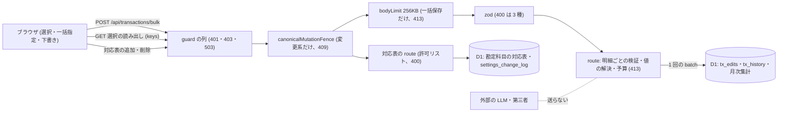

# Architecture overview

明細仕分けの一括保存で、外から届く入力の境界を許可リストで閉じ、本文と書き込みに上限を置き、変更をフェンスと項目ごとの履歴で守る。本書は、入力の検証・件数と本文の上限・400 と 413 の分け方・フェンス・変更の履歴・取込データと public リポジトリの扱いを持つ。経路ごとの入力と応答の正本は `specs/spec-classify-bulk-save.md` (以下 spec) の API契約 と「ビジネスルールと検証」の節で、`system-spec/security.md` は承認時の入力である。主体の決め方と所有者の検査 (他の利用者の行を『見つからない』にする条件) は `architecture/classify-bulk-save-auth.md` が持ち、本書は複製しない。行番号は HEAD a63d35c で 2026-10-01 に現物を開いて確かめた値。

本書が新しく決めるのは次の 6 点。

1. 一括保存の要求全体を 400 にするのは 3 つだけにする: 件数の範囲外・txId の重複・一括指定の値の範囲外。選択の読み出しの 400 は件数の範囲外と key の重複の 2 つだけ。下書きの範囲外は明細単位の invalid_item にする。
2. 一括保存の route に本文の上限 256KB を掛け、413 を 2 種に分ける: 本文の大きさは payload_too_large、書く前に測る書き込みの予算は too_many_classify_changes。どちらも明細ごとの結果を持たない。
3. 書き込みは 1 回の batch にまとめ、write_failed は batch そのものの失敗だけに使い、そのとき保存対象の全件を write_failed にする。
4. 『カテゴリなし』の予約の値を、一括指定・個別の編集・カテゴリの候補の作成と改名の 4 か所で入力として拒む。
5. 勘定科目の対応表は、対応先を勘定科目の一覧 (32 件) の許可リストで閉じ、同じ大項目の 2 行目を拒む。変更は settings_change_log に、一括保存の変更は tx_history に残す。
6. 下書きは値の解決にだけ使い保存しない。CSP・外部へ送らないこと・実データをコミットしない規則は変えない。

## Context and drivers

- 前サイクルとの関係: 前サイクルの `architecture/classify-security.md` は、/classify の新経路を zod で検証し、変更系をフェンスに登録し、外部へ送らない形を定めた。本書はその文書を書き換えず、次のように引き継ぎ、変える。
  1. 引き継ぐ: 入力を zod で検証し、SQL を Drizzle のバインドで組み、文字列を連結しない (classify-security.md §Application and supply-chain controls の Input/output validation、§Architecture decisions の qa-classify-security-web-001 の行)。
  2. 引き継ぐ: 外部 LLM を呼ばず、CSP と `_headers` を緩めない (classify-security.md §Context and drivers の Constraints、§Architecture decisions の qa-classify-decision-003 の行)。
  3. 変える: 上限の根拠。前サイクルは一括 100 件を agent の推定 (qa-classify-security-web-002) とした。今回は選択 50 件・一括 100 件を要件の土台 G5 として利用者が文面を承認した (根拠: 00 G5 / security.md §To-Be / qa-classify-bulk-decision-072)。
  4. 変える: 上限を超えた要求の返し方。前サイクルは「検証違反と上限超過は 400」とした (classify-security.md §Cross-cutting contracts の Errors/resilience)。今回は件数と重複と一括指定の範囲外を 400、本文の大きさと書き込みの予算を 413 に分ける (根拠: 00 G5・O8 / qa-classify-bulk-decision-030 / qa-classify-bulk-backend-web-010 (3))。
  5. 変える: 下書きの扱い。前サイクルは下書きを端末に閉じ、サーバへ送らないとした (classify-security.md §Data and secret protection の Retention、§System context and boundaries)。今回は下書きを一括保存の要求に入れて送る。サーバは値の解決にだけ使い、下書きとして保存しない (根拠: 00 C2 / security.md §本章での適用)。
  6. 変える: 監査。前サイクルは「新しい監査信号を追加しない」として N/A にした (classify-security.md §Detection and response)。今回は一括保存の変更を項目ごとに tx_history へ同じ op_id で残し、勘定科目の対応表の変更を settings_change_log に残すことを契約にする (根拠: 00 G5 / security.md §上流指針 / qa-classify-bulk-decision-049)。
  7. 変える・足す: 一括保存のフェンスの consumer。前サイクルは tx_edits・tx_splits・tx_history で登録するとしたが、現物は tx_edits・tx_history (`packages/api/src/canonical-mutation-fence.ts:152`) で、分割済みの明細は split_line_not_supported で拒む (`packages/api/src/routes/classify-bulk.ts:129-135`)。今回もこの形を保つ。勘定科目の対応表の入力と予約の値の拒否は新しく足す。
- Business/technical context〔観測 qa-classify-bulk-security-web-evidence-001、現物 2026-10-01〕:
  - 一括保存は `packages/api/src/routes/classify-bulk.ts:86` で `zValidator('json', bulkSchema)` を hook なしで通す。bulkSchema (:57) は `items` だけを持ち、件数を 1〜100 (MAX_BULK_ITEMS、:46) に絞る。itemSchema (:48-56) は区分 biz/per・カテゴリ大と中 60 字・所有者の列挙・支払い方法 cash/card/account・メモ 200 字を持つ。
  - txId の重複は :91 で invalid_body『同じ明細が複数回含まれています』の 400。範囲外の明細は :108-118 で invalid_item、母集団に無い txId は :120-128 で not_found、分割済みは :129-135 で split_line_not_supported、科目が区分の系統と合わない明細は :146-153 で invalid_item。
  - 書き込みは :177 の chunkByItem で、明細の文が 47 本以内に収まるよう明細を束ねた複数の batch に分け (各 batch に 3 本を予約)、予算を超えると :191 で例外を投げ、:195-203 の catch で「この batch の明細だけを失敗にする。前の batch の成功は取り消さない」として write_failed にする。catch はログを出さない。
  - 本文の上限は `packages/api/src/index.ts:94-101` の `/api/auth/*` (16KB、payload_too_large) にしか無い。route 単位の前例は `packages/api/src/routes/tradeoff.ts:42-47` (64KB) と `packages/api/src/routes/balances.ts:64-71` (8KB) で、どちらも payload_too_large『リクエストが大きすぎます』の 413。
  - 個別の編集の予算は `packages/api/src/routes/classify.ts:98-114` の planClassifyMutation が数え、超えると :116-121 の mutationTooLarge で 413 too_many_classify_changes『変更量が多すぎるため、対象を絞ってください』を返す。束ねた JSON の上限は `packages/api/src/store.ts:1789` の D1_JSON_BIND_SAFE_BYTES (1,900,000 バイト) と :1791 の D1BulkPayloadError。
  - D1 の 1 回の上限 50 は 4 か所に別の名前で置かれる: `packages/api/src/import-lifecycle.ts:304`、`packages/api/src/scheduled-maintenance-budget.ts:13`、classify.ts:90、classify-bulk.ts:44。上限を集める既存の `packages/api/src/d1-limits.ts` は、上限の値としては 1 文のバインド数 (100、`:11`) だけを持ち、ほかに予算の検査 `assertQueryBudget` (`:40`) を持つ。
  - フェンス (canonical-mutation-fence.ts:274-304) は lease を取ってから次へ進み、取れなければ 409 canonical_write_busy を返す。全ての変更系の route は `packages/api/src/import-lifecycle-pure.test.ts:726` で 3 分類に MECE で固定される。
  - CSP は index.ts:63-89 と `packages/web/public/_headers:3` にあり、`packages/api/src/index.test.ts:30` が値を固定する (default-src 'self'・connect-src 'self')。
  - 予約の値は、itemSchema・個別の編集 (classify.ts:470)・カテゴリの候補の作成と改名 (`packages/api/src/routes/settings.ts:496`・:527、optionSchema は :490-494) のどこでも拒まれていない。
- Quality attribute priorities:
  - G5 を最優先にする。入力は zod で検証し、上限・重複・値の範囲を境界で閉じ、変更はフェンスを通し、変わった項目ごとに履歴を残す (根拠: 00 G5 / security.md §To-Be / qa-classify-bulk-decision-072)。
  - 上流の指針は OWASP ASVS 5.0.0 と Secrets Management Cheat Sheet (根拠: security.md §上流指針)。
  - 設計知識は Secure by Design の『入力の境界を許可リストで閉じる』を当てる (根拠: security.md §本章での適用)。
- Constraints:
  - 表の追加は勘定科目の対応表の 1 つに限り、既存の表に列を足さない。settings_change_log の種類の制約は表の作り直しで改め、PR で承認する (根拠: 00 C2 / security.md §U9 I8)。
  - 1 要求の D1 へのクエリは 49 本以内 (根拠: 00 C4・O8 / qa-classify-bulk-decision-033)。
  - CSP (default-src 'self'・connect-src 'self') を変えない (根拠: security.md §上流指針)。
  - 対象は web だけ (根拠: security.md §カテゴリ別収集状態 / qa-classify-bulk-decision-067)。
  - public リポジトリなので実データ・secrets をコミットしない (AGENTS.md)。

## Goals and non-goals

- Goals:
  - G5: 一括保存の要求全体の 400 を 3 つ (件数の範囲外・txId の重複・一括指定の値の範囲外) に限り、下書きの範囲外と解決後に系統の合わない明細を明細単位の invalid_item にして他の明細を保存する (根拠: 00 G5・O6 / security.md §本章での適用 / qa-classify-bulk-backend-web-010 (2))。
  - G5: 本文を 256KB で止め、超えたら 413 payload_too_large を返す (根拠: 00 G5・O6 / qa-classify-bulk-decision-030)。
  - G5・G1: 書く前に予算 (1 回の batch の文 50 本・束ねた JSON 2MB) を超えると分かった要求を 413 too_many_classify_changes で返し、write_failed は batch の失敗だけにする (根拠: 00 O8・I2 / qa-classify-bulk-decision-057 / qa-classify-bulk-backend-web-010 (3)(4))。
  - G5: 『カテゴリなし』の予約の値を、一括指定と編集の値としては 400 にし、同じ名前のカテゴリの候補を作れなくする (根拠: 00 G5 / security.md §To-Be / qa-classify-bulk-decision-045・qa-classify-bulk-decision-048)。
  - G5: 勘定科目の対応表で、同じ大項目の 2 行目と一覧に無い対応先を 400 にする (根拠: 00 G5・I8 / qa-classify-bulk-decision-049)。
  - G5: 一括保存の変更を、変わった項目ごとに tx_history へ source=bulk・同じ op_id で 1 行ずつ残し、値の変わらない明細は書かない。対応表の変更を settings_change_log に残す (根拠: 00 G5 / security.md §上流指針)。
- Non-goals:
  - 選択 50 件・一括 100 件の上限を変えること (根拠: 00 範囲に含まない)。
  - 取込の検証と取込の経路を変えること (根拠: 00 範囲に含まない)。
  - CSP・secureHeaders・認証の方式を変えること。認証と所有者の検査は auth 文書が持つ。
  - 新しい監視・警報を足すこと。章は求めていない。
  - モバイル・タブレット・デスクトップ専用アプリの端末内データの保護 (根拠: qa-classify-bulk-decision-067)。

## System context and boundaries

- Users/external systems:
  - ログインした利用者 (admin・member)。画面 /classify から選択の読み出しと一括保存を呼び、設定画面から勘定科目の対応表を編集する。
  - マネーフォワードと freee の取込データ。明細の取込値 (`packages/api/src/db/schema.ts:31-32` の category_major・category_mid) は外から来た値として扱う。取込そのものは本変更の範囲外。
  - 外部の LLM や第三者のサービスへは送らない。一括保存と選択の読み出しの経路は fetch を呼ばない。
- Trust/deployment/data boundaries:
  - 信頼の境界は `/api/*` の入口。本文 (一括指定・下書き・対応表の行) とクエリ (keys) は、zod を通るまで信頼しない。
  - 下書きはブラウザ (境界の外) から届く入力で、一括指定と同じく検証してから値の解決に使う。
  - D1 は Worker の後ろにあり、ブラウザから直接は届かない。書き込みはフェンスの lease の内側でだけ行う。
  - リポジトリは public。実データは `data/` に置き `.gitignore` で除き、コミットしてよいのは匿名化済みの `samples/` だけ。
- Context diagram:

## Container and component view

| Container/Component | Responsibility | Interface | Data owner | Deployment unit |
|---|---|---|---|---|
| bodyLimit (新設、一括保存の route) | 本文を 256KB で止め、413 payload_too_large『リクエストが大きすぎます』を返す。前例は tradeoff.ts:42-47 | Hono middleware (`hono/body-limit`) | なし | Worker |
| 一括保存の zod スキーマ (classify-bulk.ts:48-57 を拡張) | 件数 1〜100・一括指定の値の範囲 (予約の値の拒否を含む) を要求全体で検証し、下書きを個別の編集と同じ制約で明細ごとに検証する | POST /api/transactions/bulk | なし | Worker |
| 選択の読み出しの検証 (新設) | keys の件数 1〜50 と重複を 400 にし、200 字を超える key と形の違う key を missing に入れる | GET (path は spec の API契約) | なし | Worker |
| 予算の検査 (planClassifyMutation と同じ関数、classify.ts:98-121) | 書く前に文の本数と束ねた JSON の大きさを測り、超えたら 413 too_many_classify_changes | 関数 | なし | Worker |
| D1 の上限の定数 (api の 1 か所に集める) | 1 起動のクエリの合計と 1 回の batch の文の本数を名前を分けて 1 か所に置く | TypeScript 定数 | なし | Worker |
| 予約の値の拒否 (core の 1 か所の定数を使う) | 一括指定・個別の編集・カテゴリの候補の作成と改名で予約の値を 400 にする | zod の refine | なし | Worker |
| 勘定科目の対応表の検証 (新設) | 対応先を TAX_ACCOUNTS (`packages/core/src/tax-accounts.ts:42`、32 件) に限り、同じ大項目の 2 行目を 400 にする | Hono route (path と code は spec の API契約) | 勘定科目の対応表 (D1) | Worker |
| canonicalMutationFence (既存 canonical-mutation-fence.ts:274) | 一括保存 (:152) と対応表の変更を lease の内側で直列化する。取れなければ 409 | Hono middleware (index.ts:115) | lease の表 (D1) | Worker |
| 履歴の writer (既存 `packages/api/src/classify-history.ts`) | 変わった項目ごとに 1 行、同じ要求は同じ op_id、source=bulk。値が変わらなければ書かない | 関数 | tx_history (D1) | Worker |
| guard-real-data.sh と security:content (既存) | 実データのコミットを止め、公開文書の絶対パスと実データの参照を検査する | PreToolUse フック・`pnpm lint` | なし | 開発端末・CI |

## Cross-cutting contracts

規範は [spec-classify-bulk-save](../specs/spec-classify-bulk-save.md) に従う。

- 入力・件数・値の範囲・400 の 3 種: spec「API契約」「ビジネスルールと検証」。
- 413 の 2 種と write_failed・409・5xx の意味と画面の扱い: spec「エラー・例外・回復」「UI・状態遷移」。
- 勘定科目の対応表の列・初期の 5 行・変更履歴の種類: spec「データモデル」。
- 履歴とログに残すもの: spec「可観測性」。
- 検証: spec「テストと受入条件」。

本書は境界の構造と採用理由を持ち、契約表を複製しない。他の利用者の行を存在しない行と同じ形で返す条件は `architecture/classify-bulk-save-auth.md` が持つ。

## Subtype architecture

- Frontend: N/A: 画面の入力制限と 400・413 の後の表示は `architecture/classify-bulk-save-frontend.md` が持つ。サーバの検証が正本で、画面の制限には頼らない。
- Backend: N/A: 値の解決・json_each で束ねる書き込み・予算を数える処理の順は `architecture/classify-bulk-save-backend.md` が持つ。本書は境界の検証と上限の条件だけを持つ。
- Infrastructure: N/A: secret・binding・Worker の構成を増やさない (`architecture/classify-bulk-save-infrastructure.md`)。
- Data: N/A: 勘定科目の対応表の列・索引・一意の制約と、settings_change_log の種類の制約の作り直しは `architecture/classify-bulk-save-database.md` が持つ。
- Security: 下記 Security architecture を合成する。

### Security architecture

#### Assets, actors and threat model

- Protected assets/data classification:
  - 明細の編集 (区分・カテゴリ大と中・所有者・支払い方法・メモ) と月次集計: 家計と事業の取引内容で、総収支と税務の入力に効く。
  - tx_history と settings_change_log: 変更を後から辿る証跡。消えたり欠けたりすると誤りを戻せない。
  - 勘定科目の対応表: 事業の明細の提案を変える設定。税務の正本は freee のまま (00 C4)。
  - 取込値 (schema.ts:31-32) と下書き: 外から来た値で、検証の対象。
  - 実データ (`data/` の MF・freee のエクスポート、統合 JSON、口座明細): public リポジトリに入れてはならない最も機微な資産。
- Actors/adversaries/abuse cases:
  - 大きな本文で Worker と D1 を疲れさせる → bodyLimit が読み込みの前に 413 payload_too_large で止める。
  - 件数の上限を超える、同じ txId を並べて同じ明細に二度書く → zod と重複の検査が 400 で止める。
  - 列挙の外の区分・所有者・支払い方法、60 字・200 字を超える文字列 → 一括指定なら 400、下書きならその明細だけ invalid_item。
  - 予約の値『カテゴリなし』を入力として送り、未分類と同じ扱いを手で作る、または同じ名前の候補を作って予約の値と取り違えさせる → 一括指定・編集・候補の作成と改名で 400 (根拠: qa-classify-bulk-decision-045・qa-classify-bulk-decision-048)。
  - 一覧に無い勘定科目を対応先に入れて提案を歪める、同じ大項目に 2 行を作って提案を曖昧にする → 対応表の検証が 400 で止める (根拠: qa-classify-bulk-decision-049)。
  - 取込値に区分の系統と合わないカテゴリが入っている → 解決後の科目を categoryAllowed (classify-bulk.ts:146-153) で検査し、合わない明細を invalid_item にする。
  - SQL インジェクション → 条件式は Drizzle の bound parameter で組み、文字列を連結しない。
  - 書き込みが途中で切れて一部だけ残る → 1 回の batch (D1 では 1 つのトランザクション) にまとめ、失敗したら全件 write_failed (根拠: qa-classify-bulk-decision-057 / qa-classify-bulk-delegated-001)。
  - 同じ本文の二度送り → 明細の値・提案との一致・月次集計・履歴が 1 回目の後と変わらない (根拠: 00 O9・I2)。
  - 取込や別の更新と重なって手当てを失う → フェンスの lease で直列化し、重なれば 409 canonical_write_busy。
  - 実データや実データから撮った画面をコミットする → guard-real-data.sh・`.gitignore`・security:content で止める。画面の撮影は samples の seed で行う。
- Trust boundaries/data flows:
  - 拒否の順は次のとおりで、書き込みより前の拒否は何も書かない (根拠: qa-classify-bulk-backend-web-010 (5))。
    1. authGuard の 401 → mustChangePasswordFence の 403 password_change_required → runtimeSchemaGuard の 503 schema_unavailable (`packages/api/src/schema-guard.ts:80`) → canonicalMutationFence の 409。
    2. bodyLimit の 413 payload_too_large → zod の 400 (件数・重複・一括指定の範囲外)。
    3. 明細ごとの結果 (not_found・split_line_not_supported・invalid_item)。
    4. 予算の 413 too_many_classify_changes。
    5. 1 回の batch。失敗は 2xx で全件 write_failed。batch の後に結果の分からない例外は onError の 500 internal (index.ts:151-181)。
  - 下書きの流れは ブラウザ → 本文 → zod → 値の解決 → 明細の編集 の一方向で、下書きそのものは D1 に書かない。

#### Identity and authorization

- Authentication/session/federation: `architecture/classify-bulk-save-auth.md` §Identity and authorization に従う。本書は認証の方式・cookie・資格情報を変えない。
- Authorization model and deny-by-default rules:
  - 3 種類の経路を guard の後に置き、userId を `c.get('userId')` からだけ取ることは auth 文書の CB-AUTH-01・CB-AUTH-02 が持つ。
  - 本書の検証は認可より前に掛かるので、検証で落ちた要求は所有を問わず同じ 400・413 になる。存在を明かさない応答の形は auth 文書が持つ。
- Tenant/resource ownership enforcement: N/A: 他の利用者の key・txId・対応表の行を『見つからない』にする条件は auth 文書の §Identity and authorization の Tenant/resource ownership enforcement が持つ。本書は複製しない。

#### Data and secret protection

- Encryption in transit/at rest/key ownership:
  - 通信は HTTPS だけ。保存時の暗号化は D1 の管理に委ねる。新しい鍵は無い。
- Secret source/rotation/redaction:
  - 3 種類の経路は secret を使わず、受けず、応答に含めない。
  - エラー応答は code と固定の文言だけを返し、SQL・スタック・他の明細の値を含めない。onError は requestId・path・例外の名前・スタックの at の行だけを出し、メッセージを出さない (index.ts:151-181)。
  - `packages/api/.dev.vars` は git の対象外 (`.gitignore:38-40`) で、git 操作に含めない (AGENTS.md)。
- Retention/deletion/privacy requests:
  - 下書きは要求で送るが、値の解決にだけ使い、サーバに下書きとして保存しない (根拠: 00 C2 / security.md §本章での適用)。
  - 明細を外部へ送らない。CSP の connect-src 'self' (index.ts:63-89、_headers:3) を変えないので、画面からも第三者へ送れない (根拠: security.md §上流指針)。
  - tx_history と settings_change_log の保持は既存のまま (settings_change_log は無期限、schema.ts:411-431)。夜間バックアップは 30 日保持 (index.ts:193)。

#### Application and supply-chain controls

- Input/output validation and injection defenses:
  - 一括保存の要求全体の 400 invalid_body は次の 3 つだけ (根拠: 00 G5・O6 / security.md §本章での適用 / qa-classify-bulk-backend-web-010 (2) / qa-classify-bulk-security-web-004)。
    1. 件数の範囲外: txId が 1〜100 件の外。
    2. 重複: 同じ txId が 2 回以上。
    3. 一括指定の値の範囲外: 個別の編集と同じ制約の外、カテゴリ (中) だけの指定、区分とカテゴリ (大) の両方を指定して系統が合わない指定、予約の値 (根拠: qa-classify-bulk-backend-web-008 (4) / qa-classify-bulk-backend-web-009 / qa-classify-bulk-decision-048)。
  - 件数の範囲外も zod の既定の 400 ではなく invalid_body の形で返す。今の route は hook を持たず (classify-bulk.ts:86)、テストは状態だけを見る (`packages/api/src/classify-bulk.integration.test.ts:202-205`・:220)。code まで確かめるテストに改める。
  - 下書きは区分・所有者・支払い方法の列挙、カテゴリ大と中 60 字、メモ 200 字で明細ごとに zod が検証し、範囲外の明細だけ invalid_item『入力を確認してください』にして他の明細を保存する (根拠: security.md §本章での適用)。
  - 書き込みより前に分かる失敗を write_failed にしない (根拠: qa-classify-bulk-backend-web-008 (5))。
  - 選択の読み出しの 400 は、key の件数 1〜50 の外と key の重複の 2 つだけ。200 字を超える key と形の違う key は missing に入れる。GET は副作用を持たず、bodyLimit もフェンスも掛けない (根拠: qa-classify-bulk-backend-web-009 (2) / qa-classify-bulk-security-web-003 / qa-classify-bulk-decision-058)。
  - 予約の値は core の 1 か所で定めた定数で照らし、一括指定・`PUT /api/transactions/:txId/edit` (classify.ts:470)・カテゴリの候補の作成と改名 (settings.ts:496・:527) の 4 か所で 400 にする (根拠: 00 G5 / qa-classify-bulk-decision-045・qa-classify-bulk-decision-048)。
  - 勘定科目の対応表は、対応先を TAX_ACCOUNTS (32 件) の許可リストで照らし、同じ大項目の 2 行目を 400 にする。path・項目名・400 の code は spec の API契約 が持つ (根拠: 00 I8 / qa-classify-bulk-decision-049)。
  - SQL は Drizzle の bound parameter と json_each で束ね、文字列を連結しない。1 文のバインド数は d1-limits.ts の D1_MAX_BOUND_PARAMS (100) に従う。
- Limits and write budget:
  - 本文の上限: 一括保存の route に bodyLimit 256KB を掛け、413 payload_too_large『リクエストが大きすぎます』を返す。code と文言は tradeoff.ts:42-47・balances.ts:64-71 と同じ。256KB は 100 件 × 約 1KB に余裕を持たせた値。txId に個別の長さの上限は付けない。登録の位置は backend 文書が持つ (根拠: 00 G5・O6 / qa-classify-bulk-decision-030 / qa-classify-bulk-backend-web-010 (3))。
  - 書き込みの予算: 書く前に 1 回の batch の文が 50 本を超えるか、束ねた JSON が 2MB を超えると分かったら、413 too_many_classify_changes『変更量が多すぎるため、対象を絞ってください』を明細ごとの結果なしで返す。検査は planClassifyMutation と同じ関数 (classify.ts:98-121) で行う (根拠: 00 O8・I2 / qa-classify-bulk-backend-web-010 (3))。
  - D1 の上限: 1 起動のクエリの合計 (50 未満) と 1 回の batch の文の本数 (50 以下) を、名前を分けて api の 1 か所に置き、4 か所の重複を集める。置き場所は実装時に決める。既存の `packages/api/src/d1-limits.ts` が候補 (章 qa-classify-bulk-backend-web-009 (4) が委ねる) (根拠: qa-classify-bulk-backend-web-008 (6) / qa-classify-bulk-backend-web-009 (4))。
  - 書き込みは json_each で束ねた 1 回の batch にする。今の chunkByItem (classify-bulk.ts:177) の分割と、前の batch の成功を残す部分成功をやめる (根拠: 00 I2 / qa-classify-bulk-delegated-001 / qa-classify-bulk-decision-057)。
  - 送り直し: 同じ本文を送っても結果は 1 回目の後と同じで、2 回目は履歴を 1 行も書かない。サーバも画面も自動では送り直さない。画面の『同じ内容で再試行』は利用者が押したときだけ送る (根拠: 00 O9 / qa-classify-bulk-backend-web-010 (1) / qa-classify-bulk-decision-054・qa-classify-bulk-decision-056)。
- Change fence:
  - 一括保存は canonical-mutation-fence.ts:152 の登録 (tx_edits・tx_history) を保つ。分割済みの明細は書かないので tx_splits を足さない。
  - 勘定科目の対応表の追加と削除はフェンスに登録する (spec の API契約)。全ての変更系の route を 3 分類に固定するテスト (import-lifecycle-pure.test.ts:726) に載せる。前例はカテゴリの候補 (canonical-mutation-fence.ts:201-207) と名義の表示名 (:215-218、consumer に settings_change_log を持つ)。
- Dependency/artifact provenance/signing/SBOM:
  - 依存を足さない。bodyLimit は既存の hono の `hono/body-limit` を使う (前例 tradeoff.ts)。
  - 依存の脆弱性は CI の `pnpm audit --prod --audit-level high` (`.github/workflows/ci.yml:50-53`) が示す。continue-on-error で警告だけになる。
  - 署名と SBOM は N/A: 配布物を第三者へ渡さない個人利用の Worker で、本変更は依存を増やさないため。
- CI/CD branch/review/environment protections:
  - 実データをコミットしない: `.gitignore` が `/data/*` (:5) と csv・xlsx・xls (:7-9) を除き、`samples/` の csv・json だけを戻す (:18-19)。`scripts/hooks/guard-real-data.sh` が PreToolUse で git 操作を止める。`git add -f` で除外を突破しない (AGENTS.md)。
  - `pnpm lint` (package.json:24) に `security:content` (package.json:33、guard-real-data.sh の公開文書の検査) と migration の承認の検査 (`.github/scripts/check-migration-approvals.mjs`) が入る。
  - 勘定科目の対応表の migration と settings_change_log の作り直しの migration は、`.github/migration-approvals.json` に sha256 を足して PR で承認する (根拠: 00 C2・I8)。
  - 画面の撮影 (spec の受入条件) は samples から seed したデータで行う。security:content は画像の中身を見ないので、撮影の元を実データにしない。

#### Detection and response

- Audit events/security telemetry/alerts:
  - 一括保存: 保存した明細の値が変わった項目ごとに tx_history へ source=bulk の行を 1 行ずつ、同じ要求に同じ op_id で残す。値が変わらない明細は書かない (classify-history.ts:1-6・:28、schema.ts:1107-1128) (根拠: 00 G5 / security.md §上流指針 / qa-classify-bulk-security-web-004)。
  - 勘定科目の対応表: 追加と削除を settings_change_log に残す (根拠: 00 I8 / qa-classify-bulk-decision-049)。種類の制約 (migrations/0056_settings_change_log.sql:10、schema.ts:417-419) の作り直しは database 文書が持つ。
  - 「誰が」: tx_history は操作者の列を持たない。扱いは auth 文書の Risks and verification が持つ。
  - batch の失敗は 2xx で返るので、状態コードだけを見る監視やログでは数えられない (qa-classify-bulk-decision-057 の不利な点)。今の catch (classify-bulk.ts:195-203) はログを出さない。何をログに出すかは spec「可観測性」と `architecture/classify-bulk-save-maintenance-ops.md` が持つ。
  - 新しい警報は N/A: 章が求めておらず、個人利用のため置かない。
- Incident response/revocation/recovery:
  - 誤った一括保存: op_id で明細の履歴を辿り、既存の取り消しで戻す。古いものは夜間バックアップ (R2、30 日保持) から戻す。
  - 対応表の誤り: settings_change_log の before/after を見て、設定画面で直す。
  - 実データをコミットしかけた: guard-real-data.sh が止めた操作を回避せず、ファイルを `data/` に戻す (AGENTS.md)。
- Vulnerability handling and SLA:
  - 依存の脆弱性は `pnpm audit` の警告を見て、次の変更で上げる。
  - SLA は N/A: 個人利用で、対応の期限を約束する相手がいないため。

#### Security verification

- SAST/SCA/secret scan/authz/abuse/penetration tests:
  - SAST: `pnpm lint` と typecheck。security:content が公開文書の絶対パスと実データの参照を検査する。
  - SCA: CI の pnpm audit (警告)。
  - API の統合テストで次を確かめる (根拠: 00 O6・O8・O9 / security.md §受入条件)。
    - 一括 101 件・一括の txId の重複・一括指定の範囲外 (予約の値・カテゴリ (中) だけ・系統の合わない区分とカテゴリ (大)) が 400 invalid_body。code まで確かめる。
    - 選択 51 件・選択の key の重複が 400。201 字の key が missing に入る。
    - 予約の値を個別の編集の値として送ると 400、予約の値と同じ名前の候補の作成と改名が 400。
    - 一括保存の本文が 256KB を超えると 413 payload_too_large。256KB 以下の 100 件は通る。
    - 予算を超える要求が 413 too_many_classify_changes で、明細ごとの結果を持たず、何も書かない。
    - batch を失敗させると 2xx で保存対象の全件が write_failed になり、tx_history に 1 行も残らない。
    - 50 件・100 件の保存で D1 へのクエリが 49 本以内。
    - 範囲外の下書きを持つ明細だけが invalid_item になり、他の明細は保存される。
    - 値が変わった項目ごとに source=bulk の履歴が 1 行ずつ同じ op_id で残り、値の変わらない明細には残らない。同じ本文の 2 回目は履歴を書かない。
    - 勘定科目の対応表で、同じ大項目の 2 行目と一覧に無い対応先が 400、変更が settings_change_log に残る。
    - 一時パスワードのままの利用者が 403 (O6 のフェンス拒否)。401 と他の利用者の行の扱いは auth 文書の Security verification が持つ。
  - 回帰: index.test.ts:30 の CSP の値、import-lifecycle-pure.test.ts:726 の MECE の分類が緑のまま。
  - ペネトレーションテストは N/A: 個人利用で外部の診断を入れる予定が無い。上の abuse のテストで代える。

## Architecture decisions

| ADR | Decision | Alternatives | Trade-on rationale | Consequences |
|---|---|---|---|---|
| CB-SEC-01 | 一括保存の要求全体の 400 を件数・重複・一括指定の範囲外の 3 つに限り、下書きの範囲外は明細単位の invalid_item にする (根拠: security.md §本章での適用 / qa-classify-bulk-backend-web-010 (2)) | 下書きの範囲外も要求全体の 400 にする | 一括指定は全件に当たるので 1 つでも止める。下書きはその明細にだけ当たるので他の明細を止めない | zod を要求全体と明細ごとの 2 段に分ける |
| CB-SEC-02 | 一括保存の route に bodyLimit 256KB を掛け、413 payload_too_large を返す (根拠: 00 G5 / qa-classify-bulk-decision-030) | 上限を置かない / 新しい code にする | 読み込みの前に止め、既存の code と文言 (tradeoff.ts・balances.ts) に揃える | 256KB を超える要求は明細ごとの結果を持たない |
| CB-SEC-03 | 書く前に測る予算の超過を 413 too_many_classify_changes にし、planClassifyMutation と同じ関数で測る (根拠: 00 O8 / qa-classify-bulk-backend-web-010 (3)) | 今の実装のまま write_failed にする | 結果の変わらない送り直しを誘わない。個別の編集と同じ code で画面の分岐が増えない | 予算の検査を 2 つの経路で共有する |
| CB-SEC-04 | 1 回の batch にまとめ、失敗は 2xx で全件 write_failed (根拠: 00 I2 / qa-classify-bulk-decision-057 / qa-classify-bulk-delegated-001) | batch ごとの部分成功を残す / 5xx を返す | 書かれたかどうかを明細ごとに伝え、途中まで書いた状態を残さない | 状態コードだけの監視では失敗を数えられない |
| CB-SEC-05 | 予約の値を一括指定・個別の編集・候補の作成と改名の 4 か所で拒む (根拠: 00 G5 / qa-classify-bulk-decision-045・qa-classify-bulk-decision-048) | 一括指定だけで拒む | 入口が 1 つでも開くと、未分類と同じ扱いを手で作れ、候補の名前と取り違える | core の 1 か所の定数を 4 か所の検証が参照する |
| CB-SEC-06 | 勘定科目の対応表の対応先を TAX_ACCOUNTS の許可リストで閉じ、同じ大項目の 2 行目を拒む (根拠: 00 I8 / qa-classify-bulk-decision-049) | 自由な文字列を受ける | 提案を一覧の外の科目へ歪めない。1 つの大項目に 1 つの対応先で提案が一意になる | 一覧の更新は core の変更として入る |
| CB-SEC-07 | 一括保存の変更を項目ごとに tx_history へ同じ op_id で残し、対応表の変更を settings_change_log に残す (根拠: security.md §上流指針 / qa-classify-bulk-decision-049) | 明細ごとに 1 行 / 監査を持たない | どの明細のどの項目を一括で変えたかを辿れ、値が変わらなければ書かないので送り直しで増えない | 対応表の種類のために制約を作り直す migration が要る |
| CB-SEC-08 | 下書きを保存せず、CSP・外部へ送らないこと・実データの規則を変えない (根拠: 00 C2 / security.md §上流指針 / qa-classify-bulk-decision-067) | 下書きをサーバに保存する / connect-src を広げる | 保存する個人データと送信先を増やさない | 端末を変えると下書きは引き継がれない |

## Delivery, migration and rollback

- Build/deploy topology: 既存の Worker のまま。secret・binding・CSP は変えない。
- Migration sequence: 次の順に入れる。
  1. 勘定科目の対応表の表と、settings_change_log の種類の制約を作り直す migration を入れる。破壊的な作り直しは `.github/migration-approvals.json` に sha256 を足して PR で承認する。`packages/api/src/schema-guard.ts:4` の EXPECTED_D1_MIGRATION を新しい番号に上げる (database 文書)。
  2. core に予約の値の定数を置き、個別の編集・候補の作成と改名の拒否を入れる。
  3. D1 の上限の定数を api の 1 か所に集める。
  4. 一括保存に bodyLimit・要求全体と明細ごとの 2 段の zod・予算の 413・1 回の batch を入れる。
  5. 選択の読み出しと勘定科目の対応表の API を、検証とフェンスの登録とともに足す。
  6. 上の Security verification のテストを足す。
  - 本番は Migrate → Deploy の順。runtimeSchemaGuard は番号の合わない D1 に 503 を返すので、順を逆にすると全ての `/api/*` が止まる (schema-guard.ts:80)。
- Rollback trigger/procedure:
  - 400・413 の分け方か履歴のテストが落ちたら、実装を差し戻す。上限と検証は前の形に戻るが、データは変わらない。
  - 対応表の表と変更履歴、予約の値で保存された明細の戻し方は database 文書が持つ。

## Risks and verification

- Risk/assumption:
  - batch の失敗が 2xx で返り、今の catch はログを出さないので、本番で失敗の件数を数えられない (qa-classify-bulk-decision-057 の不利な点)。ログを足すかは spec「可観測性」と maintenance-ops 文書に委ね、本書は code_findings に挙げる。
  - 予約の値の綴りは core の 1 か所で定める。取込値 (schema.ts:31-32) に同じ綴りが来た場合の扱いを章は定めない。本書は決めない。
  - bodyLimit はフェンスの後に掛かるので、256KB を超える要求も lease を一度取ってから 413 になる。lease は finally で外れる (canonical-mutation-fence.ts:296-303)。
  - 画面の撮影を実データで行うと、security:content は画像を見ないので素通りする。撮影は samples から seed したデータで行う。
  - 前の文書の qa-classify-security-web-002 の推定 (フィルタ名 40 字など) は本変更で触らない。
- Architecture fitness test:
  - 一括保存の 400 invalid_body が 3 種の場合にだけ出て、他の拒否は明細ごとの結果か 413 になる。
  - write_failed が batch の失敗のときにだけ出て、そのとき保存対象の全件に付く。
  - D1 の上限の定数が api の 1 か所にだけあり、値 50 の定数が他に残らない。
  - 予約の値の拒否が core の 1 か所の定数を参照している。
  - 対応表の route が import-lifecycle-pure.test.ts:726 の分類に載っている。
- Load/failure/security validation:
  - 上の Security verification のテストが緑であること。
  - `pnpm lint`・typecheck・test・skills:test・初期 JS 予算・`pnpm verify:full` が全て exit 0 (根拠: 00 O7)。
