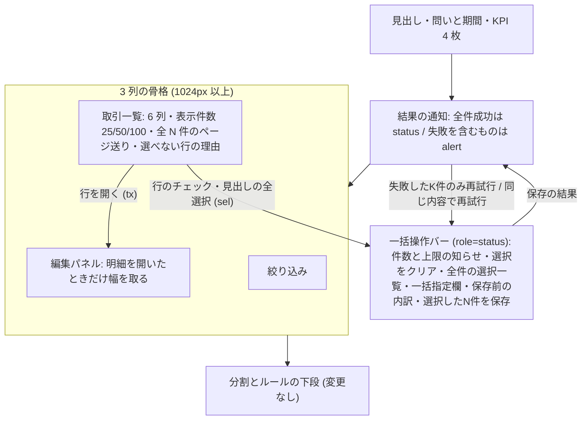

# Architecture overview

明細仕分け画面 (/classify) の取引一覧と一括操作バーを作り直す。本書は、画面の見た目・配置・文言・状態の見せ方・操作の流れ・アクセシビリティの制約を持つ。正本は `specs/spec-classify-bulk-save.md` (以下 spec) の「UI・状態遷移」「エラー・例外・回復」「テストと受入条件」である。`system-spec/ui-ux.md` (以下 ui-ux.md) と `system-spec/00-requirements-definition.md` (以下 00) は承認時の入力である。状態の置き場所・取得とキャッシュ・送信と失敗の分類・部品の境界は `architecture/classify-bulk-save-frontend.md` (以下 frontend 文書) が持つ。行番号は 2026-10-01 に commit a63d35c の現物で確かめた値。

前サイクルの `specs/spec-classify-screen.md` と `architecture/classify-ui-ux.md` が定めたものは引き継ぐ。対象は、画面の 7 つの構成 (問いと期間・KPI・絞り込み・一覧・編集パネル・一括操作バー・結果の通知)、分割とルールの下段、文言、読み込み中と空の表示である。本書で変えるのは次の 6 点。

1. 取引一覧を 7 列から 6 列にする。『取引先 / 内容』は 2 段の 1 列にまとめる。
2. 『表示件数 50件』の固定の文字を 25 / 50 / 100 件の選択にする。ページ送りは応答の件数で数える。
3. 編集パネルは、明細を開いたときだけ幅を取る。足りない幅は表の中だけを横スクロールする。
4. 一括操作バーに次の 3 つを置く。
   - 表示外を含む全件の選択一覧
   - 一括指定欄
   - 保存前の内訳
5. 選べない行には、チェックの代わりに理由を出す。見出しの全選択を 3 状態にし、50 件で止めたことを知らせる。
6. 保存の結果を出し分ける。成功は status、失敗は alert で出す。再試行は、送り直して結果が変わりうる失敗にだけ出す。

## Context and drivers

**前サイクルとの関係**: `architecture/classify-ui-ux.md` を引き継ぎ、次の点を変える。前の文書は書き換えない。

- G1 (:64) の 7 つの構成は引き継ぐ。中身を変えるのは、(4) 一覧、(5) 編集パネルの幅、(6) 一括操作バー、(7) 結果の通知である。
- G3 (:65) は「区分・カテゴリを変えて保存し、明細ごとの成否を通知する」だった。本書では次のように変える。
  - 一括指定欄を区分・カテゴリ (大/中)・所有者・支払い方法に広げる。
  - 保存前の内訳を足す。
  - 成否は失敗の種類ごとに出し分ける。
- Container (4) の一覧 (:86) は「50 件ずつ」だった。表示件数の選択に置き換え、列は 6 列にする。
- Container (6) の一括操作バー (:88) の「選択件数・一括変更」は、次の 5 つにする: 件数・全件の選択一覧・一括指定欄・保存前の内訳・保存。
- Errors/resilience (:94) の 2 つの扱いを置き換える。
  - 失敗した明細を選択に残す扱いは、write_failed の明細だけの再試行にする。
  - 409 で再試行を促す扱いは、要求全体の失敗の種類ごとの文言と『同じ内容で再試行』にする。
- 1024px 未満で縦に積む並び (:138) と、DOM と目視の検証 (:143) は引き継ぐ。1264px と 1280px の画面検査を足す。

以下の既存実装の観測は、開発着手前 (2026-10-01) の記録である。現在の構造と契約は、各設計節と spec を参照する。

- Business/technical context〔観測 qa-classify-bulk-ui-ux-web-evidence-001、現物 2026-10-01〕:
  - 画像 13 (`design/FINAL-UI/images/13-classify.png`) の要素は次のとおり。
    - 6 列の一覧 (選択・日付・取引先/内容・金額・提案カテゴリ・信頼度)。見出しの右に『表示件数 50件』の選択がある。
    - 下端に『全12件 ‹ 1 ›』。編集パネルは開いた状態。
    - 一括操作バーに『3 件選択中』『選択をクリア』、primary の『選択した3件を保存』、開閉の『^』がある。
    - 部分失敗の通知に『失敗した1件のみ再試行』と × がある。
  - 現物の一覧は 7 列で、取引先 (`packages/web/src/pages/classify/TransactionTable.tsx:96`) と内容 (:97) が別の列である。
  - 『表示件数 50件』は固定の文字で (:67)、ページ数は 50 で割る (:51)。
  - 3 列の骨格は、1200px 以上で `minmax(200px, 260px) minmax(0, 1fr) minmax(280px, 360px)` の固定である (`classify.css:88`)。1024〜1199px は `150px minmax(0, 1fr) 200px` (:386)。
  - 編集パネルの列は明細を開いていなくても描く (`ClassifyPage.tsx:377-397`)。閉じているときは『明細を選ぶと、ここで編集できます。』を出す (:379)。
  - 表は `table-layout: fixed` と `overflow-wrap: anywhere` (`classify.css:200-215`) なので、狭い幅では文字を 1 字ずつ折り返す。
  - 一括操作バー (`BulkActionBar.tsx:30`) は section で、role を持たない。選択一覧は表示中の行だけから拾う (:27、`ClassifyPage.tsx:402`)。
  - 結果の通知は成功も失敗も output 要素で (`ResultNotices.tsx:43`・`:54`・`:68`)、alert の領域が無い。
  - 再試行は失敗の code を見ずに、失敗の件数ぶん出す (:70-74)。
  - 全選択は indeterminate を持たない (`TransactionTable.tsx:49-50`)。50 件を超える分は黙って切る (:60、:84)。
  - 選べない行も、全行にチェックを出す (:115-124)。
- Quality attribute priorities:
  1. 失敗コストの抑制: 失敗コストが最も高いのは、「数十件を意図しない値で保存する」ことと「保存できたと誤解する」ことである。そこで、保存ボタンの直前に保存前の内訳を置き、押したあとは成功を status、失敗を alert に分ける (ui-ux.md §本章での適用、Information Design の『task 頻度 × 失敗コスト』)。
  2. 情報の優先度: 最も頻度の高い task は「選んだ明細をまとめて確定する」である。一括指定欄と保存ボタンは、選択一覧の直下の 1 か所に集める。一覧は 6 列に絞り、所有者・支払い方法・メモは編集パネルへ落とす (ui-ux.md §本章での適用)。
  3. アクセシビリティ: 状態を色だけで伝えない (上流の指針は Apple Human Interface Guidelines、`system-spec/ui-ux.md:31` の presentation の行)。文字を添える場所は次の 4 つ。
     - 信頼度 60 の行にも『要確認』の文字を出す。
     - 選べない行には理由の文字を出す。
     - 保存前の内訳には、『カテゴリなし』の件数と外す理由を出す。
     - 保存の結果は、文言と件数で示す。
     - 押せる領域は 44px (`--tap-target-min`、`packages/web/src/styles.css:100`) を保つ。
- Constraints:
  - 色・文字・余白・ボタンは `docs/design-system.md` に従う。値の正本は `packages/core/src/design-tokens.ts` である。`packages/web/src` に色の hex を直書きしない (`pnpm lint` の `scripts/check-design-tokens.mjs` が検査する、`docs/design-system.md:168`)。
  - `Button` の primary は 1 つの領域に 1 つ (`docs/design-system.md:109`)。mini でも押せる高さは 44px (:122)。native の button は `data-native-control` を付けたものだけ (:124-132)。
  - 一括操作バーと通知は role=status、エラーは role=alert。信頼度と分類ステータスを色だけで区別しない (00 C3)。
  - 範囲は 00 の範囲のまま。選択の上限 50 件と一括の上限 100 件、閾値 80、由来の順位と信頼度は変えない。
  - 対象は Web だけ (00 範囲外の「専用アプリ」)。

## Goals and non-goals

- Goals:
  - G4: 取引一覧を画像 13 どおりの 6 列にし、表示件数の選択 (25 / 50 / 100 件) と全 N 件のページ送りを置く。編集パネルは開いたときだけ幅を取る。1264px でも文字を 1 字ずつ折り返さない (O5)〔決定 qa-classify-bulk-decision-044〕。
  - G1: 一括操作バーに一括指定欄 (区分・カテゴリ大/中・所有者・支払い方法) を置く〔決定 qa-classify-bulk-decision-041〕。保存ボタンの直前に、保存前の内訳を出す (O1)〔決定 qa-classify-bulk-decision-037・048〕。内訳に出すのは次の件数である。
    - 保存する件数と値の出所
    - そのうち『カテゴリなし』で保存する件数
    - 外す件数と理由
  - G1: 保存の結果を種類ごとに出し分ける。再試行は write_failed の明細にだけ出す (O2)〔決定 qa-classify-bulk-decision-018・057〕。要求全体の失敗は role=alert の文言で出す〔決定 qa-classify-bulk-decision-054・055・056〕。
  - G3: 選択一覧は表示外を含めて全件を出す〔決定 qa-classify-bulk-decision-043〕。内訳行と分割の設定が不正な行は、チェックの代わりに理由を出す〔決定 qa-classify-bulk-decision-034・038、qa-classify-bulk-delegated-002〕。見出しの全選択は 50 件で止め、止めたことを件数の横に出す (O4)〔決定 qa-classify-bulk-decision-053〕。
  - O7: 既存の品質ゲート (lint・typecheck・test・skills:test・初期 JS 予算・verify:full) を緑のまま保つ。
- Non-goals:
  - 選択の上限 50 件と一括の上限 100 件の変更、絞り込み結果の全件を一度に選ぶ操作 (00 範囲外)。
  - 閾値 80、由来の順位と信頼度の変更 (00 範囲外)。信頼度 60 の行が要確認に増えるのは G2 の意図どおりである。数え方は変えない〔frontend.md §確定内容 / qa-classify-bulk-frontend-web-002 の訂正〕。
  - 分割・ルール・削除・保存フィルタの画面の作り直し (00 範囲外)。下段 (`ClassifyPage.tsx:428-453`) はそのまま。
  - 証憑の入力 (00 範囲外)。前サイクルのとおり freee の案内だけを出す。
  - 一括操作バーの共通部品化。前サイクル (`architecture/classify-frontend.md:70`) のとおり画面専用に留める。
  - 『カテゴリなし』を一括指定欄と編集パネルの候補に出すこと〔決定 qa-classify-bulk-decision-048〕。

## System context and boundaries

- Users/external systems:
  - 利用者 (SH1): 月次の整理で、未整理の明細を絞り込み、複数を選んで一括で確定する。家族 (SH2) も同じ画面を同じ権限で使う。
  - API: 次の 3 つ。名前と契約は spec「API契約」に従う。
    - 明細一覧の取得 (GET /api/transactions、変更)
    - 選択の読み出し (GET /api/transactions/selected、新設)
    - 一括保存 (POST /api/transactions/bulk、拡張)
  - 画像 13: 見た目の正本。6 列・表示件数・ページ送り・一括操作バーの並びは画像に合わせる。画像との差は次の 3 つ。
    - 一括指定欄・保存前の内訳・選べない行の理由を足す。
    - 編集パネルは閉じている間は描かない。
    - 失敗の種類ごとに文言を分ける。
- Trust/deployment/data boundaries:
  - 画面は表示と入力だけを持つ。値の最終の解決と、保存できるかの判断は、サーバが core の解決関数で行う〔ui-ux.md §To-Be / Delta の I2〕。保存前の内訳は、同じ core の関数で画面が先に出す見込みである。
  - 選択は URL の sel に行の key で持つ。画面は、選択の読み出しの応答から選択一覧を描く。置き場所と取得の仕組みは frontend 文書が持つ。
  - 失敗の文言のうち、サーバの文言 (409・400・403・413、明細の理由) は応答の message をそのまま出す。画面が持つ文言は、通信の失敗と 5xx の固定の文、外す理由、選べない行の理由、件数の文だけである。
- Context diagram: 画面の縦の並び。1024px 以上は「絞り込み / 取引一覧 / 編集パネル」の 3 列で、編集パネルの列は明細を開いたときだけある。1023px 以下は前サイクルどおり 1 列に積む。一括操作バーは一覧の下端に固定する。

## Container and component view

| Container/Component | Responsibility | Interface | Data owner | Deployment unit |
|---|---|---|---|---|
| TransactionTable (既存、列と見出しを作り直す) | 6 列の表、見出しの表示件数の選択、3 状態の全選択、選べない行の理由、全 N 件のページ送り | props: 表示中の行、total と応答の limit、選択の key、選べるかの判定の結果、表示件数とページの変更 | 選択と表示件数は URL (frontend 文書) | web の lazy chunk (`packages/web/src/AuthenticatedApp.tsx:31-32`) |
| BulkActionBar (既存を作り直す) | 件数と上限の知らせ、選択をクリア、全件の選択一覧 (開閉)、一括指定欄、保存前の内訳、保存ボタン | props: 選択の読み出しの結果、一括指定の値と変更、内訳、送信中 | 一括指定の値は画面の状態、内訳は view-model (frontend 文書) | 同上 |
| ResultNotices (既存を作り直す) | 全件成功を status で、失敗を含む結果を alert で出す。再試行を失敗の種類で絞る | props: 結果の通知、再試行と同じ内容の再試行 | 通知の値は ClassifyPage | 同上 |
| ClassifyPage (既存) | 3 列の骨格。編集パネルの列を開いたときだけ描く | なし (画面の入口) | URL と Query | 同上 |
| EditPanel・FilterPanel・下段 (既存) | 変えない。一括指定欄は CategoryPicker と OwnerSelect を編集パネル (`EditPanel.tsx:177-190`) と共有する | 既存の props | 変更なし | 同上 |
| 文言と件数の対応 (既存 `view-model.ts` に足す) | 件数の文、外す理由、選べない行の理由、要求全体の失敗の固定の文 | 純関数 | なし | 同上 |
| design tokens (既存) | 状態色、面の色、文字の大きさ | CSS 変数 | `packages/core/src/design-tokens.ts` | `packages/core` |

## Cross-cutting contracts

規範は [spec-classify-bulk-save](../specs/spec-classify-bulk-save.md) に従う。

- 画面の骨格・一括操作バー・文言 (完全一致)・状態遷移: spec「UI・状態遷移」。
- 失敗の種類と回復: spec「エラー・例外・回復」。
- 値の解決の順、『カテゴリなし』、外す理由: spec「ビジネスルールと検証」。
- 一覧・選択の読み出し・一括保存の入力と応答: spec「API契約」。
- 検証: spec「テストと受入条件」。

本書は構造と採用理由を持ち、契約表と文言の表を複製しない。文言は spec「UI・状態遷移」の文言 (完全一致) の表を正とする。

## Subtype architecture

- Frontend: 下記 Frontend architecture を合成する。
- Backend: N/A: 一括保存の値の解決・予算・batch の書き込みは `architecture/classify-bulk-save-backend.md` と spec「API契約」が持つ。本書は応答の結果と画面の文言の対応だけを持つ。
- Infrastructure: N/A: 配信と lazy chunk の構成を変えない。画面検査の新設は Frontend verification に書く。
- Data: N/A: 画面は D1 を読まない。勘定科目の対応表と『カテゴリなし』の予約の値は `architecture/classify-bulk-save-database.md` が持つ。
- Security: N/A: 画面は既存の認証の配下にある。他の利用者の key を見つからない扱いにする制約は `architecture/classify-bulk-save-security.md` が持つ。

### Frontend architecture

#### Rendering and application pattern

- Pattern: 既存の SPA の 1 画面。明細仕分け画面は `AuthenticatedApp.tsx:31-32` で lazy に読み込む。保存の前に確認ダイアログは挟まない。代わりに、保存ボタンの直前に保存前の内訳を置く (ui-ux.md §本章での適用)。
- Framework/runtime and selection rationale: 既存の React 18・react-router 7・TanStack Query 5 のまま。見た目のための依存は足さない。
- Browser/device support: 既存どおり、PC・タブレット・スマートフォンのブラウザ。
  - 1024px 以上は 3 列 (`classify.css:86-91`)。
  - 1023px 以下は前サイクルどおり 1 列に積む (`classify.css:419`、`architecture/classify-ui-ux.md:138`)。
  - 1264px と 1280px で崩れないことを、画面検査で確かめる (O5)。

#### Routes, screens and navigation

- Route/screen map:
  - `/classify` (既存)。URL の sel (選択)・tx (開いた明細)・limit (表示件数) と絞り込みの扱いは、frontend 文書の「Routes, screens and navigation」に従う。
  - 表示件数を変えたときだけ 1 ページ目に戻す〔ui-ux.md §確定内容 / qa-classify-bulk-ui-ux-web-003〕。並べ替えで 1 ページ目に戻すのは既存のまま (`ClassifyPage.tsx:365`)。
  - ページ送り・絞り込み・並べ替え・期間を変えても、選択は保つ〔決定 qa-classify-bulk-decision-043〕。表示件数の変更も、表示を変える操作として選択を保つ〔ui-ux.md §確定内容 / qa-classify-bulk-ui-ux-web-003 の訂正、agent の読み〕。
- Authentication guard/deep link/history:
  - 既存の認証後のシェルの配下に置く。sel と tx を含む URL を開き直すと、同じ選択と同じ明細に戻る。
  - URL の書き換えは既存の setLocation (`ClassifyPage.tsx:119-123`) と同じく replace で、履歴を積まない。

#### Component and design-system boundaries

- Component hierarchy:
  - 3 列の骨格 (`classify-body`):
    - 編集パネルの列は、明細を開いたときだけ描いて幅を取る。閉じている間は、絞り込みと取引一覧の 2 列にして、一覧へ幅を渡す〔決定 qa-classify-bulk-decision-044〕。
    - 閉じている間の案内文 (`ClassifyPage.tsx:379`) は、パネルの列と一緒に出なくなる。
    - 列の幅の値は実装時に決める (ui-ux.md §To-Be / Delta の O5 が委ねる)。満たす条件は O5 の観測点 (1264px と 1280px で各列が最小幅以上、本体の横はみ出し 0、閉じると一覧が広がる) である。
  - 取引一覧 (`classify-table`) の上から順の並び:
    1. 見出し『取引一覧（N件）』(既存、:66)。右に『表示件数』の名前を持つ選択欄を置き、25 件・50 件・100 件を並べる。今の固定の文字 (:67) を置き換える〔決定 qa-classify-bulk-decision-044、ui-ux.md §確定内容 / qa-classify-bulk-ui-ux-web-003〕。
    2. 表。6 列の並びは、選択・日付・取引先/内容・金額・提案カテゴリ・信頼度。
       - 取引先/内容の列は、取引先を 1 段目、内容を 2 段目に置く。取引先と内容が同じ文字なら 1 段にする〔ui-ux.md §確定内容 / qa-classify-bulk-ui-ux-web-003、利用者は未確認〕。
       - 行を開く操作は、今と同じく内容の文字の text ボタン (`TransactionTable.tsx:128-136`) に持たせる。1 段にまとめたときは、その 1 段に持たせる。
    3. ページ送り『全N件 ‹ p ›』(既存、:154-168)。ページ数は応答の limit で数える (frontend 文書)。
  - 横スクロール: 足りない幅では、既存の横スクロールの容器 (`classify-table-scroll`、`classify.css:193-198`) の中だけで動かし、本体は横にはみ出させない (O5)。そのために、各列に最小幅を持たせて `overflow-wrap: anywhere` による 1 字ずつの折り返しをやめる。最小幅の値は実装時に決める (ui-ux.md §To-Be / Delta の O5 が委ねる)。
  - 選べない行: 分割の内訳行と、分割の設定が不正な明細の行は、選択の列にチェックを出さない。その位置に理由の文字を出す〔決定 qa-classify-bulk-decision-034・038、frontend.md §確定内容 / qa-classify-bulk-frontend-web-003〕。理由の文言は spec「UI・状態遷移」の文言 (完全一致) に従う。
  - 一括操作バー (`classify-bulk-bar`) は、既存の一覧の下端の sticky (`classify.css:364-372`) を保つ。中の並び (狭い幅では折り返す):
    1. 件数『N 件選択中』(既存の文言、`BulkActionBar.tsx:31`)。N は表示外の選択を含む。全選択を 50 件で止めたときは、件数の横に『上限の 50 件で止めました』を出す〔決定 qa-classify-bulk-decision-053〕。
    2. 『選択をクリア』(text の mini、既存 :32-34)。
    3. 選択一覧の開閉 (既存の native の disclosure、:38-47、画像 13 の『^』)。
       - 開くと、選択の読み出しの結果から全件を、日付・取引先・金額で並べる。
       - sel に残った選べない行は、理由を添えて並べる〔frontend.md §確定内容 / qa-classify-bulk-frontend-web-003〕。
    4. 一括指定欄。区分・カテゴリ (大)・カテゴリ (中)・所有者・支払い方法の 5 つで、どれも何も指定しない状態を既定とする〔決定 qa-classify-bulk-decision-041〕。
       - カテゴリ (中) は、カテゴリ (大) を選ぶまで選べない。
       - 区分を指定したら、カテゴリ (大) の候補をその区分の系統だけにする。指定しないときは、系統ごとに分けて両方を出す。
       - 『カテゴリなし』は候補に出さない〔決定 qa-classify-bulk-decision-048、frontend.md §確定内容 / qa-classify-bulk-frontend-web-004 の訂正〕。
    5. 保存前の内訳。次を文字と件数で出す〔決定 qa-classify-bulk-decision-037・048、frontend.md §確定内容 / qa-classify-bulk-frontend-web-004 の訂正〕。
       - 保存する件数と、値の出所ごとの件数 (一括指定・下書き・提案・今の値)。
       - そのうち『カテゴリなし』で保存する件数。
       - 外す件数と理由。理由は次の 4 つ。
         - 『指定・下書き・提案なし』(O1)。
         - 『変わる値がありません』。
         - 選べない行。
         - 『指定したカテゴリ (大) が明細の区分に合いません』。
       - 見つからない件数。
       - 『提案なし』の行の理由は、何をすれば保存できるかを書く。理由は次の 2 つに分ける〔frontend.md §確定内容 / qa-classify-bulk-frontend-web-002 の訂正、文言は agent の案で利用者は未確認〕。
         - 勘定科目の対応表に行の無い大項目の事業の明細。
         - MF の大項目が空か『未分類』の明細。
    6. 『選択したN件を保存』(primary の mini、既存 :35-37)。N は保存する件数で、0 件のときは押せない。送信中は『保存しています…』。
  - 結果の通知 (`ResultNotices`、`ClassifyPage.tsx:316` の位置のまま):
    - 全件成功: 件数の文を status の領域に出す。
    - 失敗を含む結果: 部分失敗と要求全体の失敗は、alert の領域に出す〔ui-ux.md §本章での適用、00 C3〕。
    - 再試行の出し分け:
      - 『失敗した{K}件のみ再試行』の K は write_failed の件数だけ。押すとその明細だけを送る〔決定 qa-classify-bulk-decision-018・057〕。
      - 見つからない・値が不正・分割がある明細は、既存の『失敗の内訳』(`ResultNotices.tsx:75-84`) にサーバの理由を出し、再試行は出さない。
      - 通信の失敗・5xx・409 の後は『同じ内容で再試行』を出す。400・403・413 の後は出さない〔決定 qa-classify-bulk-decision-054・055・056〕。
- Design tokens/reusable primitives:
  - チェックは既存の `components/SelectionCheckbox.tsx` を使う。native の input で、indeterminate は ref で input に設定する。行の名前は『(日付) (取引先) を選択』、全選択は『表示中の明細をすべて選択』で、どちらも見た目のラベルは隠す (既存 :78、:119)。
  - ボタンは `components/Button.tsx` を使う。一括操作バーの primary は『選択したN件を保存』の 1 つだけ (`docs/design-system.md:109`)。
    - 再試行の 2 つ (『失敗した{K}件のみ再試行』『同じ内容で再試行』) は、既存の再試行 (`ResultNotices.tsx:72`) と同じ text の mini にする。
    - danger は使わない。一括保存は確認ダイアログと組み合わせる取り消せない操作として扱わない (:111)。
  - 区分の欄は native の select 要素にし、編集パネルのクイック仕分け (`EditPanel.tsx:158-172`) の primary の切り替えは使わない。一括操作バーの primary を保存の 1 つに保つためである (CBS-UX-05)。カテゴリは `components/CategoryPicker.tsx:125`、所有者は OwnerSelect を、編集パネルと共有する。
  - 色は design tokens の既存の文字用トークンと淡い面の組だけを使い、必ず文字を添える。成功の通知は既存の `is-ok`、失敗は `is-ng` の見た目 (`classify.css:337-343`) を保つ。
  - 表の `data-table-kind="sortable"` (`TransactionTable.tsx:71`、`docs/design-system.md:162`) と日付の SortableTableHeader は保つ。
- Accessibility standard:
  - 見出しの全選択の 3 状態〔frontend.md §確定内容 / qa-classify-bulk-frontend-web-003〕:
    - 表示中の選べる行がすべて選択済みなら checked。一部だけなら indeterminate。1 件も無ければ未チェック。
    - indeterminate は native の input のプロパティで示し、ARIA の属性は重ねない。
    - checked か indeterminate のときに押すと、表示中の行を外す。未チェックのときに押すと、合計 50 件まで選べる行を足す。
  - 一括操作バーは role=status を持つ (00 C3)。件数・上限の知らせ・保存前の内訳の変化は、この領域で知らせる。
  - 失敗を含む通知は role=alert。全件成功は status (既存の output 要素は暗黙で status)。
  - 選べない行の理由・『要確認』・『カテゴリなし』の件数・外す理由は、どれも文字で出し、色だけに頼らない (`system-spec/ui-ux.md:31`)。
  - 押せる領域は、mini のボタン・チェック・開閉のボタンでも 44px を保つ。

#### State and data flow

- Local/server/global state ownership: N/A: 選択・表示件数・開いた明細・一括指定の値・直前の要求の本文の置き場所は、frontend 文書の「State and data flow」が持つ。本書は、それぞれの状態をどう見せるかだけを持つ。
- Fetch/cache/invalidation/optimistic update: 楽観更新をしない。保存の後の通知と一覧は、取り直した値だけで描く。読み直しの範囲は frontend 文書に従う。
- Form/validation/error presentation:
  - 一括指定欄の誤りは、欄の段階で起こさない。カテゴリ (中) は (大) を選ぶまで選べない。『カテゴリなし』は候補に無い。系統の合わない (大) を区分の指定と組ませない。
  - 系統の合わない行は、保存前の内訳で理由を付けて外し、失敗に数えない。
  - 要求全体の失敗は、通知の文言 (role=alert) で出す。選択は残すので、利用者は同じ画面で欄を直して保存し直せる〔決定 qa-classify-bulk-decision-055〕。

#### Backend integration

- API client/generated types/versioning: N/A: 画面は frontend 文書の取得と送信の口だけを通る。型と送り方は frontend 文書の「Backend integration」が持つ。
- Auth/session/CSRF/CORS: 既存のセッション cookie と同一オリジンのまま。401 は既存のログイン切れの扱い (`packages/web/src/api-client.ts:18` の AUTH_EVENT) に任せ、本書は文言を足さない。
- Offline/retry/timeout:
  - 自動では送り直さない。
  - 送り直しは、利用者が押す次の 2 つだけ〔決定 qa-classify-bulk-decision-054〕。
    - 『同じ内容で再試行』(直前の要求の本文をそのまま送る)。
    - 『失敗した{K}件のみ再試行』(write_failed の明細だけを送る)。

#### Performance and observability

- Bundle/render/Core Web Vitals budgets:
  - 初期 JS の予算 110KiB (`packages/web/scripts/check-initial-js-budget.mjs:8`) に入らない lazy chunk の中で足す。
  - 一括指定欄を変えるたびに、保存前の内訳を最大 50 件ぶん計算し直す。表全体は描き直さない (frontend 文書)。
- Client logs/metrics/traces and privacy: 画面から外へログを送らない。取引先・内容・金額を console に出さない。画面検査の記録は匿名化済みの fixture だけで撮る。

#### Frontend verification

- Unit/component/visual/e2e/accessibility:
  - DOM (`packages/web/src/pages/classify/classify.dom.test.tsx`):
    - 6 列の見出し、取引先/内容の 2 段、取引先と内容が同じときの 1 段。
    - 表示件数の 3 つの選択肢、limit が 100 のときのページ数。
    - 選べない行の理由。見出しの全選択の checked・indeterminate・未チェックと、50 件で止めたときの『上限の 50 件で止めました』。
    - 一括指定欄の候補の絞り込みと『カテゴリなし』が無いこと。
    - 保存前の内訳の件数と理由。選択一覧に表示外の選択が出ること。
    - 全件成功は status、失敗を含む結果は alert であること。
    - 再試行が write_failed の明細にだけ出ること。
    - 通信の失敗・5xx・409・400・403・413 の出し分け。
  - 前サイクルのテストのうち次の 2 本は、期待を置き換える (spec「テストと受入条件」)。
    - :371 (AT-04): 名前は『6 列』だが、7 つの th を期待している。
    - :581: 旧い文言『通信できませんでした。同じ内容で再試行できます。』と『失敗した2件のみ再試行』を期待している。
  - 見た目: `packages/web/scripts/check-financial-visuals.mjs` に明細仕分けの範囲 (`KANJO_VISUAL_SCOPE=classify`) を新設する。`packages/web/scripts/viewports.mjs` に 1264px を足す (今は :35 の 1280 まで)。
    - 確かめること: 1264px と 1280px で、各列が最小幅以上、本体の横はみ出し 0、編集パネルを閉じると一覧が広がる (O5)。
    - 今の既定の幅の並び (`check-financial-visuals.mjs:16-19`) と範囲の分岐 (cash :1917、guide :2144、improvement :2277) に classify は無い。
    - 実行の口は既存の `check:*-screen` (`packages/web/package.json:24-26`) に倣う。
  - 狭い幅: 既存の `check:mobile-layout` (`packages/web/scripts/check-mobile-layout.mjs:65` の classify) を 6 列に合わせて通す。
  - CI の headless Chrome は pointer: none なので、hover と pointer の media query に頼らない (spec「テストと受入条件」)。
  - e2e: N/A: spec のテストの方針のとおり、DOM・API・画面検査で足りるとする。

## Architecture decisions

| ADR | Decision | Alternatives | Trade-on rationale | Consequences |
|---|---|---|---|---|
| CBS-UX-01 | 取引先と内容を 2 段の 1 列にまとめた 6 列にし、所有者・支払い方法・メモは編集パネルへ落とす〔決定 qa-classify-bulk-decision-044、ui-ux.md §本章での適用〕 | 7 列のまま列幅を詰める / 列を出し分ける | 画像 13 と同じ並びになり、1264px でも 1 字ずつの折り返しを避けられる | 内容の文字を開くボタンに持たせる位置が 2 段目になる。前サイクルの AT-04 の期待を置き換える |
| CBS-UX-02 | 編集パネルは明細を開いたときだけ描いて幅を取る。足りない幅は表の中だけを横スクロールする〔決定 qa-classify-bulk-decision-044〕 | パネルの幅を常に取り、表を詰める / パネルを重ねて出す | 閉じている間の幅を一覧へ渡せる。本体の横はみ出しを 0 に保てる | 閉じている間の案内文 (`ClassifyPage.tsx:379`) が出なくなる。開閉で一覧の幅が変わる |
| CBS-UX-03 | 一括指定欄と保存ボタンを選択一覧の直下の 1 か所に集め、保存ボタンの直前に保存前の内訳を置く〔ui-ux.md §本章での適用、決定 qa-classify-bulk-decision-041〕 | 確認ダイアログで内訳を見せる / 編集パネルで一括指定する | 頻度の高い task を 1 か所で終えられる。内訳は押す前に必ず目に入る | 一括操作バーが高くなる。sticky のバーが一覧の行を覆わないかを画面検査で確かめる |
| CBS-UX-04 | 全件成功は status、失敗を含む結果は alert に出す。再試行は write_failed の明細と、通信の失敗・5xx・409 の後の『同じ内容で再試行』だけ〔決定 qa-classify-bulk-decision-018・054・055・056・057〕 | すべての失敗に再試行を出す (今の :70-74) / 通知を 1 種類の output のまま | 押しても結果の変わらない失敗にボタンを出さない。「保存できたと誤解する」失敗コストを下げる | 失敗の種類ごとの分岐がテストに増える。分け方は frontend 文書の 1 つの関数に置く |
| CBS-UX-05 | 一括操作バーの区分の欄を native の select 要素にし、primary は保存の 1 つだけにする〔`docs/design-system.md:109`〕 | 編集パネルのクイック仕分けの primary の切り替えを流用する | 1 つの領域に primary を 2 つ置かない。「指定しない」を選択肢として持てる | 編集パネルと一括操作バーで、区分の入力の見た目が異なる |
| CBS-UX-06 | 見出しの全選択を 3 状態にし、50 件で止めたことを件数の横に出す〔決定 qa-classify-bulk-decision-053、frontend.md §確定内容 / qa-classify-bulk-frontend-web-003〕 | 今の 2 状態のまま / 50 件を超えたら押せなくする | 止めた後に押しても何も変わらない今の不具合 (:84) を解き、見出しから外す手段を持てる | indeterminate は SelectionCheckbox の native のプロパティで示し、テストもプロパティで検査する |

## Delivery, migration and rollback

- Build/deploy topology: 既存の web の build と deploy のまま。api・core・web・migration を揃えて出すかは、実装時に決める (infrastructure.md §確定内容 が委ねる)。
- Migration sequence:
  1. 取引一覧の 6 列・表示件数・ページ送り (TransactionTable と classify.css)。
  2. 編集パネルの可変幅と、表の中だけの横スクロール。
  3. 選べない行の理由と 3 状態の全選択。
  4. 一括操作バーの選択一覧・一括指定欄・保存前の内訳。frontend 文書の段 1 の間は、表示外の選択を件数だけ『表示外の選択 N 件』として出す〔frontend.md §確定内容 / qa-classify-bulk-frontend-web-003〕。
  5. 結果の通知の status と alert の出し分けと、再試行の絞り込み。
  6. DOM テストの更新と、画面検査の範囲と 1264px の追加。
- Rollback trigger/procedure:
  - 引き金は次の 3 つ。
    - 1264px で一覧の列が最小幅を割る、または本体が横にはみ出す。
    - 選択一覧の件数と URL の sel の件数が合わない。
    - 失敗の後に『保存できたか確かめられませんでした…』の文言と『同じ内容で再試行』が出ない。
  - 手順: web の実装を戻す。画面は保存するデータを持たないので、戻すのは実装だけ。下書きは端末の localStorage に残る。

## Risks and verification

- Risk/assumption:
  - 一括指定欄と保存前の内訳が加わると、sticky の一括操作バーが高くなり、狭い幅で一覧の最後の行を覆うおそれがある。画面検査と `check:mobile-layout` で確かめる。覆うときの直し方は spec の改訂で決める。
  - 一括操作バーを role=status にすると (00 C3)、一括指定欄を変えるたびに内訳の文が読み上げられる。読み上げが多すぎると分かったら、role=status の範囲を件数と内訳の文に絞るかを spec の改訂で決める。
  - 選択の列は幅が狭く、選べない行の理由の文字が何段にも折り返すおそれがある。1264px の画面検査で行の高さを確かめる。
  - 次の 2 つは agent の案で、利用者は未確認である。
    - 表示件数の既定 50 件と、取引先と内容が同じときの 1 段〔ui-ux.md §確定内容 / qa-classify-bulk-ui-ux-web-003〕。
    - 『提案なし』の 2 つの理由文〔frontend.md §確定内容 / qa-classify-bulk-frontend-web-002 の訂正〕。
    - spec「未決事項」の閉じ方に従う。
  - 画像 13 との差 (一括指定欄・保存前の内訳・選べない行の理由が無い、パネルが開いた状態だけ) は spec のまま据え置く。
  - 内訳行の理由の文言は、章の frontend.md §確定内容 / qa-classify-bulk-frontend-web-004 (2) がサーバの split_line_read_only (`packages/api/src/routes/classify.ts:406`) と同じ文言に改めた。章の qa-classify-bulk-frontend-web-003 (1) とその訂正の本文には改める前の文言が残るので、実装は spec FR-08 と「UI・状態遷移」の表の文言を正とする。本書は文言を逐語で持たない。
- Architecture fitness test:
  - `pnpm lint` で hex の直書きが 0 件。
  - 各テストが旧実装 (a63d35c) で落ちることを確かめる。例は次の 4 つ。
    - 7 列の現行で、6 列の見出しのテストが落ちる。
    - 固定の『表示件数 50件』(:67) で、表示件数の選択のテストが落ちる。
    - output だけの現行 (`ResultNotices.tsx:68`) で、alert のテストが落ちる。
    - 全行にチェックを出す現行 (:115-124) で、選べない行のテストが落ちる。
  - 画面検査の 1264px は、今の `classify.css:88` の固定の 3 列で落ち、可変の骨格で通ることを確かめる。
- Load/failure/security validation:
  - 失敗の再現は、fetch のモックの列で行う。
    - 通信の失敗
    - 500
    - 409 canonical_write_busy
    - 400
    - 403
    - 413 payload_too_large と too_many_classify_changes
    - 2xx の write_failed と理由つきの失敗の混在
  - それぞれで、文言の領域 (status か alert か)、選択が残るか、再試行のボタンの有無を確かめる。
  - 表示 100 件で全選択を 2 回押すと、1 回目で 50 件で止まり、2 回目で表示中の行が外れることを確かめる。
  - 画面の表示に他の利用者の明細が出ないことは、選択の読み出しの API テストに任せる (spec「テストと受入条件」)。
