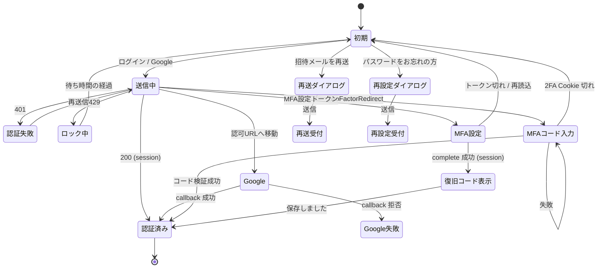

# ログイン画面 v2 再現仕様 (01-login-v2.png)

この文書は `/login`（ログイン、Focus Ledger）を `design/FINAL-UI/images/01-login-v2.png` どおりに作り直し、認証基盤を Better Auth へ移すための再現仕様である。後段の exact-13 実装計画は、この 1 本を画面・認証フロー・API・migration の正本として参照する。

正本の優先順位は次のとおり。

1. `system-spec/` 配下（00-requirements-definition.md と 8 章、正本 spec-state.json の qa_log）。本書と食い違ったら system-spec に従い、本書を直す。
2. 本書。
3. 画像 01-login-v2.png。文言は画像と完全一致で使う。画像の文言と system-spec の決定が食い違う欄は、§UI・状態遷移の「画像と決定の差分」表に扱いを示す。

注記の書き方は次の 3 種類。

- 「(agent 推定・利用者未確認。根拠 qa-login-v2-...)」: system-spec に agent の推定として載っている値。
- 「(提案・agent 推定・未確定)」: system-spec にも値が無く、本書が plan のために置いた案。plan で確定するまで確定扱いにしない。§決定事項と未決事項に対応する Q を置く。
- 注記の無い値: 利用者決定（decision-001〜006、承認 appr-foundation-login-v2-001/002）か、既存コードまたは画像の観測値である。

qa id は `qa-login-v2-` を省いて書くことがある（例: decision-005 は `qa-login-v2-decision-005`）。

## 目的と成功状態

### 目的

金融明細を預かる入口を、テナント管理者に招待された本人だけが、自分で選んだ認証手段（Google アカウント、またはメールアドレスとパスワード）で入れる場にする（U1）。管理者は他人の秘密（仮パスワード）を一切持たない。招待はメールのリンクで本人に届き、本人がその場で認証手段を選んで登録を完了する。

- パスワードを忘れた本人は、自分で再設定できる。
- 同じメールアドレスで Google とパスワードの両方を使う本人は、再認証とメール確認を経て 1 つのアカウントに連携できる。
- パスワードでのログインには TOTP を重ねる（管理者は必須、一般は任意）。
- ログイン画面は、何が守られるか（暗号化・MFA・不正ログイン対策、認証用途に限った情報利用、認証情報とテナント内データの分離）と、サービスの稼働状況・ヘルプ・プライバシーをログイン前に示す。

保守者（SH5）に対しては、認証を Better Auth の正規の機能に寄せて自前の暗号処理（`kanjo_session` の署名・世代照合・一時パスワード）を撤去する。既存 20 画面と API の認証契約（401/403/409・監査の actor 記録）は同じ契約テストで守る（G7）。

### 成功状態（S1〜S7 を本画面の言葉で言い直したもの）

| ID | 成功状態 | 判定の場所 |
|---|---|---|
| S1 (G1) | `/login` に画像の構成要素がすべて出る。文言は画像と完全一致。色・余白・部品はトークンと共通部品経由で、直書き色の lint が 0 件。送信中・認証失敗・ロック中・MFA コード入力・再送受付・再設定受付の 6 状態を持つ。 | DOM テスト・lint |
| S2 (G2/G7) | Better Auth へ移しても、未認証の `/api/*` が 401、停止利用者の既存セッションが 401、非管理者の管理 API が 403、最後の管理者の停止が 409。既存の PBKDF2 利用者が再設定なしでログインできる。旧 `kanjo_session` の署名経路が 0 件。 | API 契約テスト・移行テスト |
| S3 (G3) | 招待された本人が、メールのリンクから Google かパスワードを選んで登録を完了できる。管理者がパスワードを設定する経路が 0 件。再送依頼の応答で招待の有無が分からない。自己登録の経路が 0 件。 | 統合テスト |
| S4 (G4) | 本人がメールで再設定を完了すると既存セッションが全て失効し、応答から登録の有無が分からない。連携は再認証とメール確認を経たときだけ成立する。 | 統合テスト |
| S5 (G5) | TOTP 未設定の管理者は、パスワードでのログインでも招待のパスワード登録直後でも、TOTP の設定を終えるまでセッションを得ない（decision-005/-006）。TOTP 設定済みの利用者はコード入力を経てだけ得る。Google でログインした管理者には TOTP を求めない。各入口で連続失敗がロックされる。 | 統合テスト |
| S6 (G6) | 未認証で稼働状態・ヘルプ・プライバシーが見られ、稼働状態の応答に内部情報が含まれない。 | API・DOM テスト |
| S7 (G7) | 既存 20 画面の認証ガードと契約テストが緑のまま。移行の migration は追加のみ（§データモデルの注記あり）。旧経路への戻し手順が docs にある。 | CI・docs |

## スコープ

### 対象（in）

- ログイン画面 `/login` の作り直し（画像の全構成要素と 6 状態）。
- 未認証で到達できる画面の新設: `/invite/accept`（招待の承諾）、`/reset-password`（パスワード再設定）、`/mfa`（MFA の設定と入力）、`/help`、`/privacy`（frontend-web-006）。
- 設定画面のアカウント欄に、連携（追加・解除）と MFA（有効化・無効化・復旧コードの再発行）を置く（frontend-web-003）。
- 設定画面の利用者管理を、招待の作成・再送・取消と状態表示に作り直す（decision-004、backend-web-003）。
- Better Auth（v1.7.5 固定）の導入: メールとパスワード、Google（OIDC）、D1 のセッション表、twoFactor（TOTP・復旧コード）、アカウント連携（decision-001・-005）。
- 自前認証の撤去: `kanjo_session` の署名と世代照合、一時パスワードの発行、初回変更の強制（mustChangePasswordFence）（G2・G3）。
- 既存 users と PBKDF2 ハッシュの Better Auth の表への複写（migration 0048）。
- 招待の API、ログイン画面からの再送依頼、再設定依頼、MFA 設定の完了 API、稼働状態 API。
- Resend によるメール送信（招待・再設定・連携確認）を `sendMail(to, template, params)` の 1 関数に閉じ、テストで差し替える（decision-002、backend-web-004）。
- レート制限と列挙防止の、新しい入口（MFA・再送・再設定・MFA 設定）への拡張。監査ログの新しい action。
- docs の更新: 移行と戻し、secret、Google Cloud Console、Resend、管理者の締め出しからの復旧、プライバシー（maintenance-ops-web-001、infrastructure-web-003）。

### 対象外（out）

- 自己登録（サインアップ）。招待制だけを保つ（U7）。
- Google 以外のソーシャルログイン、SAML などの企業 SSO。
- パスキー（WebAuthn）と SMS の MFA。MFA は TOTP だけ（decision-003）。
- 信頼端末（trustDevice）。管理者の MFA 必須を 30 日素通りさせないため使わない（security-web-004）。
- 複数テナント。画像の「テナント管理者」は既存の単一テナント `'default'` の管理者を指す。
- 外部の状況ページサービスとの連携。稼働状態は自前の `GET /api/status` で出す。
- 独自ドメインの取得と DNS 設定そのもの。手順だけを docs に書く。
- web 以外のプラットフォーム。
- 旧表（users・旧 audit の列など）の削除。本サイクルでは消さない（C3）。
- Cloudflare Access のサーバ側検証経路の変更。2026-09-11 の利用者決定どおり残置する（C9）。

## 用語と主体

| 用語 | 意味 |
|---|---|
| テナント管理者（管理者） | `role='admin'` の利用者。招待・停止・役割変更ができる。MFA（TOTP）が必須。 |
| 一般利用者 | `role='member'` の利用者。MFA は任意。 |
| 招待 | 管理者がメールアドレスと役割を入れて作る、期限付き・1 回限りの登録権。`invitations` 表の 1 行。状態は未承諾・承諾済み・期限切れ・取消の 4 つ。 |
| 招待トークン | 招待メールのリンクに載る 32 バイトの乱数（base64url）。D1 には SHA-256 だけを置く（backend-web-002）。 |
| 再送依頼 | ログイン画面の『招待メールを再送』から、本人がメールアドレスを入れて招待メールをもう一度求めること。 |
| 再設定依頼 | 『パスワードをお忘れの方』から、本人がメールアドレスを入れて再設定リンクを求めること。 |
| 連携 | 同じメールアドレスの Google とパスワードを、1 人の利用者の 2 つの認証手段（Better Auth の account 行 2 つ）にすること。ログイン済みで、再認証と確認メールを経たときだけ成立する。 |
| 自動連携 | Better Auth 既定の「サインインのついでに同じメールの account を連携する」動き。`disableImplicitLinking=true` で止める。 |
| MFA 設定トークン | TOTP 未設定の管理者がパスワードで認証した直後に出す、10 分・1 回限りのトークン。`mfa_setup_token` 表に SHA-256 で置く（database-web-005）。 |
| 関門 | `databaseHooks.session.create.before`。セッションを作ってよいかを許可側で決める 1 か所（auth-web-007）。 |
| 保持 | 『次回からもログイン状態を保持する』。保持ありは 30 日、保持なしはブラウザを閉じるまでで最長 12 時間（decision-005）。 |
| 復旧コード | TOTP を失ったときに 1 回だけ使えるコード。2FA plugin が発行する。 |
| 列挙防止 | 応答の本文・ステータス・所要時間から、利用者や招待の有無が分からないようにすること（C6）。 |

| 主体 | 役割 |
|---|---|
| SH1 利用者本人（運営者、兼テナント管理者） | 迷わずログインする。家族や委託先を招待する。自分の管理者アカウントを MFA で守る。 |
| SH2 招待される共同利用者 | 招待メールから Google かパスワードを選んで登録する。忘れたら自分で再設定する。 |
| SH3 初見でログイン画面を開く人 | 何が守られるか、稼働しているか、どこを見ればよいかを知る。 |
| SH4 事後の調査主体 | 招待・連携・再設定・MFA の変更が、いつ誰の操作で起きたかを監査ログで追う。 |
| SH5 保守者 | Better Auth の正規機能に寄せ、既存の契約を壊さない。 |
| Google | OIDC の認可と ID トークンの検証（外部送信先 1）。 |
| Resend | 宛先メールアドレスと本文を受けてメールを送る（外部送信先 2）。業務データは送らない（C7）。 |

## ユースケースとユーザーフロー

### UC-1 パスワードでログインする（一般利用者・TOTP 未設定）

1. `/login` でメールアドレスとパスワードを入れ、保持のチェックを選んで『ログイン』を押す（Ctrl+Enter でも送れる。既存の挙動を残す）。
2. web は `authClient.signIn.email({ email, password, rememberMe })` を呼ぶ（frontend-web-006）。
3. 成功するとセッション Cookie が付き、元いた画面（`next`）へ戻る。`next` が無ければ `/`。
4. 失敗は §7.15 の「認証失敗」、ロックは「ロック中」。

### UC-2 パスワードでログインする（TOTP 設定済み）

1. UC-1 の 1〜2。
2. 応答が `twoFactorRedirect: true` なら、セッションはまだ無い。web は `/mfa`（コード入力）へ進む（frontend-web-006）。
3. 6 桁のコードか復旧コードを入れる。成功でセッションが発行され、`next` へ戻る。

### UC-3 TOTP 未設定の管理者がパスワードでログインする（既存の管理者を含む）

1. UC-1 の 1〜2。
2. 関門がセッションを作らせない。応答は MFA 設定トークン（§API「パスワードでのログイン」。返し方は Q-1）。
3. web は `/mfa`（設定）へ進む。QR（totpURI）を読み、初回コードを入れる。
4. `POST /api/auth/mfa-setup/complete` が成功すると、トークンを消費して TOTP を有効にし、セッションを発行する。復旧コードを 1 回だけ表示する。
5. 移行で入った既存の管理者は、移行後の最初のパスワードログインでこの流れに入る（G5 の「次回ログインで設定を求める」はこの場面に当たる）。

### UC-4 Google でログインする

1. 『Googleでログイン』を押す。保持のチェックの値を一緒に渡す（frontend-web-006）。
2. 認可開始（`POST /api/auth/sign-in/social`）で、保持なしなら署名付きの `dont_remember` Cookie を先に付けてから Google へ移る（auth-web-007）。
3. Google から `GET /api/auth/callback/google` に戻る。state・PKCE・nonce を検証する。
4. 次のどれかなら拒否し、`/login?error=google` に戻す: `email_verified=false`、招待も登録も無いメールアドレス、停止中の利用者、同じメールのパスワード利用者で未連携（`account_not_linked`）。
5. 通れば、管理者でも TOTP を求めずにセッションを発行する（decision-005）。

### UC-5 招待を受けて登録する（パスワード）

1. 招待メールのリンク `/invite/accept?token=…` を開く。
2. 画面が招待のメールアドレスと役割を示す（トークンの確認は `POST /api/auth/invite/inspect`）。
3. 『メールアドレスとパスワードで登録』を選び、パスワードを 2 回入れて送る（`POST /api/auth/invite/accept`）。
4. 利用者が作られ、招待が承諾済みになる。自動ログインはしない（autoSignIn=false）。
5. 管理者なら MFA 設定トークンが返り、`/mfa`（設定）へ進む（decision-006）。UC-3 の 3〜4 と同じ。
6. 一般利用者ならログイン画面へ戻り、メールアドレスが入った状態になる（frontend-web-006）。

### UC-6 招待を受けて登録する（Google）

1. UC-5 の 1〜2。
2. 『Googleで登録』を選ぶ。web は `authClient.signIn.social({ provider: 'google', requestSignUp: true, … })` を呼ぶ（backend-web-004）。
3. Google の確認済みメールアドレスが招待と同じなら、利用者が作られ、招待が承諾済みになり、セッションが発行される（管理者でも TOTP は求めない）。
4. 別のメールアドレスの Google アカウントなら拒否し、承諾画面に戻して案内を出す。

### UC-7 招待メールの再送を依頼する

1. 『招待メールを再送』を押す。メールアドレスの入力欄を持つダイアログが開く（上の『メールアドレス』欄に値があれば入れておく）。
2. 送ると、宛先の有無にかかわらず同じ受付表示（§7.15「再送受付」）が出る。
3. 有効な未承諾の招待がそのメールにあれば、新しいトークンで招待メールを送り直す（古いトークンは無効になる）。

### UC-8 パスワードを再設定する

1. 『パスワードをお忘れの方』を押す。メールアドレスの入力欄を持つダイアログが開く。
2. 送ると、登録の有無にかかわらず同じ受付表示（§7.15「再設定受付」）が出る。
3. 登録があれば、1 時間有効・1 回限りの再設定リンクがメールで届く（backend-web-002）。
4. `/reset-password?token=…` で新しいパスワードを 2 回入れて送る。成功すると、その利用者の既存セッションが全て失効する。
5. ログイン画面へ戻り、新しいパスワードでログインする。管理者は UC-2 または UC-3 に続く。

### UC-9 Google とパスワードを連携する（設定画面）

1. ログイン済みの本人が、設定画面のアカウント欄で『Googleを連携』（またはパスワードの追加）を選ぶ。
2. 既存の手段で再認証する（パスワードがある人はパスワードの再入力。Google だけの人は Google での再ログイン）。
3. 確認メール（1 回限り・期限付き）が本人のメールアドレスに届く。
4. リンクを開くと、ログイン済みのまま連携の最後の段へ進む。Google なら `linkSocial` で Google へ移り、同じ確認済みメールアドレスのときだけ account が加わる。パスワードなら新しいパスワードを設定する。
5. 連携の追加と解除は監査ログに残る（G4）。

### UC-10 公開情報を見る

1. フッターの『サービス状況』は、画面を開いたときに `GET /api/status` を呼んで表示する。
2. 『ヘルプ』『プライバシー』は `/help`・`/privacy` を未認証で開く。

### UC-11 管理者が招待を管理する（設定画面）

1. 管理者が設定画面の利用者管理で、メールアドレスと役割を入れて招待を作る。
2. 招待の一覧で状態（未承諾・承諾済み・期限切れ・取消）を見て、再送・取消ができる。
3. 利用者の停止と役割変更は既存どおり。停止した利用者のセッションは即時に失効する。

## 機能要件

| ID | 要件 | 根拠 |
|---|---|---|
| FR-01 | `/login` に §7.2 の文言と §7.1 の構成を、画像どおりの単一カラムで描く。アプリ枠（サイドバー・ヘッダー）の外に置く。 | G1、ui-ux-web-001、C5 |
| FR-02 | パスワードでのログインは Better Auth の `signIn.email` を `rememberMe` 付きで呼ぶ。チェックありは `rememberMe: true`、なしは `false`。 | auth-web-007、frontend-web-006 |
| FR-03 | Google でのログインは、認可開始に保持の指定を渡す。保持なしなら、認可開始の処理が Better Auth の secret で署名した `dont_remember` Cookie を先に付ける（署名の明記は completeness low-3 の是正。§既知の課題 K-4）。 | auth-web-007、backend-web-005 |
| FR-04 | Google は `email_verified=true` かつ、招待または登録のあるメールアドレスのときだけ通す。停止中の利用者は拒否する。state・PKCE・nonce を検証する。 | G3、O3、security-web-003 |
| FR-05 | 自動連携を止める: `accountLinking.disableImplicitLinking=true`、`allowDifferentEmails=false`、`trustedProviders` は設定しない。同じメールの Google サインインは `account_not_linked` で拒否する。 | auth-web-007 |
| FR-06 | 自己登録を塞ぐ: `databaseHooks.user.create.before` で、作成しようとするメールアドレスに有効な（期限内・未承諾・未取消の）招待が無ければ拒否する。Google provider は `disableImplicitSignUp=true`（`disableSignUp` は使わない）。`requestSignUp: true` は招待承諾画面だけが使う。 | backend-web-004 |
| FR-07 | `emailAndPassword.autoSignIn=false`。招待のパスワード登録の直後にセッションを作らない。 | auth-web-007、decision-006 |
| FR-08 | 関門を許可側で書く: `databaseHooks.session.create.before` で、利用者が管理者かつ `twoFactorEnabled` が偽なら、許すのは Google の戻り（`/callback/google`）と MFA 設定の完了処理（`/mfa-setup/complete`）が作るセッションだけにする。それ以外の経路（`/sign-in/email`、`/sign-up/email`、今後増える経路）は全て拒否する。 | auth-web-007、decision-005/-006 |
| FR-09 | 関門は停止中（`status='suspended'`）の利用者のセッションを全ての経路で拒否する。 | G2、O2・O3 |
| FR-10 | TOTP 未設定の管理者がパスワードで認証したとき（ログイン・招待の承諾）、10 分・1 回限りの MFA 設定トークンを返す。 | auth-web-007、database-web-005 |
| FR-11 | `POST /api/auth/mfa-setup/complete` は、設定トークンと TOTP の初回コードを受け、検証に成功したときだけトークンを消費して TOTP を有効にし、セッションを発行する。パスワード側で TOTP 未設定の管理者にセッションを出す唯一の経路とする。 | backend-web-005 |
| FR-12 | TOTP 設定済みの利用者は、2FA plugin の `twoFactorRedirect` を経て `/mfa` でコード（または復旧コード）を入れたあとにだけセッションを得る。`trustDevice` は使わない。 | auth-web-007、security-web-004 |
| FR-13 | 保持: 保持ありは `session.expiresIn=30 日`・`updateAge=1 日`。保持なしは、関門でセッション行の `expiresAt` を発行から 12 時間にし、延長しない。Cookie は Max-Age も Expires も持たない。 | decision-005、auth-web-007、O2 |
| FR-14 | Cookie は `Secure`・`HttpOnly`・`SameSite=Lax`、接頭辞 `kanjo`。 | auth-web-007 |
| FR-15 | 既存の PBKDF2（`pbkdf2-sha256$` 形式）は `emailAndPassword.password.verify` を差し替えて読む。新しく設定するパスワードのハッシュ形式は §データモデル（Q-8）。 | C4、auth-web-007 |
| FR-16 | 招待: 管理者が作成・一覧・再送・取消できる。トークンは 32 バイトの base64url、保存は SHA-256、有効期限 72 時間（agent 推定・利用者未確認。根拠 backend-web-002）。承諾は Google（同じ確認済みメール）かパスワードでだけ完了する。 | G3、decision-004 |
| FR-17 | 招待の消費（承諾済みへの更新）と利用者作成を同じ単位で行う。D1 batch に入れられない場合の順序と補償は §既知の課題 K-6。 | backend-web-004、backend-web-005 |
| FR-18 | 再送依頼・再設定依頼は、宛先の有無にかかわらず 202 と同じ本文を返す。送信は `executionCtx.waitUntil` で応答の後に行う（agent 推定・利用者未確認。根拠 backend-web-002）。 | C6、O4・O5 |
| FR-19 | 再設定: 1 時間有効・1 回限り（agent 推定・利用者未確認。根拠 backend-web-002）。完了でその利用者の全セッションを削除する（Better Auth `revokeSessionsOnPasswordReset: true`）。 | G4、O5 |
| FR-20 | 連携: ログイン済みで、既存手段の再認証とアプリ独自の確認メール（1 回限り・期限付き、SHA-256 保存）を経たあとだけ `linkSocial`（またはパスワードの追加）を許す。別メール・未確認の Google は連携しない。追加・解除を監査に残す。 | G4、auth-web-007、O5 |
| FR-21 | TOTP: 管理者は必須、一般は設定画面で任意に有効化できる。復旧コードは 1 回限り。 | decision-003、O6 |
| FR-22 | レート制限: ログイン・MFA コード・再送依頼・再設定依頼の各入口に、IP とアカウントの 2 軸で 15 分に 5 回失敗で 15 分ロックを掛ける（agent 推定・利用者未確認。根拠 security-web-002）。MFA 設定（`/mfa-setup/*`）も MFA の入口として同じ規則を当てる（completeness medium の suggested_fix）。 | G5、O6 |
| FR-23 | `GET /api/status` は認証不要で `{ status: 'normal' \| 'degraded' }` だけを返す。D1 への `SELECT 1` の成否で決める。認証ガードより前に mount する。IP 単位で 1 分 60 回まで（agent 推定・利用者未確認。根拠 backend-web-002、backend-web-004、security-web-002）。 | G6、O7 |
| FR-24 | `/help`・`/privacy` を未認証で描く。プライバシーには外部送信先（Google・メール送信事業者）と利用目的・保存期間を載せる。 | G6、O7 |
| FR-25 | メール送信は `sendMail(to, template, params)` の 1 関数に閉じる。テンプレートは招待・再設定・連携確認の 3 種。テストでは差し替える。 | decision-002、backend-web-004、I5 |
| FR-26 | 一時パスワードの発行 API・画面・列の利用、初回変更の強制（`mustChangePasswordFence`・`PasswordChangePage` の forced 表示）を撤去する。 | G3、decision-004、O4 |
| FR-27 | `/api/*` の認証ガードの mount 順序、admin 判定（403）、有効な管理者が 0 人になる変更の拒否（409）、監査の `actor_user_id` を移行前と同じ契約で保つ。Cloudflare Access の JWT 経路は残す。 | G7、C9 |
| FR-28 | 認証の表（user・session・account・verification・twoFactor・invitations・mfa_setup_token）は業務データの表と分け、業務データの表から外部キーを張らない。 | G5、database-web-003 |

## 非機能要件

| ID | 要件 | 根拠 |
|---|---|---|
| NFR-01 | 列挙防止: ログイン・再送依頼・再設定依頼の応答は、利用者や招待の有無で本文・ステータス・所要時間が変わらない。未登録・停止・誤パスワードは同じ 401 と同じ本文で返し、所要時間を揃える（未登録でも PBKDF2 を 1 回回す。既存の方式を残す）。 | C6、security-web-003 |
| NFR-02 | 秘密（`BETTER_AUTH_SECRET`・`GOOGLE_CLIENT_ID`・`GOOGLE_CLIENT_SECRET`・`RESEND_API_KEY`）は Workers の secret で持ち、リポジトリ・ログ・応答に出さない。`wrangler.jsonc` の `secrets.required` に加える。 | C2、infrastructure-web-004、security-web-004 |
| NFR-03 | トークン（招待・再設定・連携確認・MFA 設定）と復旧コードの平文が D1 のどの列にも残らない。 | database-web-003、O4・O6 |
| NFR-04 | 外部へ出るのは Google と Resend だけ。業務データ（明細・金額）は送らない。 | C7 |
| NFR-05 | 色は `packages/core/src/design-tokens.ts` 由来のトークンだけ。共通部品（Button・UiIcon・ConfirmDialog と新設の Input）を使う。直書き色の lint が 0 件。 | C5、O1 |
| NFR-06 | アクセシビリティ: 入力欄に `<label>` と `autocomplete`（`email`・`current-password`・`new-password`・`one-time-code`）を付け、貼り付けとパスワード管理ツールを妨げない。パズル型の認証（CAPTCHA）を置かない（WCAG 2.2 の Accessible Authentication。fetched-references の wcag22-accessible-authentication）。エラーは `role="alert"`、受付は `role="status"`。 | O1 |
| NFR-07 | 初期 JS 予算（既存の js-budget）を超えない。ログイン画面から認証後の画面のコードを読まない。Better Auth のクライアントは container の中に閉じる。 | frontend-web-006 |
| NFR-08 | 停止・再設定・MFA 無効化の効果は即時。Better Auth の `session.cookieCache` は使わない（キャッシュ中は失効が遅れるため。提案・agent 推定・未確定。Q-9）。 | G2 |
| NFR-09 | Better Auth は v1.7.5 に固定する（lockfile で exact）。 | C1 |
| NFR-10 | 実行時間: 認証の各 API は Workers の CPU 上限内に収まる。PBKDF2 10 万回の検証 1 回を含むログインで、既存と同程度（既存テストの時間計測を基準にする）。 | C1 |

## UI・状態遷移

### 7.1 画面骨格

背景は薄い色の全面。中央に幅の決まったカード 1 枚を置き、その上にロゴを置く。アプリ枠の外（C5）。

| 順 | 領域 | 中身 |
|---|---|---|
| 1 | ロゴ（カードの外、上） | 棒グラフのマーク（4 本、teal の濃淡）と「Focus Ledger」 |
| 2 | 見出し | h1「ログイン」、説明文 |
| 3 | Google | 『Googleでログイン』ボタン（Google の G ロゴ付き、白地・枠線）、注記 |
| 4 | 区切り | 左右の線と中央の「または」 |
| 5 | パスワードのフォーム | 小見出し、メールアドレス、パスワード（表示切替）、保持のチェックと説明、『ログイン』（主ボタン、teal、全幅）、『パスワードをお忘れの方』（リンク、中央） |
| 6 | 招待の囲み | メールのアイコン、見出し、説明 2 文、『招待メールを再送』（副ボタン）、注記 |
| 7 | 連携の囲み | リンク（鎖）のアイコン、太字 1 文、説明 1 文。背景は 6 より薄い青系 |
| 8 | 区切り線 | — |
| 9 | 安心 3 項目 | 見出しと、アイコン付きの 3 行（見出し＋説明） |
| 10 | フッター | 区切り線の下に 3 つを縦線で区切って並べる: サービス状況（盾とチェックのアイコン）、ヘルプ（? のアイコン）、プライバシー（盾のアイコン） |

部品の割当（frontend-web-006）。

- `packages/web/src/features/auth/` に container 1 つ（`LoginContainer.tsx`）と表示部品（`LoginView.tsx`、`GoogleButton.tsx`、`PasswordForm.tsx`、`InvitePanel.tsx`、`LinkPanel.tsx`、`TrustList.tsx`、`LoginFooter.tsx`、`RequestDialog.tsx`）に分ける（部品名は提案・agent 推定・未確定）。
- 状態から文言を作る純関数は `features/auth/view-model.ts` に置く（frontend-web-002）。
- 入力欄は共通の Input 部品を `packages/web/src/components/Input.tsx` に新設する（frontend-web-006）。
- アイコンは既存の UiIcon。Google の G ロゴだけは、Google のブランド規定どおりの SVG を部品内に置く（UiIcon の単色アイコンでは代えない）。
- `/invite/accept`・`/reset-password`・`/mfa`・`/help`・`/privacy` も同じカードの型（ロゴ＋カード＋フッター）で作る（ui-ux-web-001）。

### 7.2 文言（完全一致）

画像から書き写した文言。句読点・全角記号・空白の有無まで一致させる。

| 場所 | 文言 |
|---|---|
| ロゴ | Focus Ledger |
| 見出し（h1） | ログイン |
| 説明 | 登録済みの認証方法でログインしてください。 |
| Google ボタン | Googleでログイン |
| Google の注記 | 招待先と同じメールアドレスのGoogleアカウントを使用してください。 |
| 区切り | または |
| 小見出し | メールアドレスとパスワードでログイン |
| ラベル | メールアドレス |
| placeholder | you@example.com |
| ラベル | パスワード |
| 表示切替（隠している状態） | 表示 |
| 表示切替（見せている状態） | 隠す（画像に無い状態。既存 Login.tsx の文言を残す） |
| チェック | 次回からもログイン状態を保持する |
| チェックの説明 | 保持する場合は30日間、しない場合は12時間でログイン状態が切れます |
| 主ボタン | ログイン |
| リンク | パスワードをお忘れの方 |
| 招待の見出し | 招待を受けた方 |
| 招待の説明 1 | 招待メールのリンクから、Googleアカウントまたはメール＋パスワードを選んで登録を完了してください。 |
| 招待の説明 2 | 管理者が仮パスワードを設定することはありません。 |
| 招待のボタン | 招待メールを再送 |
| 招待の注記 | アカウントはテナント管理者からの招待で作成されます。 |
| 連携（太字） | 同じメールアドレスでGoogleとパスワードを登録した場合は、1つのアカウントとして安全に連携します。 |
| 連携（説明） | 連携時は再認証とメール確認が必要です。 |
| 安心の見出し | 安心してご利用いただくために |
| 安心 1 見出し / 説明 | セキュリティについて / 全通信を暗号化し、MFAと不正ログイン対策で保護します |
| 安心 2 見出し / 説明 | プライバシーについて / ログイン情報は認証と保護の用途に限って使用します |
| 安心 3 見出し / 説明 | お客様のデータについて / 認証情報とテナント内データを分離して管理します |
| フッター 1 | サービス状況：正常（「正常」は成功色。全角コロン） |
| フッター 2 | ヘルプ |
| フッター 3 | プライバシー |

画像に無く、本書が置く文言（提案・agent 推定・未確定。Q-5）。

| 場面 | 文言 |
|---|---|
| 送信中の主ボタン | 確認中…（既存 Login.tsx の文言を残す） |
| 認証失敗（401） | メールアドレスまたはパスワードが正しくありません。（既存の文言を残す） |
| ロック中（429） | 試行回数の上限に達しました。約N分後にもう一度お試しください（既存の文言を残す。N は `retryAfterSeconds` を分に切り上げ） |
| 認証が未設定（503） | 認証が未設定です。管理者にお問い合わせください（既存の文言を残す） |
| 通信失敗 | ログインに失敗しました。通信状況を確認してもう一度お試しください（既存の文言を残す） |
| Google の失敗（`?error=google`） | Googleでログインできませんでした。招待先と同じメールアドレスのGoogleアカウントか確認してください。パスワードで登録済みの方は、ログイン後に設定画面から連携できます。 |
| 受付（再送・再設定で共通の 1 種類） | 受け付けました。該当するアカウントがある場合は、数分以内にメールが届きます。 |
| 再送ダイアログの見出し / ボタン | 招待メールを再送 / 送信 |
| 再設定ダイアログの見出し / ボタン | パスワードの再設定 / 再設定メールを送信 |
| サービス状況（degraded） | サービス状況：一部不調（警告色） |
| サービス状況（取得できない） | サービス状況：確認できません（中立色） |

受付の文言は、宛先の有無で変えない（ui-ux-web-002）。ui-ux-web-002 の「同じ文言を 1 種類だけ持ち」は、再送と再設定で 1 種類を共有すると読んだ（両方の読みを満たす）。

### 7.3 Google ボタン

- 押すと、ボタンを送信中にし（二重押し防止）、`authClient.signIn.social({ provider: 'google', callbackURL, errorCallbackURL })` を呼ぶ。保持なしの指定の渡し方は §API「Google でのログイン」（Q-3）。
- `callbackURL` は `next`（同じオリジンの相対パスだけ。§ビジネスルール BR-12）。`errorCallbackURL` は `/login?error=google`。
- 保持のチェックは、画像ではパスワード欄の下にあるが、Google にも効く（auth-web-006、frontend-web-006）。この UI の結びつきは利用者が確認していない（completeness low-2。§既知の課題 K-3）。

### 7.4 パスワードのフォーム

- メールアドレス: `type="email"`、`autocomplete="email"`、`inputmode="email"`、必須。前後の空白を除き小文字にしてから送る（既存 users の正規化と同じ）。
- パスワード: `type` は `"password"` と `"text"` のリテラル 2 択で切り替える。切替ボタンは native button で `data-native-control="toggle"` を静的リテラルで、onClick より前に書く（既存の契約ガードに合わせる）。`aria-pressed` を持つ。
- 保持のチェック: 既定はチェックあり（画像と既存 Login.tsx の既定 `true`）。
- 『ログイン』: 送信中は無効化し「確認中…」。Ctrl+Enter（macOS は ⌘+Enter）でも送信する（既存の挙動を残す）。
- 『パスワードをお忘れの方』: §7.9 の再設定ダイアログを開く。既存の「管理者に連絡」のモーダルは消す。

### 7.5 招待の囲み

- 文言は §7.2。囲みは薄い背景と枠線（トークン）。
- 『招待メールを再送』: §7.9 の再送ダイアログを開く。

### 7.6 連携の囲み

- 文言は §7.2。操作は持たない（連携の入口は設定画面。UC-9）。
- 太字の 1 文は画像どおり 2 行に折れてよい（改行位置は幅に任せ、文言に改行を入れない）。

### 7.7 安心 3 項目

- 見出しと 3 行。各行はアイコン（盾とチェック、錠前、文書）＋見出し＋説明。
- 幅 480px 未満では縦積みのまま左右余白 16px（ui-ux-web-002）。画像は既に縦積みなので、幅で並びは変えない。
- 文言の中身を事実にするのは本仕様の他の節（暗号化は HTTPS と Secure Cookie、MFA は FR-21、不正ログイン対策は FR-22、用途限定は §可観測性の「ログに出さない」、分離は FR-28）。

### 7.8 フッター

- サービス状況: 画面を開いたときに `GET /api/status` を 1 回呼ぶ。`normal` → 「正常」（成功色）、`degraded` → 「一部不調」（警告色）、失敗・429・タイムアウト（5 秒）→ 「確認できません」（中立色）（提案・agent 推定・未確定。Q-5）。取得中は「サービス状況：」の後ろを空にし、レイアウトを動かさない。
- ヘルプ: `/help` へのリンク。プライバシー: `/privacy` へのリンク。どちらも同じタブで開く。
- 3 つは縦線で区切る。幅 480px 未満では折り返してよい。

### 7.9 再送・再設定のダイアログ

- どちらも同じ部品（RequestDialog）で、見出し・説明・メールアドレス欄・送信ボタン・閉じるを持つ（文言は §7.2 の本書の追加分）。
- 開いたとき、ログインフォームのメールアドレス欄に値があれば入れておく。
- 送信中はボタンを無効化する。202 でも 429 でもネットワーク以外の応答なら、受付の文言（§7.2）を出す。429 のときも受付の文言を出す（ロックの有無からも宛先が推測されないようにする。提案・agent 推定・未確定。Q-6）。ネットワーク失敗だけは通信失敗の文言を出す。
- 受付を出した後は、同じダイアログから続けて送れない（閉じて開き直す）。

### 7.10 `/mfa`（コード入力と設定）

コード入力（TOTP 設定済み。twoFactorRedirect の後）。

- 見出し「2段階認証」、説明「認証アプリに表示されている6桁のコードを入力してください。」（提案・agent 推定・未確定。Q-5）。
- 6 桁の数字入力: `inputmode="numeric"`、`autocomplete="one-time-code"`、`pattern="[0-9]{6}"`（ui-ux-web-002）。
- 下に「復旧コードを使う」リンクを置き、押すと復旧コードの入力欄に切り替わる（ui-ux-web-002）。
- 送信は `authClient.twoFactor.verifyTotp({ code })` または `verifyBackupCode({ code })`。成功で `next` へ。
- 失敗は「コードが正しくありません。」、ロックは §7.2 のロック中の文言。
- 2FA の一時 Cookie（Better Auth の two_factor Cookie）が切れて 401 になったら、「時間切れです。もう一度ログインしてください。」を出して `/login` に戻す。

設定（TOTP 未設定の管理者。MFA 設定トークンの後）。

- 見出し「2段階認証の設定」。管理者は設定を終えるまでログインできないことを 1 文で示す。
- `POST /api/auth/mfa-setup/start`（提案・未確定。§API）で totpURI を受け、QR を描く。QR の下に手入力用の秘密鍵（base32）を出す。
- 初回コードを入れて `POST /api/auth/mfa-setup/complete` を呼ぶ。成功したら復旧コード（10 個）を 1 回だけ表示し、「保存しました」を押すまで次へ進ませない。
- 設定トークンは画面のメモリにだけ持つ（localStorage・sessionStorage・URL に置かない）。再読込で失われたら「もう一度ログインしてください。」を出して `/login` に戻す。
- 10 分を過ぎたら同じ扱い。

QR の描画はクライアント側のライブラリで行い、外部の QR 生成サービスへ送らない（C7）。ライブラリの選定は plan で決める（Q-7）。

### 7.11 `/invite/accept`

- `?token=` を読み、`POST /api/auth/invite/inspect` で招待のメールアドレス（全体を表示。本人の招待なので伏せない）と役割を得る。読み込んだら URL から token を消す（`history.replaceState`）。token はメモリに持つ。
- 無効（期限切れ・承諾済み・取消・不明）なら 1 種類の文言「この招待リンクは使えません。テナント管理者に再送を依頼するか、ログイン画面の『招待メールを再送』をご利用ください。」（提案・agent 推定・未確定）。
- 選択肢は 2 つ: 『Googleで登録』と『メールアドレスとパスワードで登録』。
- パスワードの場合: 新しいパスワードと確認の 2 欄（`autocomplete="new-password"`）。強度の規則は既存の `validatePasswordPolicy`（routes/auth.ts の weak_password）を使う。
- 応答が `next: 'mfa_setup'` なら `/mfa`（設定）へ、`next: 'login'` なら `/login?email=<招待のメール>` へ（frontend-web-006）。

### 7.12 `/reset-password`

- `?token=` を読み、URL から消してメモリに持つ。
- 新しいパスワードと確認の 2 欄。送信は `authClient.resetPassword({ newPassword, token })`。
- 成功: 「パスワードを再設定しました。新しいパスワードでログインしてください。」を出し、『ログインへ』で `/login`。
- 無効・期限切れ: 「この再設定リンクは使えません。もう一度『パスワードをお忘れの方』からお試しください。」（文言は提案・agent 推定・未確定）。

### 7.13 `/help` と `/privacy`

- 静的な内容を web に持つ（API を呼ばない）。
- ヘルプ: ログインの手順、招待の受け方、再送、再設定、連携、MFA（設定・コード入力・復旧コード・MFA を失ったときは管理者へ）の説明（G6）。
- プライバシー: ログイン情報の利用目的（認証と保護に限る）、保存するもの（メールアドレス、パスワードのハッシュ、セッション、MFA の秘密鍵の暗号文、ログイン履歴の監査記録）、保存期間（セッションは 30 日または 12 時間、招待は 72 時間、再設定は 1 時間、MFA 設定トークンは 10 分、監査記録は既存の保持規則。値は docs/data-schema.md から転記する）、外部送信先（Google：認可と ID トークンの検証、Resend：宛先メールアドレスとメール本文）（G6・O7）。

### 7.14 設定画面（アカウント欄と利用者管理）

画像は無い。部品は既存の設定画面の型に合わせる。

- アカウント欄（全利用者）: 認証手段の一覧（パスワード・Google）と、連携の追加・解除。MFA の状態、有効化（一般）、無効化（一般だけ。管理者は無効化できない）、復旧コードの再発行。パスワードの変更（既存 `POST /api/auth/password` の置き換え先は §API の表）。
- 利用者管理（管理者）: 招待の作成（メールアドレス・役割）、招待の一覧（状態・期限・招待者）、再送、取消。利用者の一覧・停止・役割変更は既存どおり。一時パスワードの発行ボタンを消す（decision-004）。

### 7.15 画面の状態

| 状態 | 契機 | 見た目 |
|---|---|---|
| 初期 | 表示 | §7.2 の文言。サービス状況は取得中 |
| 未入力 | 必須欄が空のまま『ログイン』を押した | `role="alert"` で必要な入力を伝え、最初の未入力欄へフォーカス。API は呼ばない |
| 送信中 | 『ログイン』か Google を押した | Google・パスワード・保持設定の全てを一時無効化。主ボタンは「確認中…」、Google は「Googleへ移動中…」。入力欄は読み取り専用 |
| 認証失敗 | 401（invalid credentials、停止、未登録を区別しない） | フォームの上に `role="alert"` で失敗の文言。パスワード欄を空にし、フォーカスをパスワード欄へ |
| ロック中 | 429 | `role="alert"` でロックの文言。主ボタンを約 N 分無効化し、残り時間を分で出す |
| MFA コード入力 | `twoFactorRedirect` | `/mfa`（コード入力）へ移る |
| MFA 設定 | MFA 設定トークン | `/mfa`（設定）へ移る |
| 再送受付 | 再送ダイアログの送信 | ダイアログ内に `role="status"` で受付の文言 |
| 再設定受付 | 再設定ダイアログの送信 | ダイアログ内に `role="status"` で受付の文言 |
| Google の失敗 | `?error=google` で開いた | `role="alert"` で Google の失敗の文言。URL から `error` を消す |
| 認証が未設定 | 503 `auth_not_configured` | `role="alert"` で未設定の文言。資格情報の誤りではないため入力欄に `aria-invalid` は付けない |

G1 の 6 状態（送信中・認証失敗・ロック中・MFA コード入力・再送受付・再設定受付）は全てこの表にある。MFA 設定と Google の失敗は、decision-005/-006 と Google の経路から本書が足した状態である。

### 7.16 状態遷移



未認証時の経路の扱い（提案・agent 推定・未確定。Q-4）。

- 公開経路は `/login`・`/invite/accept`・`/reset-password`・`/mfa`・`/help`・`/privacy`。未認証でも描く。
- それ以外の経路に未認証で来たら、`/login?next=<元のパスと query>` へ `replace` で移る（現行は URL を変えずにその場でログイン画面を描く。§互換性の差分表）。
- 認証済みで `/login` に来たら `next` か `/` へ移る。
- 認証済みで `/mfa`・`/invite/accept`・`/reset-password` に来たら、`/mfa` 以外は `/` へ移る（招待の承諾・再設定はログアウト中の操作とする）。

### 7.17 狭い画面とアクセシビリティ

- 幅 480px 未満では、カードの左右余白を 16px にする（ui-ux-web-002）。カードは画面幅いっぱい（左右 16px の外余白）。
- 安心 3 項目は縦積み（ui-ux-web-002）。
- フォーカス順は画像の上から下。ダイアログはフォーカスを閉じ込め、Esc で閉じ、閉じたら開いたボタンへ戻す。
- 状態の変化は色だけで示さない（サービス状況は文言、エラーは文言とアイコン）。

### 7.18 画像と決定の差分

| 欄 | 画像 | 決定・扱い | 根拠 |
|---|---|---|---|
| 保持の説明文 | 「保持する場合は30日間、しない場合は12時間でログイン状態が切れます」 | 文言は画像のまま。実際の非保持は「ブラウザを閉じるまで、かつ最長 12 時間」。説明文に「ブラウザを閉じるまで」を足さない | frontend-web-006（-005 の追記を承認範囲外として戻した）、decision-005 |
| 保持のチェックの位置 | パスワード欄の下 | Google にも効く。先に Google を押した人は、チェックを見ないまま既定値（チェックあり）が効く。既定をチェックありにすることで、見落としても保持なし（12 時間）へ意図せず落ちない | frontend-web-006、completeness low-2（K-3） |
| チェックボックスとリンクの色 | 青 | トークンの色にする（主色やリンク色の値はトークンが決める）。画像の青の再現は求めない | C5、NFR-05 |
| サービス状況 | 「正常」固定 | `GET /api/status` の値で「正常」「一部不調」「確認できません」を出し分ける | G6、FR-23 |
| パスワード欄 | 12 個の●（入力済みのモック） | 初期は空。placeholder は無い | 画像のモック |
| 『Googleでログイン』の G ロゴ | 多色の G | Google のブランド規定の SVG を使う | Google の利用規定 |
| 見出しの語 | 「Googleでログイン」（空白なし） | 画像どおり空白なし。G1 の記述「『Google でログイン』」の空白は章の表記であり、画像を優先する | 本書の優先順位 3、G1 |
| 『パスワードをお忘れの方』 | リンク | 旧実装の「管理者に連絡」のモーダルを、再設定の依頼ダイアログに置き換える | G4 |
| MFA・再送・再設定の表示 | 画像に無い | §7.9・§7.10 の文言（本書の提案） | ui-ux-web-001/002 |

## ビジネスルールと検証

| ID | ルール |
|---|---|
| BR-01 | 利用者は招待を経てだけ作られる。作成の 1 か所（`user.create.before`）で、同じメールアドレスの有効な招待（`revoked_at IS NULL AND accepted_at IS NULL AND expires_at > now`）が無ければ拒否する。移行の複写（migration 0048）はこの規則の外で、SQL で直接行う。 |
| BR-02 | 招待から作る利用者の役割は、招待の `role` から `user.create.before` が入れる。本人の入力から受けない。 |
| BR-03 | Google で作る利用者・ログインする利用者は、ID トークンの `email_verified=true` かつ、メールアドレスの小文字化が招待（または既存の user）と一致する。 |
| BR-04 | 招待の状態は core の純関数 `invitationStatus(invite, now)` で決める: `revoked_at` があれば取消、`accepted_at` があれば承諾済み、`expires_at <= now` なら期限切れ、それ以外は未承諾。優先はこの順（backend-web の Clean Architecture の適用。core に置く）。 |
| BR-05 | 同じメールアドレスに未承諾の招待は 1 件だけ。新しく作る・再送するときは、古い未承諾の招待を取消にするか、同じ行のトークンと期限を置き換える（本書は置き換えを採る。提案・agent 推定・未確定。Q-10）。既に user があるメールアドレスへの招待は 409。 |
| BR-06 | 管理者に MFA を求めるかは core の純関数 `requiresTotpSetup({ role, twoFactorEnabled, path })` で決める（backend-web の Dependency Rule）。`role='admin' && !twoFactorEnabled` かつ `path` が `/callback/google`・`/mfa-setup/complete` 以外なら「作らせない」。 |
| BR-07 | 保持なしのセッションは、発行から 12 時間の `expiresAt` を持ち、`updateAge` による延長を受けない。保持ありは 30 日で、1 日ごとに延長される。 |
| BR-08 | 再設定の完了、停止、MFA の無効化（本人）、連携の解除で、その利用者の他のセッションの扱い: 再設定と停止は全セッションを削除する（G2・G4）。MFA の無効化と連携の解除は削除しない（提案・agent 推定・未確定）。 |
| BR-09 | 有効な管理者が 0 人になる変更（最後の管理者の停止・降格）は 409。既存の規則を残す。 |
| BR-10 | 管理者は TOTP を無効化できない。一般利用者は無効化できる（decision-003）。 |
| BR-11 | トークンは全て 32 バイトの乱数の base64url。保存は SHA-256 の 16 進。比較はハッシュどうしの等価（`WHERE token_hash = ?`）で行う。 |
| BR-12 | `next`・`callbackURL` は同じオリジンの相対パスだけを受ける（`/` で始まり `//` で始まらない）。それ以外は `/` に置き換える（オープンリダイレクトを防ぐ）。 |
| BR-13 | メールアドレスは前後の空白を除いて小文字にしてから扱う。長さ 3〜254。既存 users の CHECK と同じ。 |
| BR-14 | パスワードの強度は既存の規則（routes/auth.ts の `weak_password`）を使う。Better Auth の `minPasswordLength` と `maxPasswordLength` はこの規則に合わせる。 |
| BR-15 | 列挙防止のため、ログインの失敗は未登録・停止・誤パスワード・関門での拒否（管理者の MFA 設定トークン以外）を同じ 401 と同じ本文にする。 |

## API契約

共通の前提。

- Better Auth のインスタンスは `packages/api/src/better-auth.ts`（提案・agent 推定・未確定）で `betterAuth({ basePath: '/api/auth', … })` として作り、要求ごとに env と D1 から組む。`/api/auth/*` の既定の経路は `auth.handler` へ向ける（backend-web-004）。
- アプリ独自の `/api/auth/*`（`mfa-setup/*`・`invite/*`・`password-reset/request`・`me`）は、`auth.handler` の catch-all より前に mount する。
- mount 順序（`packages/api/src/index.ts`）。
  1. `requestId`・`secureHeaders`（既存）
  2. `/api/status`（新設。認証ガードより前）
  3. `/api/auth/*` に bodyLimit 16KiB（既存。413 `payload_too_large`）
  4. アプリ独自の `/api/auth/*` の route
  5. `auth.handler`（Better Auth）
  6. `aiAgentRoute`・`improvementAgentRoute`（既存。位置は変えない）
  7. `/api/*` に authGuard → runtimeSchemaGuard → canonicalMutationFence（mustChangePasswordFence は撤去）
  8. `adminUsersRoute`（招待を含む）、`accountRoute`（新設。連携）、既存の route
- authGuard と adminGuard は `auth.api.getSession({ headers })` でセッションを取る（backend-web-004）。`c.set('userId', …)`・`c.set('actor', …)` の形は変えない（`SessionActor` から `mustChangePassword` を除く）。
- Better Auth の組込みのレート制限は切り（`rateLimit.enabled=false`）、既存の login-rate-limit を広げて使う（提案・agent 推定・未確定。二重の 429 の形を避けるため）。
- エラー本文の形。アプリ独自の route は既存の `{ error: { code, message } }`。Better Auth の既定の経路は Better Auth の形（`{ code, message }`）のまま返し、web の view-model が両方を読む。401 のログイン失敗だけは hooks.after で既存の `invalid_credentials` の本文に揃える（BR-15）。
- 新設の変更系のうち `/api/*` の配下（管理と連携）は、`canonical-mutation-fence.ts` の `CANONICAL_MUTATION_ROUTES` に登録する。`/api/auth/*` は fence の外（既存の authRoute と同じ）。

| 区分 | method | path | 状態 |
|---|---|---|---|
| 読取り | GET | /api/status | 新設 |
| 認証 | POST | /api/auth/sign-in/email | Better Auth（置換: 旧 `POST /api/auth/login`） |
| 認証 | POST | /api/auth/sign-in/social | Better Auth |
| 認証 | GET | /api/auth/callback/google | Better Auth |
| 認証 | POST | /api/auth/two-factor/verify-totp、/api/auth/two-factor/verify-backup-code | Better Auth |
| 認証 | POST | /api/auth/mfa-setup/start | 新設（提案・agent 推定・未確定） |
| 認証 | POST | /api/auth/mfa-setup/complete | 新設 |
| 公開 | POST | /api/auth/invite/inspect | 新設 |
| 公開 | POST | /api/auth/invite/accept | 新設 |
| 公開 | POST | /api/auth/invite/resend-request | 新設 |
| 公開 | POST | /api/auth/password-reset/request | 新設 |
| 公開 | POST | /api/auth/reset-password | Better Auth |
| 読取り | GET | /api/auth/me | 既存（形を縮める） |
| 認証 | POST | /api/auth/sign-out | Better Auth（置換: 旧 `POST /api/auth/logout`） |
| 管理 | GET・POST | /api/admin/invitations | 新設 |
| 管理 | POST | /api/admin/invitations/:id/resend、/api/admin/invitations/:id/revoke | 新設 |
| 本人 | POST | /api/account/link/start、/api/account/link/confirm | 新設 |
| 本人 | POST | /api/auth/link-social、/api/auth/unlink-account | Better Auth |
| 本人 | POST | /api/auth/two-factor/enable、/disable、/generate-backup-codes | Better Auth（設定画面から。ログイン済みが前提） |
| 本人 | POST | /api/auth/change-password | Better Auth（置換: 旧 `POST /api/auth/password`） |

この表の `/api/auth/*` だけをmethod/path allowlistで公開する。Better Authが持つ仕様外のtoken/account endpointと、将来pluginが追加するendpointはdefault-denyで404にする。
| 管理 | GET・PATCH | /api/admin/users、/api/admin/users/:id | 既存（停止でセッション削除を足す） |
| 消す | POST | /api/admin/users、/api/admin/users/:id/password-reset | 撤去（一時パスワード） |

Better Auth の既定の経路で、本仕様が使わないもの（`/sign-up/email` を直接呼ぶ経路、`/request-password-reset`、`/send-verification-email` など）は、アプリ側の route で先に 404 を返して塞ぐ（提案・agent 推定・未確定。Q-11）。`/sign-up/email` は `user.create.before` でも拒否されるが、入口を 1 つにしてレート制限と監査を効かせるため塞ぐ。招待の承諾は `auth.api.signUpEmail` をサーバ内から呼ぶ。

### API: 稼働状態（GET /api/status、新設）

#### 識別と目的

- 認証不要の稼働状態。フッターの『サービス状況』が使う（G6、O7）。
- route は `packages/api/src/routes/status.ts`（提案・agent 推定・未確定）。

#### 認証・認可

- 認証不要。認証ガードより前に mount する（backend-web-004）。
- Cookie があっても読まない。

#### Request

- 本文・query なし。

#### Response

- 200 `{ "status": "normal" }`: D1 への `SELECT 1` が成功。
- 200 `{ "status": "degraded" }`: `SELECT 1` が失敗または 2 秒を超えた（2 秒は提案・agent 推定・未確定）。
- ヘッダ `Cache-Control: no-store`。
- 他の項目（版・構成・エラー文）を含めない（O7）。

#### Validation・ビジネスルール

- 値は `normal` と `degraded` の 2 つだけ（backend-web-002）。

#### Error contract

| HTTP | code | 条件 | クライアントの扱い |
|---|---|---|---|
| 429 | `rate_limited` | 同じ IP から 1 分に 60 回を超えた | 「確認できません」 |
| 5xx | — | Worker の失敗 | 「確認できません」 |

#### 実行セマンティクス

- 読取りだけ。副作用なし（レート制限の計数を除く）。

#### キャッシュ・ページング

- キャッシュしない（`no-store`）。ページングなし。

#### 可観測性と監査

- 要求ログに経路・状態・所要時間。監査ログには書かない。
- `degraded` のとき、原因（例外の種類）を要求ログにだけ出す。応答には出さない。

#### セキュリティ確認

- 内部情報（例外文、D1 の名前、版）を返さない。
- 1 分 60 回の制限の保存先は Q-12。

#### Contract tests

- 未認証で 200 と `{status:'normal'}` だけを返す（キーが `status` 1 つ）。
- D1 を失敗させると 200 `{status:'degraded'}`、本文に例外文が無い。
- 61 回目が 429。
- authGuard より前にあること（Cookie なしで 401 にならない）。

### API: パスワードでのログイン（POST /api/auth/sign-in/email、Better Auth）

#### 識別と目的

- メールアドレスとパスワードでの認証。旧 `POST /api/auth/login` を置き換える（G2）。
- Better Auth の既定の経路に、hooks.before（レート制限・停止の扱い）と hooks.after（失敗本文の統一・MFA 設定トークンの返却）を足す。

#### 認証・認可

- 未認証で呼ぶ。Cloudflare Access の経路が有効な環境では、旧実装どおり 400 `access_mode` を返す（C9）。
- `BETTER_AUTH_SECRET` が未設定なら 503 `auth_not_configured`（既存の契約を残す）。

#### Request

```json
{ "email": "you@example.com", "password": "…", "rememberMe": true }
```

- `callbackURL` は送らない（web が画面遷移を持つ）。

#### Response

| 場合 | HTTP | 本文 | Cookie |
|---|---|---|---|
| 成功（一般、または TOTP 不要の経路） | 200 | Better Auth の `{ redirect: false, token, user }` | セッション Cookie。保持ありは Max-Age 30 日、保持なしは Max-Age も Expires も無し |
| TOTP 設定済み | 200 | `{ twoFactorRedirect: true }` | 2FA の一時 Cookie だけ。セッション Cookie は無い |
| TOTP 未設定の管理者 | 200 | `{ mfaSetupRequired: true, setupToken: "<base64url>", expiresAt: "<ISO>" }`（提案・agent 推定・未確定。返し方は Q-1） | 無い（session 行も 0 件） |

`user` には `id`・`email`・`role` だけを返す（`additionalFields` の `returned` を絞る。提案・agent 推定・未確定）。

#### Validation・ビジネスルール

- メールアドレスは BR-13 で正規化する。
- 停止中の利用者は、hooks.before でパスワードの検証を 1 回回したうえで、誤パスワードと同じ 401 にする（NFR-01。関門でも拒否するが、本文を揃えるため前で止める）。
- 関門（FR-08）がセッションを拒否した場合のうち、「管理者で TOTP 未設定」だけを MFA 設定トークンへ変える。それ以外の拒否は 401 `invalid_credentials`。
- 設定トークンを出すとき、同じ利用者の未消費の古いトークンは消費済みにする（database-web-005）。
- 保持なし（`rememberMe:false`）は、関門でセッション行の `expiresAt` を発行から 12 時間にする（FR-13）。

#### Error contract

| HTTP | code | 条件 | クライアントの扱い |
|---|---|---|---|
| 400 | `access_mode` | Cloudflare Access の経路が有効 | 旧実装と同じ扱い |
| 400 | `invalid_request` | 本文の形が違う | 通信失敗の文言 |
| 401 | `invalid_credentials` | 未登録・停止・誤パスワード・関門の拒否（MFA 設定を除く） | 認証失敗（§7.15） |
| 413 | `payload_too_large` | 本文が 16KiB を超える | 通信失敗の文言 |
| 429 | `login_rate_limited`（`retryAfterSeconds` 付き） | IP かアカウントの軸でロック中 | ロック中（§7.15） |
| 503 | `auth_not_configured` | secret が未設定 | 未設定の文言 |

#### 実行セマンティクス

- 成功時は session 行を 1 件作る。MFA 設定トークンの場合は `mfa_setup_token` 行を 1 件作り、古い未消費行を消費済みにする。
- 失敗は IP とアカウントの両軸の計数を 1 増やす。成功でアカウント軸を戻す（既存の規則）。

#### キャッシュ・ページング

- `Cache-Control: no-store`。ページングなし。

#### 可観測性と監査

- 監査: 成功は `auth_login`、失敗は `auth_login_failed`（既存の action を残す）。`actor_user_id` は成功時の利用者 id。失敗時は、登録のあるメールならその id、無ければ NULL（既存の規則）。MFA 設定トークンの発行は `auth_mfa_setup_issued`（新 action。§データモデル）。
- 要求ログにメールアドレス・パスワード・トークンを出さない。

#### セキュリティ確認

- 所要時間: 未登録でも PBKDF2 を 1 回回す（NFR-01）。
- MFA 設定トークンは平文で保存しない。応答に載せるのはこの 1 回だけ。
- 保持なしの Set-Cookie に Max-Age も Expires も無い。

#### Contract tests

- 既存 PBKDF2 の利用者が、移行後に同じパスワードでログインできる（O2）。
- 未登録・停止・誤パスワードが同じ 401・同じ本文。所要時間の差が既存のテストの許容内。
- 保持ありで Max-Age=2592000、保持なしで Max-Age も Expires も無い。保持なしで 12 時間後のアクセスが 401、途中のアクセスで `expiresAt` が延びない（O2）。
- TOTP 未設定の管理者: session 行が 0 件、セッション Cookie が無い、応答が MFA 設定トークン（O6）。
- TOTP 設定済み: `twoFactorRedirect: true`、セッション Cookie が無い。
- 5 回失敗で 6 回目が 429。他のアカウントは阻害されない（O6）。
- 旧 `POST /api/auth/login` が 404。

### API: Google でのログイン（POST /api/auth/sign-in/social と GET /api/auth/callback/google、Better Auth）

#### 識別と目的

- Google（OIDC）での認可開始と戻り。ログイン（UC-4）と、招待の承諾（UC-6、`requestSignUp: true`）で使う。

#### 認証・認可

- 未認証で呼ぶ。戻りで招待・登録・停止・`email_verified` を確かめる（FR-04）。

#### Request

認可開始。

```json
{ "provider": "google", "callbackURL": "/", "errorCallbackURL": "/login?error=google", "requestSignUp": false }
```

- 保持なしの指定は、本文に足すか query に載せる（提案・agent 推定・未確定。Q-3）。本書の案: web は `fetchOptions.query = { remember: '0' }` を付け、hooks.before（`/sign-in/social`）がそれを読んで `ctx.setSignedCookie('dont_remember', 'true', secret, …)` を呼ぶ（completeness low-3 の suggested_fix）。
- `requestSignUp: true` は招待承諾画面だけが送る。

戻りは Google からのリダイレクト（`code`・`state`）。

#### Response

- 認可開始: 200 `{ url: "https://accounts.google.com/…", redirect: true }`。web は `url` へ移る。
- 戻り（成功）: 302 で `callbackURL` へ。セッション Cookie 付き（保持なしなら Max-Age も Expires も無し）。
- 戻り（拒否）: 302 で `errorCallbackURL?error=<code>` へ。web は `error` の種類を区別せず、1 種類の文言にする（§7.2）。

#### Validation・ビジネスルール

- state・PKCE・nonce を検証する（Better Auth の既定。無効化しない）。
- `email_verified=false` は拒否（O3）。
- 登録済みの利用者で Google の account が無い（パスワードだけ）場合は `account_not_linked`（FR-05）。
- 新規作成は `requestSignUp: true` のときだけ試み、`user.create.before` が有効な招待を確かめる（FR-06）。
- 停止中の利用者は関門で拒否する（FR-09）。
- 管理者でも TOTP を求めない（decision-005）。関門は `/callback/google` を許す。
- 招待の消費は `user.create.after` で行う（K-6）。
- 保持なしなら、戻りの処理が署名付き `dont_remember` Cookie を読み、Max-Age の無い Cookie を出す。関門は `expiresAt` を 12 時間にする。

#### Error contract

| 事象 | 戻り先 | クライアントの扱い |
|---|---|---|
| state・PKCE・nonce の不一致 | `errorCallbackURL?error=…` | Google の失敗の文言 |
| `email_verified=false` | 同上 | 同上 |
| 招待も登録も無い（`signup_disabled` 相当） | 同上 | 同上 |
| `account_not_linked` | 同上 | 同上 |
| 停止中 | 同上 | 同上 |
| 招待承諾画面からで、メールが招待と違う | `/invite/accept?error=google_mismatch`（提案） | 承諾画面で「招待されたメールアドレスのGoogleアカウントを選んでください。」 |

エラーコードの名前は Better Auth v1.7.5 の実際の値を実装時に固定版で確かめ、テストに書く。

#### 実行セマンティクス

- 新規作成時: user・account・session の行を作り、招待を承諾済みにする。
- 既存利用者: session の行を作る。

#### キャッシュ・ページング

- なし。

#### 可観測性と監査

- 成功は `auth_login`（手段を detail に `google`）。新規作成は加えて `auth_invite_accept`。拒否は `auth_login_failed`（手段 `google`、理由の区分は detail に。応答には出さない）。
- ID トークン・code・state をログに出さない。

#### セキュリティ確認

- `dont_remember` Cookie は Better Auth の secret で署名する（未署名は読まれない。completeness low-3）。
- `callbackURL`・`errorCallbackURL` は BR-12 の検査を通す（Better Auth の `trustedOrigins` を配信元に限る。infrastructure-web-004）。
- 自動連携が起きない（`account` 行が増えない）。

#### Contract tests

- `email_verified=false`、招待・登録の無いメール、停止中の利用者、state／PKCE／nonce の不一致が、それぞれ拒否される（O3）。
- 同じメールのパスワード利用者の Google サインインが `account_not_linked` で、account 行が増えない（O5）。
- 保持なしで Set-Cookie に Max-Age も Expires も無く、12 時間後が 401（O2）。Google の戻りが `dont_remember` を読むことを固定版 v1.7.5 で確かめる（auth-web-007 の末尾のテスト）。
- 管理者が Google で TOTP なしにセッションを得る（O6）。
- 招待のある確認済みメールで `requestSignUp: true` なら利用者が作られ、招待が承諾済みになる（O4）。`requestSignUp` なしでは作られない。

### API: MFA コードの検証（POST /api/auth/two-factor/verify-totp・verify-backup-code、Better Auth）

#### 識別と目的

- TOTP 設定済みの利用者が、パスワードの認証後にコード（または復旧コード）を入れてセッションを得る（FR-12）。

#### 認証・認可

- Better Auth の 2FA 一時 Cookie（`twoFactorRedirect` の時に付く）が要る。無ければ 401。

#### Request

```json
{ "code": "123456" }
```

- `trustDevice` は送らない。サーバでも受けても無視する（hooks.before で落とす。提案・agent 推定・未確定）。

#### Response

- 200 と セッション Cookie（保持の指定はパスワード認証時の `rememberMe` を引き継ぐ）。

#### Validation・ビジネスルール

- TOTP は 6 桁・30 秒（Better Auth の既定。issuer は「Focus Ledger」。提案・agent 推定・未確定）。
- 復旧コードは 1 回限り。使ったら消す（O6）。
- 関門: TOTP 設定済みの管理者は、この経路のセッションを許す（`twoFactorEnabled=true` のため）。

#### Error contract

| HTTP | code | 条件 | クライアントの扱い |
|---|---|---|---|
| 401 | Better Auth の既定（無効なコード） | コードが違う | 「コードが正しくありません。」 |
| 401 | Better Auth の既定（2FA Cookie なし・期限切れ） | 一時 Cookie が無い | 時間切れの文言で `/login` へ |
| 429 | `login_rate_limited` | MFA の入口（scope_kind `mfa`）でロック | ロック中の文言 |

#### 実行セマンティクス

- 成功で session 行を 1 件作る。復旧コードなら、そのコードを消す。

#### キャッシュ・ページング

- なし。

#### 可観測性と監査

- 成功は `auth_login`（detail に `totp` か `backup_code`）。失敗は `auth_login_failed`（detail に `mfa`）。復旧コードの使用は `auth_mfa_backup_code_used`（新 action）。

#### セキュリティ確認

- 15 分に 5 回失敗で 15 分ロック（FR-22）。
- 信頼端末の Cookie が出ない。

#### Contract tests

- 正しいコードでセッションが出て、誤ったコードで出ない。
- 同じ復旧コードの 2 回目が拒否される（O6）。
- 6 回目の失敗が 429。
- `trustDevice: true` を送っても信頼端末の Cookie が出ない。

### API: MFA 設定の開始（POST /api/auth/mfa-setup/start、新設・提案・agent 推定・未確定）

この API は system-spec に無い。completeness-findings の medium（§既知の課題 K-1）を plan で解くための案として置く。確定扱いにしない。

#### 識別と目的

- セッションを持たない、TOTP 未設定の管理者に、TOTP の秘密鍵と totpURI を出す。Better Auth の `/two-factor/enable` は sessionMiddleware を要するため使えない（completeness medium の観測）。

#### 認証・認可

- セッションは要らない。MFA 設定トークン（未消費・期限内）が要る。

#### Request

```json
{ "setupToken": "<base64url>" }
```

#### Response

- 200 `{ "totpURI": "otpauth://totp/Focus%20Ledger:…?secret=…&issuer=Focus%20Ledger", "secret": "<base32>" }`

#### Validation・ビジネスルール

- トークンは消費しない（complete で消費する）。
- 秘密鍵は Better Auth の twoFactor と同じ対称暗号（`BETTER_AUTH_SECRET` 由来）で暗号化し、twoFactor 表に未有効の行として置く（`user.twoFactorEnabled` は偽のまま）。
- 同じトークンで再度呼ばれたら、同じ秘密鍵を返す（再読込やネットワークの再試行で QR が変わらないように）。

#### Error contract

| HTTP | code | 条件 | クライアントの扱い |
|---|---|---|---|
| 401 | `mfa_setup_token_invalid` | トークンが無い・不明・消費済み・期限切れ | 「もう一度ログインしてください。」で `/login` |
| 429 | `login_rate_limited` | MFA の入口でロック | ロック中の文言 |

#### 実行セマンティクス

- twoFactor の行を 1 件作るか、既にあればそれを使う。冪等。

#### キャッシュ・ページング

- `no-store`。

#### 可観測性と監査

- 監査は書かない（complete で書く）。秘密鍵・totpURI をログに出さない。

#### セキュリティ確認

- トークンの照合は SHA-256 の等価。平文を保存しない。
- レート制限の入口に加える（completeness medium の suggested_fix）。

#### Contract tests

- トークン無し・不明・消費済み・期限切れが 401（completeness medium の suggested_fix）。
- 同じトークンで 2 回呼ぶと同じ secret。
- twoFactor 表の秘密鍵が平文でない。

### API: MFA 設定の完了（POST /api/auth/mfa-setup/complete、新設）

#### 識別と目的

- 設定トークンと TOTP の初回コードを受け、成功でトークンを消費して TOTP を有効にし、セッションを発行する（backend-web-005）。パスワード側で TOTP 未設定の管理者にセッションを出す唯一の経路（FR-11）。

#### 認証・認可

- セッションは要らない。MFA 設定トークンが要る。関門は `/mfa-setup/complete` の経路を許す。

#### Request

```json
{ "setupToken": "<base64url>", "code": "123456", "rememberMe": true }
```

- `rememberMe` はパスワード認証のときの値を web が引き継いで送る（提案・agent 推定・未確定。トークン行に保存する案もある。Q-1）。

#### Response

- 200 `{ "backupCodes": ["…", …] }` とセッション Cookie（保持は `rememberMe` に従う）。
- 復旧コードはこの応答で 1 回だけ返す。

#### Validation・ビジネスルール

- トークンの消費は `UPDATE mfa_setup_token SET consumed_at=? WHERE token_hash=? AND consumed_at IS NULL AND expires_at>?` の更新行数が 1 のときだけ有効（database-web-005）。
- 初回コードを、start で置いた秘密鍵で検証する。検証の前に消費しない。
- 順序（提案・agent 推定・未確定。completeness medium (b) と K-1）: (1) コード検証 → (2) 1 つの D1 batch で「トークンの消費」と「`twoFactorEnabled=true`・復旧コードの保存」→ (3) `internalAdapter.createSession` でセッション作成。(3) が失敗しても、TOTP は有効なので、利用者は `/login` からやり直して UC-2 の経路でセッションを得られる（再試行できる順序）。database-web-005 の「TOTP の有効化とセッションの作成を同じ D1 batch」は、アダプタ経由のセッション作成を batch に入れられるかが未確認のため、plan で確かめる。

#### Error contract

| HTTP | code | 条件 | クライアントの扱い |
|---|---|---|---|
| 400 | `invalid_request` | 本文の形が違う・コードが 6 桁の数字でない | 入力欄のエラー |
| 401 | `mfa_setup_token_invalid` | トークンが無い・不明・消費済み・期限切れ・別の利用者 | 「もう一度ログインしてください。」 |
| 401 | `mfa_code_invalid` | 初回コードが違う（トークンは消費しない） | 「コードが正しくありません。」 |
| 409 | `mfa_setup_not_started` | start を呼んでいない（秘密鍵が無い） | start からやり直す |
| 429 | `login_rate_limited` | MFA の入口でロック | ロック中の文言 |

#### 実行セマンティクス

- 成功で `mfa_setup_token` の 1 行が消費済み、`user.twoFactorEnabled=true`、twoFactor の行が有効、session の行が 1 件増える。
- 同じトークンの 2 回目は 401。

#### キャッシュ・ページング

- `no-store`。

#### 可観測性と監査

- 監査: `auth_mfa_enable`（actor = 本人）と `auth_login`（detail に `mfa_setup`）。
- トークン・コード・復旧コードをログに出さない。

#### セキュリティ確認

- TOTP 設定前に管理者のセッションが存在する経路が 0 件（decision-006）。
- 復旧コードは平文で保存しない（NFR-03、K-7）。

#### Contract tests

- 正しいトークンと正しいコードでセッションが出て、`twoFactorEnabled=true`（O6）。
- 同じトークンの 2 回目、期限切れ、別の利用者のトークンが拒否される（database-web-005）。
- 誤ったコードでトークンが消費されない。5 回失敗でロック。
- D1 にトークンの平文が無い。
- 招待のパスワード登録直後の管理者が、この API を経るまで session 行 0 件（auth-web-007）。

### API: 招待の確認（POST /api/auth/invite/inspect、新設）

#### 識別と目的

- 承諾画面が、招待のメールアドレスと役割を表示するために使う。

#### 認証・認可

- 認証不要。招待トークンが要る。

#### Request

```json
{ "token": "<base64url>" }
```

- token を URL の query ではなく本文で送る（アクセスログに残さない）。

#### Response

- 200 `{ "email": "…", "role": "admin" | "member", "expiresAt": "<ISO>" }`

#### Validation・ビジネスルール

- 状態は BR-04。未承諾のときだけ 200。

#### Error contract

| HTTP | code | 条件 | クライアントの扱い |
|---|---|---|---|
| 404 | `invitation_unavailable` | 不明・期限切れ・承諾済み・取消（区別しない） | §7.11 の無効の文言 |
| 429 | `login_rate_limited` | IP 軸でロック（scope_kind `invite_resend` を共用。提案） | ロック中の文言 |

#### 実行セマンティクス

- 読取りだけ。

#### キャッシュ・ページング

- `no-store`。

#### 可観測性と監査

- 監査は書かない。token をログに出さない。

#### セキュリティ確認

- 無効の理由を区別しない。
- 失敗（404）を IP 軸で数え、トークンの総当たりを止める。

#### Contract tests

- 未承諾で 200。期限切れ・承諾済み・取消・不明が同じ 404・同じ本文（O4）。

### API: 招待の承諾（パスワード）（POST /api/auth/invite/accept、新設）

#### 識別と目的

- 招待トークンとパスワードで利用者を作る（UC-5）。Google での承諾は `sign-in/social` の `requestSignUp: true`（前掲）。

#### 認証・認可

- 認証不要。招待トークンが要る。

#### Request

```json
{ "token": "<base64url>", "password": "…" }
```

- 確認欄の一致は web で確かめる。サーバは `password` 1 つを受ける。
- `name` は受けない。user の `name` にはメールアドレスの `@` より前を入れる（提案・agent 推定・未確定）。

#### Response

- 管理者: 200 `{ "next": "mfa_setup", "setupToken": "<base64url>", "expiresAt": "<ISO>" }`（backend-web-005）。
- 一般: 200 `{ "next": "login", "email": "…" }`（backend-web-005、frontend-web-006）。
- どちらもセッション Cookie を出さない（autoSignIn=false）。

#### Validation・ビジネスルール

- 招待が未承諾（BR-04）。
- パスワードの強度は BR-14。
- 手順（提案・agent 推定・未確定。K-6）: (1) トークンのハッシュで招待を引き、未承諾を確かめる → (2) `auth.api.signUpEmail({ email: invite.email, password, name })`（`user.create.before` が有効な招待と役割を確かめる。autoSignIn=false）→ (3) `UPDATE invitations SET accepted_at=? WHERE id=? AND accepted_at IS NULL AND revoked_at IS NULL` の更新行数が 1 か確かめる → 0 なら作った user を削除して 404 → (4) 管理者なら MFA 設定トークンを発行する。backend-web-005 の「招待の消費と同じ D1 batch」は (2) がアダプタ経由のため同じ batch に入れられるかが未確認で、plan で確かめる。
- 同時に 2 回承諾されても、user のメールの一意制約で 2 人目は作られない。

#### Error contract

| HTTP | code | 条件 | クライアントの扱い |
|---|---|---|---|
| 400 | `weak_password` | 強度の規則に合わない | 入力欄のエラー（既存の文言） |
| 404 | `invitation_unavailable` | 不明・期限切れ・承諾済み・取消 | §7.11 の無効の文言 |
| 409 | `user_exists` | そのメールの利用者が既にいる | 「このメールアドレスは登録済みです。ログインしてください。」（提案） |
| 429 | `login_rate_limited` | IP 軸でロック | ロック中の文言 |

#### 実行セマンティクス

- 成功で user・account（credential）が各 1 行、招待が承諾済み、管理者なら `mfa_setup_token` が 1 行。
- 途中の失敗は §上の補償で、招待が承諾済みなのに user が無い状態と、user があるのに招待が未承諾の状態を残さない。

#### キャッシュ・ページング

- `no-store`。

#### 可観測性と監査

- 監査 `auth_invite_accept`（actor = 作られた利用者、detail に手段 `password` と招待 id）。
- パスワード・トークンをログに出さない。

#### セキュリティ確認

- 役割は招待から入れ、本文から受けない（BR-02）。
- 自動ログインしない。

#### Contract tests

- 一般: 利用者が作られ、セッション Cookie が無く、`next:'login'`（O4）。
- 管理者: session 行 0 件、`next:'mfa_setup'`、設定トークンで complete するとセッションが出る（decision-006、O6）。
- 期限切れ・承諾済み・取消のトークンが 404（O4）。
- D1 に招待トークンの平文が無い（O4）。
- 招待の無いメールで `POST /api/auth/sign-up/email` を直接呼んでも利用者が作られない（O3）。

### API: 招待メールの再送依頼（POST /api/auth/invite/resend-request、新設）

#### 識別と目的

- ログイン画面の『招待メールを再送』。本人がメールアドレスを入れて、招待メールを再送してもらう（G3）。

#### 認証・認可

- 認証不要。

#### Request

```json
{ "email": "you@example.com" }
```

#### Response

- 常に 202 `{ "ok": true }`（宛先の有無で変えない。backend-web-002）。

#### Validation・ビジネスルール

- メールアドレスを BR-13 で正規化する。形が不正でも 202（列挙の手がかりを減らす。提案・agent 推定・未確定）。
- そのメールに未承諾で期限内の招待があれば、トークンを作り直し（古いトークンは無効）、期限を発行から 72 時間に延ばし、招待メールを送る。期限切れの未承諾の招待は再送しない（管理者の再送が要る。提案・agent 推定・未確定。Q-10）。
- 送信は `waitUntil` で応答の後。

#### Error contract

| HTTP | code | 条件 | クライアントの扱い |
|---|---|---|---|
| 202 | — | 常に | 受付の文言 |
| 429 | `login_rate_limited` | scope_kind `invite_resend` でロック | 受付の文言（§7.9。Q-6） |
| 413 | `payload_too_large` | 16KiB 超 | 通信失敗の文言 |

#### 実行セマンティクス

- 招待がある場合だけ `invitations` の 1 行を更新し、メールを 1 通送る。
- 送信の失敗は応答に影響しない。要求ログに残す。

#### キャッシュ・ページング

- なし。

#### 可観測性と監査

- 監査 `auth_invite_resend_request`（actor NULL、送った場合だけ。detail に招待 id）（提案・agent 推定・未確定）。
- メールアドレスを要求ログに出さない。

#### セキュリティ確認

- 所要時間を揃える: 招待の有無に関わらず、同じ処理量（トークン生成とハッシュ）を行い、送信は応答の後。
- 15 分に 5 回で 15 分ロック（IP とアカウント（メール）の 2 軸。security-web-002）。依頼は失敗ではないが、回数で数える（提案）。

#### Contract tests

- 招待あり・招待なし・承諾済み・登録済みのメールで、ステータス・本文が同じ（O4）。
- 招待ありのとき `sendMail` が 1 回、テンプレート `invite`。なしのとき 0 回。
- 古いトークンが無効になる。
- 6 回目が 429。

### API: パスワード再設定の依頼（POST /api/auth/password-reset/request、新設）

#### 識別と目的

- 『パスワードをお忘れの方』。再設定リンクをメールで送る（G4）。内部で Better Auth の `auth.api.requestPasswordReset` を呼び、応答を 202 に揃える（Better Auth の既定の経路は 200 を返すため、アプリ側で包む）。

#### 認証・認可

- 認証不要。

#### Request

```json
{ "email": "you@example.com" }
```

#### Response

- 常に 202 `{ "ok": true }`（backend-web-002）。

#### Validation・ビジネスルール

- メールアドレスを BR-13 で正規化。
- 有効な利用者（停止中でない）でパスワード（credential の account）を持つときだけ送る。Google だけの利用者には送らない（提案・agent 推定・未確定）。
- 再設定トークンは Better Auth の組込み（verification 表）を使い、1 時間で切れる（`resetPasswordTokenExpiresIn=3600`）。保存形式を実装時に D1 の行で確かめ、平文なら独自発行へ置き換える（database-web-003）。
- 送信は `sendResetPassword` の中で `waitUntil` に回す。

#### Error contract

| HTTP | code | 条件 | クライアントの扱い |
|---|---|---|---|
| 202 | — | 常に | 受付の文言 |
| 429 | `login_rate_limited` | scope_kind `password_reset` でロック | 受付の文言（Q-6） |

#### 実行セマンティクス

- 送る場合だけ verification の 1 行とメール 1 通。

#### キャッシュ・ページング

- なし。

#### 可観測性と監査

- 監査 `auth_password_reset_request`（送った場合だけ、actor = 対象の利用者）（提案・agent 推定・未確定）。

#### セキュリティ確認

- 所要時間を揃える（送信は応答の後）。
- Better Auth の `/request-password-reset` を直接呼べないように塞ぐ（Q-11）。

#### Contract tests

- 登録あり・なし・停止中で同じ 202・同じ本文（O5）。
- 登録ありのとき `sendMail` が 1 回、テンプレート `password_reset`。
- 6 回目が 429。

### API: パスワード再設定の完了（POST /api/auth/reset-password、Better Auth）

#### 識別と目的

- 再設定リンクのトークンと新しいパスワードで再設定する。完了で全セッションを失効させる（G4）。

#### 認証・認可

- 認証不要。再設定トークンが要る。

#### Request

```json
{ "token": "…", "newPassword": "…" }
```

#### Response

- 200 `{ "status": true }`。セッションは出さない。

#### Validation・ビジネスルール

- トークンは 1 時間・1 回限り。
- トークンはPOST bodyだけで受ける。queryのtokenは履歴・access log漏えい防止のため400で拒否する。
- パスワードの強度は BR-14。
- `revokeSessionsOnPasswordReset: true` で、その利用者の session 行を全て消す。
- 新しいハッシュの形式は Q-8。

#### Error contract

| HTTP | code | 条件 | クライアントの扱い |
|---|---|---|---|
| 400 | Better Auth の既定（無効なトークン） | 不明・期限切れ・使用済み | §7.12 の無効の文言 |
| 400 | Better Auth の既定（パスワード長） | 強度に合わない | 入力欄のエラー |

#### 実行セマンティクス

- account.password を更新し、verification の行を消し、session を全て消す。

#### キャッシュ・ページング

- なし。

#### 可観測性と監査

- 監査 `auth_password_reset`（actor = 本人）。

#### セキュリティ確認

- 使用済みトークンの 2 回目が無効。
- 停止中の利用者の再設定は、成功してもログインできない（関門）。

#### Contract tests

- 再設定で、既存の全セッション（保持あり・なし）が 401 になる（O5）。
- 同じトークンの 2 回目、1 時間後のトークンが拒否される。
- D1 に再設定トークンの平文が無い（無ければ OK、有れば独自発行へ。database-web-003）。

### API: 本人の情報とログアウト（GET /api/auth/me・POST /api/auth/sign-out）

#### 識別と目的

- `GET /api/auth/me` は既存の web の me 問い合わせのために残す（形を縮める）。`POST /api/auth/sign-out` は旧 `POST /api/auth/logout` の置き換え。

#### 認証・認可

- me: authGuard（`auth.api.getSession`）。sign-out: セッション Cookie。

#### Request

- 本文なし。

#### Response

- me: 200 `{ "authenticated": true, "user": { "id", "email", "role", "status", "createdAt", "lastLoginAt", "twoFactorEnabled", "providers": ["credential","google"], "authAccounts": [{ "id", "providerId" }] } }`。`authAccounts` は本人所有の解除用IDだけを返しtoken列を含めない。`mustChangePassword` を消す（FR-26）。
- sign-out: 200 `{ "success": true }` と Cookie の削除。

#### Validation・ビジネスルール

- me は停止中なら 401（関門と authGuard の両方で拒否）。

#### Error contract

| HTTP | code | 条件 | クライアントの扱い |
|---|---|---|---|
| 401 | `unauthorized`（`認証が必要です`） | セッションが無い・切れた・停止中 | `/login?next=…` へ |
| 503 | `auth_not_configured` | secret が未設定 | 未設定の文言 |

#### 実行セマンティクス

- sign-out は session 行を 1 件消す。

#### キャッシュ・ページング

- `no-store`。

#### 可観測性と監査

- sign-out は `auth_logout`（既存の action）。

#### セキュリティ確認

- me に秘密（ハッシュ・MFA の秘密鍵）を含めない。

#### Contract tests

- 未認証の me が 401 `unauthorized`（既存の契約）。
- `mustChangePassword` が応答に無い。
- sign-out 後の me が 401。

### API: 招待の管理（GET・POST /api/admin/invitations、POST /api/admin/invitations/:id/resend・revoke、新設）

#### 識別と目的

- 管理者が招待を作り、一覧し、再送・取消する（G3、UC-11）。route は既存の `routes/admin-users.ts` に置く。

#### 認証・認可

- authGuard → adminGuard（403 `forbidden`）。管理者のセッションは MFA を経たもの（関門で保証される）か Google のもの（auth-web の least privilege）。

#### Request

- `GET /api/admin/invitations`: query なし。
- `POST /api/admin/invitations`: `{ "email": "…", "role": "admin" | "member" }`
- `POST /api/admin/invitations/:id/resend`: 本文なし。
- `POST /api/admin/invitations/:id/revoke`: 本文なし。

#### Response

- 一覧: 200 `{ "invitations": [{ "id", "email", "role", "status": "pending" | "accepted" | "expired" | "revoked", "expiresAt", "invitedBy", "createdAt", "acceptedAt" }] }`。`status` は BR-04 の core 関数で出す。
- 作成: 201 `{ "invitation": { … } }`。
- 再送: 200 `{ "invitation": { … } }`。
- 取消: 200 `{ "invitation": { … } }`。

#### Validation・ビジネスルール

- 作成: メールは BR-13。既に user があれば 409 `user_exists`。未承諾の招待があれば、その行のトークンと期限を置き換えて送り直す（BR-05）。
- 再送: 未承諾か期限切れなら、トークンを作り直して期限を 72 時間後にし、送る。承諾済み・取消は 409。
- 取消: 未承諾か期限切れなら `revoked_at` を入れる。承諾済みは 409。

#### Error contract

| HTTP | code | 条件 | クライアントの扱い |
|---|---|---|---|
| 400 | `invalid_request` | メール・役割の形が違う | 入力欄のエラー |
| 401 | `unauthorized` | 未認証 | ログインへ |
| 403 | `forbidden` | 管理者でない | 既存の扱い |
| 404 | `not_found` | 招待が無い | 一覧を取り直す |
| 409 | `user_exists`・`invitation_not_pending` | 上の規則 | 通知 |
| 502 | `mail_send_failed` | 作成・再送のメール送信が失敗 | 「招待は作成しましたが、メールを送れませんでした。再送してください。」（提案） |

#### 実行セマンティクス

- 作成と監査の記録は同じ D1 batch（backend-web の data-access の適用）。
- 管理者の作成・再送は、送信の成否を応答に反映する（本人の再送依頼と違い、列挙防止の対象外。送信は同期。提案・agent 推定・未確定）。

#### キャッシュ・ページング

- 一覧は `no-store`。件数は少ない前提でページングしない（最大 200 件を返す。提案）。

#### 可観測性と監査

- 監査: 作成 `admin_user_invite`（既存 action を招待の作成に使う）、再送 `admin_invite_resend`、取消 `admin_invite_revoke`（新 action）。actor = 管理者。

#### セキュリティ確認

- 応答にトークンを含めない（メールでだけ届く）。
- `CANONICAL_MUTATION_ROUTES` に invitations を登録する。

#### Contract tests

- 非管理者が 403、未認証が 401（既存の契約と同じ）。
- 作成で `sendMail` が 1 回、D1 にトークンの平文が無い（O4）。
- 再送で古いトークンが無効になる。取消後の承諾が 404。
- 状態が core の関数と一致する（期限切れの判定を含む）。

### API: 連携の開始と確認（POST /api/account/link/start・confirm、新設）と Better Auth の link-social・unlink-account

#### 識別と目的

- ログイン済みの本人が、再認証と確認メールを経て Google（またはパスワード）を追加し、不要な手段を解除する（G4、UC-9）。route は `routes/account.ts`（提案）。

#### 認証・認可

- authGuard（本人のセッション）。本人のものだけを操作できる。管理者も他人の認証手段を設定できない（auth-web の least privilege）。

#### Request

- `POST /api/account/link/start`: `{ "target": "google" | "password", "currentPassword": "…" }`（パスワードを持つ人は必須）。Google だけの人は `currentPassword` を送らず、セッションの `createdAt` が 10 分以内であることで再認証とみなす（直前に Google でログインし直す。提案・agent 推定・未確定。Q-13）。
- `POST /api/account/link/confirm`: `{ "token": "<base64url>" }`
- 続き（Google）: `authClient.linkSocial({ provider: 'google', callbackURL: '/settings', headers: { "x-kanjo-link-grant": linkGrant } })`。link grant はURL queryへ置かない。
- 続き（パスワード）: `POST /api/account/link/password` `{ "token", "newPassword" }`（サーバ内で `auth.api.setPassword`。提案）。
- 解除: `/auth/me` の本人所有 `authAccounts` から選んだ `accountId` を `authClient.unlinkAccount({ accountId })` に渡す。

#### Response

- start: 202 `{ "ok": true }`（確認メールを送った）。
- confirm: 200 `{ "target": "google" | "password", "linkGrant": "<短命の許可>" }`。Google連携では一度だけ `x-kanjo-link-grant` headerに渡し、パスワード連携ではPOST bodyへ渡す。
- linkSocial の戻り: 302 で `/settings`。

#### Validation・ビジネスルール

- 再認証: パスワードの照合（失敗はログインと同じ計数でロック）。
- 確認メールのトークン: 1 回限り・期限付き（期限は 1 時間。提案・agent 推定・未確定）・SHA-256 保存（auth-web-007）。
- linkSocial は、confirm で得た許可（同じ利用者・同じ target・期限内）が無ければ hooks.before で拒否する。許可はbody/header限定で、queryは受け付けない。
- Google のメールがログイン中の利用者のメールと違えば拒否（`allowDifferentEmails=false`）。`email_verified=false` も拒否。
- 解除: 最後の 1 つの手段は解除できない（Better Auth の既定）。

#### Error contract

| HTTP | code | 条件 | クライアントの扱い |
|---|---|---|---|
| 401 | `unauthorized` | 未認証 | ログインへ |
| 401 | `reauth_failed` | 現在のパスワードが違う・再ログインが古い | 入力欄のエラー／Google で再ログインを促す |
| 404 | `link_token_unavailable` | 確認トークンが不明・期限切れ・使用済み・別の利用者 | 「この確認リンクは使えません。」 |
| 409 | `already_linked` | 既に同じ手段がある | 通知 |
| 429 | `login_rate_limited` | 再認証の失敗でロック | ロック中の文言 |

#### 実行セマンティクス

- start: 確認トークン 1 行とメール 1 通（送信は同期でも可。本人向けで列挙の対象外）。
- confirm: トークンを条件付き UPDATE で消費。
- linkSocial の戻り: account の行が 1 件増える。

#### キャッシュ・ページング

- なし。

#### 可観測性と監査

- 監査: 追加 `auth_link_add`、解除 `auth_link_remove`（O5）。actor = 本人、detail に provider。

#### セキュリティ確認

- 再認証とメール確認の両方を経ないと連携しない（O5）。
- 確認トークンの平文を保存しない。
- `CANONICAL_MUTATION_ROUTES` に account の link を登録する。

#### Contract tests

- 再認証なし、メール確認なしのそれぞれで連携が成立しない（O5）。
- 別メール・未確認の Google が連携されない（O5）。
- 連携の追加・解除が audit_log に残る（O5）。
- 確認トークンの 2 回目が 404。

## データモデル

### migration `migrations/0048_login_v2_better_auth.sql`（番号は database-web-002。名前は提案）

追加する表（Better Auth の既定名、接頭辞なし。database-web-002・-003）。列は Better Auth v1.7.5 の schema 生成（`@better-auth/cli generate`）の出力を正とし、以下は本仕様が必要とする列と追加の列である。

| 表 | 主な列 | 備考 |
|---|---|---|
| `user` | `id`（既存 users.id をそのまま）、`name`、`email`（UNIQUE、小文字）、`emailVerified`、`image`、`createdAt`、`updatedAt`、`twoFactorEnabled`（2FA plugin）、`role`（additionalFields、`admin`・`member`）、`status`（additionalFields、`active`・`suspended`）、`lastLoginAt` | `role`・`status` を user に持つかは提案・agent 推定・未確定（Q-14） |
| `session` | `id`、`userId`（FK cascade）、`token`（UNIQUE）、`expiresAt`、`ipAddress`、`userAgent`、`createdAt`、`updatedAt` | 保持なしは `expiresAt` を発行から 12 時間 |
| `account` | `id`、`userId`（FK cascade）、`accountId`、`providerId`（`credential`・`google`）、`password`（`pbkdf2-sha256$…` のまま）、`accessToken` などの OAuth 列、`createdAt`、`updatedAt` | 既存のハッシュは形式ごと複写（C4） |
| `verification` | `id`、`identifier`、`value`、`expiresAt`、`createdAt`、`updatedAt` | Better Auth の再設定トークン |
| `twoFactor` | `id`、`userId`（FK cascade）、`secret`（暗号文）、`backupCodes`（K-7） | 2FA plugin |
| `invitations` | `id`、`email`、`role`、`token_hash`（UNIQUE）、`expires_at`、`accepted_at`、`revoked_at`、`invited_by`、`created_at`、`updated_at` | database-web-002。`created_at`・`updated_at` は本書の追加 |
| `mfa_setup_token` | `id`、`user_id`（`user.id` への FK、ON DELETE CASCADE）、`token_hash`（SHA-256、UNIQUE）、`expires_at`（発行から 10 分）、`consumed_at`（未消費は NULL）、`created_at` | database-web-005 |
| `link_confirmation_token` | `id`、`user_id`（FK cascade）、`target`（`google`・`password`）、`token_hash`（UNIQUE）、`expires_at`、`consumed_at`、`created_at` | 連携確認のトークン（database-web-003 の「アプリ独自に発行」）。表名と列は提案・agent 推定・未確定 |

索引（提案）: `invitations(email) WHERE accepted_at IS NULL AND revoked_at IS NULL`、`mfa_setup_token(user_id)`、`mfa_setup_token(expires_at)`、`session(userId)`、`session(expiresAt)`。

既存 users からの複写（C3・C4・database-web-002/-003）。

- `INSERT INTO "user" (id, name, email, emailVerified, …, role, status, twoFactorEnabled, …) SELECT id, <name>, email, <emailVerified>, …, role, status, 0, … FROM users;`
  - `emailVerified` の値は Q-15（本書の案は 1。管理者が登録し運用してきたメールであるため）。
- `INSERT INTO account (id, userId, accountId, providerId, password, …) SELECT <新 id>, id, id, 'credential', password_hash, … FROM users WHERE must_change_password = 0;`
  - `must_change_password = 1`（一時パスワードのまま未変更）の利用者は、一時パスワードで入れてしまわないように account を複写しない。この利用者には招待を作り直して送る手順を docs に書く（提案・agent 推定・未確定。Q-16）。
- 既存の行は書き換えない。旧 `users`・`must_change_password`・`temporary_password_expires_at` の列は残す（C3）。
- 旧 `kanjo_session` の Cookie は複写しない。移行後、全利用者は 1 回ログインし直す。

既存表の CHECK の拡張（§既知の課題 K-5）。

- `password_login_rate_limits.scope_kind` の CHECK は `('ip','account')` に固定されている（0039）。security-web-002 の「scope_kind に `invite_resend`・`password_reset`・`mfa` を加える」には CHECK の拡張が要る。
- `audit_log.action` の CHECK も固定されている（0039）。新しい action を足すには CHECK の拡張が要る。
- SQLite の CHECK の拡張は表の再構築でしか行えない（0034・0039 の前例がある）。再構築は行の値を変えずに複写するが、C3 の「追加のみ」と字面で衝突する。plan で (a) 前例どおりの再構築、(b) 新しい表を足して新しい入口だけをそこへ書く、のどちらかを選ぶ。

追加する audit action（提案・agent 推定・未確定。既存の action は残す）。

| action | 契機 |
|---|---|
| `auth_login`（既存） | 全経路の成功（detail に手段） |
| `auth_login_failed`（既存） | 全経路の失敗 |
| `auth_logout`（既存） | sign-out |
| `auth_password_change`（既存） | 設定画面でのパスワード変更 |
| `admin_user_invite`（既存） | 招待の作成 |
| `admin_user_update`・`admin_user_suspend`（既存） | 役割変更・停止 |
| `admin_invite_resend`・`admin_invite_revoke` | 管理者の再送・取消 |
| `auth_invite_accept` | 招待の承諾（Google・パスワード） |
| `auth_invite_resend_request` | ログイン画面からの再送（送った場合） |
| `auth_password_reset_request`・`auth_password_reset` | 再設定の依頼（送った場合）と完了 |
| `auth_mfa_setup_issued`・`auth_mfa_enable`・`auth_mfa_disable`・`auth_mfa_backup_code_used`・`auth_mfa_backup_codes_regenerated` | MFA |
| `auth_link_add`・`auth_link_remove` | 連携 |

`admin_user_password_reset`（既存）は新しく書かない。旧行のために CHECK には残す。

### 反映先

- `docs/data-schema.md`: 新しい表・列・索引、複写の規則、旧表の扱い。
- `packages/api/src/audit-log.ts`: `AUDIT_ACTIONS` に新 action。
- `packages/api/src/login-rate-limit.ts`: scope の追加（K-5 の結論に従う）。
- `packages/api/src/runtime-schema-guard`（既存の runtimeSchemaGuard）: 0048 の表が無ければ 503 `schema_not_ready`。

### core の型（新設）

`packages/core/src/auth/`（提案）に、入出力を持たない関数を置く（backend-web の Dependency Rule）。core は Better Auth を知らない。

- `invitationStatus(invite, now): 'pending' | 'accepted' | 'expired' | 'revoked'`（BR-04）
- `invitationExpiresAt(issuedAt): Date`（72 時間）
- `resetTokenExpiresAt(issuedAt)`（1 時間）、`mfaSetupTokenExpiresAt(issuedAt)`（10 分）
- `requiresTotpSetup({ role, twoFactorEnabled, path })`（BR-06）
- `sessionExpiresAt({ remember, issuedAt })`（30 日 / 12 時間）
- `isSafeRelativePath(next)`（BR-12）

### 定期処理

- 既存の cron（`0 18 * * *`、`scheduledMaintenance`）に、期限切れの `mfa_setup_token`・`link_confirmation_token`・`session`・`verification` の行の削除を足す（database-web-005「期限切れの行は定期処理で消す」）。招待は状態表示に使うので消さない。
- `cleanupExpiredTemporaryPasswords`（users.ts）は一時パスワードの撤去に合わせて止める（旧列は残す）。

## 認証・認可

- 認証基盤は Better Auth（v1.7.5 固定）を継続する（decision-001、decision-005）。
- 認証手段は 2 つ: メールとパスワード（`emailAndPassword`、`password.verify` を差し替えて PBKDF2 を読む）、Google（OIDC、state・PKCE・nonce）。
- 設定値（auth-web-007、backend-web-004/-005、security-web-004、infrastructure-web-004）。

| 設定 | 値 |
|---|---|
| `basePath` | `/api/auth` |
| `baseURL`・`trustedOrigins` | 配信元（本番とステージング）に合わせる |
| `secret` | `BETTER_AUTH_SECRET` |
| `emailAndPassword.enabled` | true |
| `emailAndPassword.autoSignIn` | false |
| `emailAndPassword.password.verify` | PBKDF2（`pbkdf2-sha256$`）を読む関数に差し替え |
| `emailAndPassword.revokeSessionsOnPasswordReset` | true |
| `socialProviders.google` | `clientId`・`clientSecret`、`disableImplicitSignUp: true`（`disableSignUp` は使わない） |
| `account.accountLinking.disableImplicitLinking` | true |
| `account.accountLinking.allowDifferentEmails` | false |
| `account.accountLinking.trustedProviders` | 設定しない |
| `session.expiresIn` | 30 日 |
| `session.updateAge` | 1 日 |
| `advanced.cookiePrefix` | `kanjo` |
| Cookie の属性 | Secure・HttpOnly・SameSite=Lax |
| `plugins` | `twoFactor({ issuer: 'Focus Ledger' })`。`trustDevice` を使わない |
| `databaseHooks.user.create.before` | 有効な招待が無ければ拒否。役割を招待から入れる |
| `databaseHooks.user.create.after` | Google の承諾で招待を承諾済みにする（K-6） |
| `databaseHooks.session.create.before` | 関門（FR-08・FR-09）と保持なしの 12 時間（FR-13） |

- 関門の判定（許可側）。

| 利用者 | 経路 | 結果 |
|---|---|---|
| 停止中 | 全て | 拒否 |
| 管理者・TOTP 未設定 | `/callback/google` | 許す |
| 管理者・TOTP 未設定 | `/mfa-setup/complete` | 許す |
| 管理者・TOTP 未設定 | それ以外（`/sign-in/email`、`/sign-up/email`、今後増える経路） | 拒否（`/sign-in/email` と招待の承諾は MFA 設定トークンへ） |
| 管理者・TOTP 設定済み | `/sign-in/email` | 2FA plugin が `twoFactorRedirect` に変える。コード検証後の作成を許す |
| 一般 | 全て | 許す（TOTP 設定済みなら 2FA plugin が挟まる） |

- Google でログインした管理者には TOTP を求めない（decision-005）。2FA plugin は `/sign-in/email` にだけ掛かり、`/callback/google` には掛からないことを固定版で確かめる。
- 認可: `/api/*` は authGuard（未認証 401）、`/api/admin/*` は adminGuard（403）。TENANT_ID は `'default'` のまま。
- 本人の連携・MFA・パスワードは本人のセッションだけが変えられる。管理者も他人のものを変えられない。
- Cloudflare Access の JWT 経路（`ACCESS_AUD`・`ACCESS_TEAM_DOMAIN`）は authGuard に残す（C9）。
- 停止: `PATCH /api/admin/users/:id` で `status='suspended'` にすると、同じ処理でその利用者の session 行を全て消す（即時失効。G2）。
- 旧 `kanjo_session` の署名・世代照合・`SESSION_TTL_MS`・`mustChangePasswordFence` と `SESSION_SECRET` は撤去する（G2）。障害時も旧認証との二重正本へ戻さず、復元点と互換revisionまたはforward-fixで回復する。

## エラー・例外・回復

| 事象 | 検知 | 利用者に見えるもの | 回復 |
|---|---|---|---|
| パスワードの誤り・未登録・停止 | 401 | 認証失敗の文言 | 入れ直す。忘れたら再設定 |
| ロック | 429 | ロック中の文言と残り分数 | 待つ |
| Google の拒否 | `?error=` | Google の失敗の文言 | 正しいアカウントで再試行、またはパスワードでログインして連携 |
| 2FA Cookie 切れ | verify が 401 | 時間切れの文言 | `/login` からやり直す |
| MFA 設定トークン切れ・再読込 | 401 `mfa_setup_token_invalid` | 「もう一度ログインしてください。」 | `/login` からやり直す（新しいトークンが出る） |
| complete の後にセッション作成だけ失敗 | 5xx | 「設定は完了しました。もう一度ログインしてください。」（提案） | `/login` でパスワード → UC-2 |
| TOTP を失った（一般） | — | — | 復旧コードでログインし、設定画面で TOTP を作り直す |
| TOTP を失った（管理者・復旧コードも無い） | — | — | 他の管理者が居なければ、`scripts` の seed で twoFactor の行を消し、次のパスワードログインで UC-3 に入る（maintenance-ops-web-002） |
| 最後の管理者を停止しようとした | 409 | 既存の文言 | 既存どおり |
| メール送信の失敗（本人の依頼） | Resend の非 2xx | 受付の文言のまま | 要求ログで検知。本人は時間をおいて再依頼 |
| メール送信の失敗（管理者の招待） | 502 `mail_send_failed` | 通知 | 再送 |
| 稼働状態の取得失敗 | 5xx・429・タイムアウト | 「確認できません」 | 次に画面を開いたとき |
| migration 未適用 | 503 `schema_not_ready` | 失敗状態 | Migrate を適用する |
| secret 未設定 | 503 `auth_not_configured` | 未設定の文言 | secret を設定する（docs） |
| 移行の失敗 | — | — | Better Auth の route を外し旧 authRoute と authGuard を戻す commit を revert で作る。新表は残し、旧 users で動かす（maintenance-ops-web-002） |

## イベント・非同期処理

| 動き | 契機 | 内容 |
|---|---|---|
| メール送信（本人の依頼） | 再送依頼・再設定依頼 | `executionCtx.waitUntil` で応答の後に `sendMail` を呼ぶ（backend-web-002） |
| メール送信（管理者・連携） | 招待の作成・再送、連携の開始 | 要求の中で `sendMail` を呼ぶ（提案） |
| 期限切れ行の削除 | 既存の cron `0 18 * * *` | §データモデル「定期処理」 |
| サービス状況の取得 | ログイン画面の表示 | 1 回だけ。再取得しない |

- `sendMail(to, template, params)` は `packages/api/src/mail.ts`（提案）に置き、Resend の HTTP API へ `fetch` する。テンプレートは `invite`・`password_reset`・`link_confirm` の 3 つ。テストでは差し替える（backend-web-004、I5）。
- 送信元は利用者が用意する独自ドメインのサブドメイン（例: `mail.<domain>`）。ドメインが用意できるまではステージングだけ Resend の検証用アドレスで送る（agent 推定・利用者未確認。根拠 infrastructure-web-002）。送信元の値は環境変数 `MAIL_FROM`（vars。提案）。
- キュー・Durable Objects は足さない。

## 可観測性

- 要求ログは既存の方式（経路・状態・所要時間）。認証の新しい route も同じ。
- ログに出さないもの: メールアドレス、パスワード、全てのトークン、TOTP のコードと秘密鍵、復旧コード、ID トークン、Cookie の値（G5「ログイン情報は認証と保護の用途に限って使う」）。
- 監査は §データモデルの action。actor は操作した本人（管理者の操作は管理者）。
- メール送信の失敗は、テンプレート名と Resend の HTTP 状態だけを要求ログに出す。
- `degraded` の原因は要求ログにだけ出す。
- 外部の計測サービスは足さない。

## 互換性・移行・リリース

- secret: `wrangler.jsonc` の `secrets.required` に `BETTER_AUTH_SECRET`・`GOOGLE_CLIENT_ID`・`GOOGLE_CLIENT_SECRET`・`RESEND_API_KEY` を加える（infrastructure-web-004）。`nodejs_compat` は既に有効（Better Auth の AsyncLocalStorage に要る）。
- Google Cloud Console: 承認済みリダイレクト URI に本番とステージングの 2 つ（`<origin>/api/auth/callback/google`）を登録する（agent 推定・利用者未確認。根拠 infrastructure-web-002）。
- Resend: 送信ドメインの SPF・DKIM。手順を docs に置く（infrastructure-web-003）。
- リリース順: secret の設定 → Migrate（0048）→ Deploy。既存の Deploy・Migrate の手順とゲートに従う。
- 移行時の利用者への影響: 旧 `kanjo_session` は読まれなくなるので、全利用者が 1 回ログインし直す。管理者は最初のパスワードログインで TOTP の設定を求められる（UC-3）。一時パスワードのまま未変更の利用者は、招待を作り直す（Q-16）。
- 戻し: Better Auth の route を外し、旧 authRoute と authGuard を戻す commit を revert で作る。新表は残し、旧 users で動かす（maintenance-ops-web-002）。移行後に作られた利用者（招待の承諾）は旧 users に無いので、戻したあとは入れない。docs に明記する。
- docs: `docs/runbooks/account-login-operations.md` の一時パスワードの手順を、招待の再送・取消と、締め出し（最後の管理者の停止・MFA 喪失）からの復旧に置き換える（maintenance-ops-web-001）。移行と戻し、secret、Google、Resend、プライバシーを置く（I8）。

### 既存との差分（変える・残す・消す）

比較元は `specs/spec-account-login.md`（旧仕様、01-login.png）と現行実装（main 8f72ff0）。

| 区分 | 対象 | 旧 | 新 |
|---|---|---|---|
| 変える | 認証基盤 | 自前（`auth.ts` 317 行: PBKDF2・HMAC 署名の `kanjo_session`・`session_generation`） | Better Auth（D1 の session 表） |
| 変える | ログイン API | `POST /api/auth/login` `{email,password,remember}` | `POST /api/auth/sign-in/email` `{email,password,rememberMe}` |
| 変える | ログアウト API | `POST /api/auth/logout` | `POST /api/auth/sign-out` |
| 変える | パスワード変更 API | `POST /api/auth/password` | `POST /api/auth/change-password`（Better Auth） |
| 変える | Cookie | `kanjo_session`、SameSite=**Strict**、非保持も Max-Age 12 時間 | `kanjo` 接頭辞の Better Auth の Cookie、SameSite=**Lax**（OAuth の戻りに要る）、非保持は Max-Age・Expires なし＋サーバ側 12 時間 |
| 変える | 停止・再設定の失効 | `session_generation` を進める | session 行の削除 |
| 変える | 『パスワードをお忘れの方』 | 管理者への連絡を案内するモーダル | メールでの再設定（依頼ダイアログ） |
| 変える | 利用者の追加 | 管理者が一時パスワード（16 文字・72 時間）を発行し別経路で伝える | 招待メール（72 時間・1 回限り） |
| 変える | ログイン画面 | ロゴ無しのカード 1 枚（メール・パスワード・保持・ボタン）。説明「登録済みのメールアドレスとパスワードでご利用いただけます。」 | 画像どおり（§7.1・§7.2）。説明「登録済みの認証方法でログインしてください。」 |
| 変える | 未認証の経路 | どのパスでもその場でログインを描く | 公開経路以外は `/login?next=…` へ（Q-4） |
| 変える | `GET /api/auth/me` | `mustChangePassword` を含む | 含まない。`twoFactorEnabled`・`providers` を足す |
| 変える | Web の認証呼び出し | `fetch('/api/auth/login')` を Login.tsx が直接呼ぶ | `createAuthClient` を container に閉じる（frontend-web-006） |
| 残す | エラー文言 | 401・429・503・通信失敗の文言 | 同じ（§7.2） |
| 残す | 送信中・表示切替・Ctrl+Enter | 「確認中…」、「表示／隠す」、`data-native-control="toggle"` | 同じ |
| 残す | 保持の既定と期間 | 既定 ON、30 日 / 12 時間 | 同じ（非保持はブラウザを閉じるまでが加わる） |
| 残す | レート制限 | IP とアカウントの 2 軸、15 分 5 回・15 分ロック | 同じ値で入口を広げる |
| 残す | 列挙防止 | 未登録・停止・誤パスワードを同じ 401・同じ所要時間 | 同じ（関門の拒否も含める） |
| 残す | 認可の契約 | 401 `unauthorized`・403 `forbidden`・409（最後の管理者）・`actor_user_id` | 同じ（G7） |
| 残す | Cloudflare Access の経路 | authGuard の JWT 検証 | 同じ（C9） |
| 残す | 既存のパスワード | PBKDF2 10 万回 | 同じハッシュを読む（再設定を強いない。C4） |
| 残す | 旧表・旧列 | users など | 消さない（C3） |
| 消す | 一時パスワード | `POST /api/admin/users`（直接作成）、`POST /api/admin/users/:id/password-reset`、UserAdmin の発行ボタン | 撤去（decision-004） |
| 消す | 初回変更の強制 | `mustChangePasswordFence`、`PasswordChangePage` の forced 表示、403 `password_change_required` | 撤去（G3） |
| 消す | 一時パスワードの掃除 | `cleanupExpiredTemporaryPasswords` | 止める |
| 消す | 自前の署名 | `SESSION_TTL_MS`、HMAC 署名・検証、`SESSION_SECRET` | 撤去（G2）。旧認証との二重正本は残さない |

## テストと受入条件

### テストの置き場所（提案・agent 推定・未確定。maintenance-ops-web-001 の「既存の契約テストを Better Auth 版で緑にし、統合テストを加える」を具体化）

| ファイル | 固定する内容 |
|---|---|
| `packages/api/src/account-login.test.ts`（既存を Better Auth 版に書き換え） | 未認証の `/api/*` が 401、停止利用者の既存セッションが 401、非管理者の `/api/admin/*` が 403、最後の管理者の停止が 409、監査の `actor_user_id`（O2・G7） |
| `packages/api/src/login-v2.test.ts`（新設） | §API の Contract tests。保持の Cookie と 12 時間、関門、MFA 設定、招待、再送、再設定、連携、稼働状態、レート制限、列挙防止 |
| `packages/api/src/login-v2-migration.test.ts`（新設） | 0048 の複写（既存 PBKDF2 でログインできる、`must_change_password=1` の account を複写しない、既存行を書き換えない）、平文のトークンが D1 に無い |
| `packages/core/src/auth/*.test.ts`（新設） | `invitationStatus`・期限・`requiresTotpSetup`・`sessionExpiresAt`・`isSafeRelativePath` |
| `packages/web/src/account-login.dom.test.tsx`（既存を書き換え） と `packages/web/src/features/auth/login.dom.test.tsx`（新設） | 全構成要素の描画、文言の完全一致（§7.2）、6 状態、ダイアログ、`/mfa` の入力と設定、`/invite/accept`、`/reset-password`、`/help`・`/privacy`、未認証の経路の扱い |
| `packages/web/src/features/auth/view-model.test.ts`（新設） | 状態から文言を作る純関数、`retryAfterSeconds` の分への切り上げ |

テストを確定する前に、それが旧実装で落ちることを確かめる。

- 例 1: 旧実装では、保持なしの Set-Cookie に Max-Age（12 時間）がある。O2 のテストは旧実装で落ちる。
- 例 2: 旧実装には `/api/status` が無く 401 になる。
- 例 3: 旧実装の文言「登録済みのメールアドレスとパスワードでご利用いただけます。」では §7.2 の完全一致が落ちる。
- 検査の対象が 0 件で緑になるテストにしない。列挙防止のテストは、招待あり・なしの両方の fixture を持ち、それぞれで `sendMail` の呼び出し回数（1 と 0）も確かめる。

Better Auth と Google・Resend は、テストでは次のように差し替える（提案）。

- Google: ID トークンと token エンドポイントを返す fetch の差し替え（`email_verified` の真偽、nonce の不一致を作れる）。
- Resend: `sendMail` を差し替えて呼び出しを記録する。
- 時刻: 12 時間・10 分・72 時間・1 時間の経過は、時計の注入で作る。

### 受入条件

| ID | 受入条件 | 確かめ方 |
|---|---|---|
| AT-01 | `/login` に §7.1 の 10 領域と §7.2 の全文言が完全一致で出る。ロゴはカードの外の上にある。 | DOM |
| AT-02 | 送信中・認証失敗・ロック中・MFA コード入力・再送受付・再設定受付の 6 状態が出る（O1）。 | DOM |
| AT-03 | 直書き色の lint が 0 件。pnpm lint・typecheck・初期 JS 予算を CI で通す（O1）。 | CI |
| AT-04 | 既存の account-login の契約テスト（401・停止 401・403・409・actor）が Better Auth 版で緑（O2）。 | API |
| AT-05 | 既存 PBKDF2 の利用者が再設定なしでログインできる（O2）。 | API・migration |
| AT-06 | 保持ありの Set-Cookie は Max-Age=30 日。保持なしは Max-Age も Expires も無く、12 時間後に 401、途中で延長されない。パスワードと Google の両方（O2）。 | API |
| AT-07 | Google で `email_verified=false`・招待と登録の無いメール・停止中・state／PKCE／nonce の不一致が拒否される。自己登録の経路が 0 件（O3）。 | API |
| AT-08 | 招待作成 → メール（差し替え）→ Google またはパスワードで登録、の 2 経路が完結する。期限切れ・使用済み・取消で拒否。D1 にトークンのハッシュだけ。一時パスワードの API・画面が 0 件。再送依頼の応答が招待の有無で変わらない（O4）。 | API・DOM |
| AT-09 | 再設定で既存セッションが全て 401。登録の有無で応答が変わらない。連携は再認証とメール確認の両方を経ないと成立しない。別メール・未確認の Google は連携されない。連携の追加・解除が audit_log に残る（O5）。 | API |
| AT-10 | TOTP 未設定の管理者は、パスワードのログインでも招待のパスワード登録直後でも session 行 0 件で、設定トークンで TOTP を設定・検証すると発行される。Google の管理者は TOTP なしで発行される。一般は有効化した場合だけ求められる（O6、decision-005/-006）。 | API |
| AT-11 | 復旧コードは 1 回限りで平文保存されない。ログイン・MFA・再送・再設定・MFA 設定の各入口で連続失敗がロックされ、他の利用者を阻害しない（O6）。 | API・D1 |
| AT-12 | 未認証で `GET /api/status` が 200 と `{status}` だけ。`/help`・`/privacy` が未認証で描かれ、プライバシーに外部送信先（Google・メール送信事業者）と利用目的・保存期間が載る（O7）。 | API・DOM |
| AT-13 | `/api/*` の mount 順序、Cloudflare Access の経路、`actor_user_id` が移行前と同じ。migration 0048 が既存行を 1 行も書き換えない（K-5 の結論に従う）（G7・S7）。 | API・migration 検査 |
| AT-14 | 外部への送信先が Google と Resend だけ。ログに秘密（§可観測性）が出ない（C7）。 | API（fetch の監視）・ログ検査 |
| AT-15 | 戻し手順・secret・Google・Resend・締め出しからの復旧の手順が docs にある（S7、maintenance-ops-web-001）。 | docs |

受入は、実行済みの最新のテスト証跡だけで判定する。未実施、一部適合、または既知の逸脱が 1 件でも残る項目は PASS にしない。

## 決定事項と未決事項

### 決定事項（利用者決定）

| ID | 決定 | 根拠 |
|---|---|---|
| D-1 | Google ログインは Better Auth への全面移行で実現する。訂正後の比較のあとも Better Auth を継続する。 | decision-001、decision-005 |
| D-2 | メールは Resend などの外部 API で送る。 | decision-002 |
| D-3 | MFA は TOTP。管理者は必須、一般は任意。 | decision-003 |
| D-4 | 一時パスワードを撤去し、招待リンク方式にする。 | decision-004 |
| D-5 | TOTP 未設定の管理者には、TOTP の設定を終えるまでセッションを発行しない。Google でログインした管理者には TOTP を求めず Google 側に委ねる。保持しないときはブラウザを閉じるまで、かつ最長 12 時間。 | decision-005 |
| D-6 | 招待からのパスワード登録では自動でログインさせず、管理者は登録直後に TOTP の設定を終えてから初めてセッションを得る。 | decision-006 |
| D-7 | 画像 01-login-v2.png を正とし、U1〜U9 を承認した。 | appr-foundation-login-v2-001/002 |

### 未決事項（plan で決める）

| ID | 事項 | 本書の案 | 決め手 |
|---|---|---|---|
| Q-1 | `/sign-in/email` と招待の承諾で、MFA 設定トークンを返す手段と、complete へ保持の指定を引き継ぐ手段。 | 関門が拒否した理由を要求単位の印に残し、hooks.after が `FAILED_TO_CREATE_SESSION` の応答を 200 `{mfaSetupRequired, setupToken}` に置き換える。保持は web が complete に送る。 | K-1。固定版 v1.7.5 で hooks.after が応答を置き換えられるかを確かめる |
| Q-2 | MFA 設定の開始 API の形。 | `POST /api/auth/mfa-setup/start`（§API）。 | K-1 |
| Q-3 | Google の認可開始に保持なしを渡す手段。 | query `remember=0` を hooks.before が読み、`ctx.setSignedCookie` で `dont_remember` を付ける。 | K-4 |
| Q-4 | 未認証で公開経路以外に来たときの扱い。 | `/login?next=` へ replace。 | 現行はその場で描く。route を `/login` にする G1 に合わせた |
| Q-5 | 画像に無い文言（MFA・受付・Google の失敗・サービス状況の degraded と取得失敗・承諾と再設定の画面）。 | §7.2 の本書の追加分。 | 利用者に文言を確かめてよい。実装はこのまま進められる |
| Q-6 | 再送・再設定の 429 を画面でどう見せるか。 | 受付の文言と同じにする（ロックの有無も宛先の手がかりになりうるため）。 | security の観点で確かめる |
| Q-7 | QR の描画ライブラリ。 | クライアント側の軽量ライブラリを遅延読込（初期 JS 予算の外）。 | NFR-07 |
| Q-8 | 新しく設定するパスワードのハッシュ形式（Better Auth 既定の scrypt か、既存と同じ PBKDF2 か）。 | 既存と同じ PBKDF2 で `hash` も差し替える（形式を 1 つに保ち、戻しの際にも旧経路で読める）。 | 戻し手順（revert）の成立性 |
| Q-9 | `session.cookieCache` を使わないこと。 | 使わない。 | 停止の即時失効（G2） |
| Q-10 | 同じメールへの未承諾の招待の扱い、期限切れの招待の本人再送。 | 同じ行のトークンと期限を置き換える。期限切れは本人の再送依頼では送らず、管理者の再送だけで送る。 | G3 の「管理者は再送・取消できる」 |
| Q-11 | 使わない Better Auth の既定の経路を塞ぐか。 | `/sign-up/email`・`/request-password-reset`・`/send-verification-email` などを 404 にする。 | 入口を 1 つにしてレート制限と監査を効かせる |
| Q-12 | `GET /api/status` の 1 分 60 回の計数の保存先。 | Workers の Rate Limiting binding か D1 の表。 | 書込み量と費用 |
| Q-13 | Google だけの利用者の再認証の定義。 | セッションの `createdAt` が 10 分以内（直前に Google でログインし直す）。 | ASVS の再認証の要件 |
| Q-14 | `role`・`status` を Better Auth の user に持つか、旧 users を参照し続けるか。 | user の additionalFields に持つ（関門と authGuard が 1 表で判定できる）。 | 戻し手順との整合（旧 users の role・status と二重になる） |
| Q-15 | 複写する利用者の `emailVerified`。 | 1。 | 連携（`allowDifferentEmails=false`）と Google の照合への影響 |
| Q-16 | 一時パスワードのまま未変更（`must_change_password=1`）の利用者。 | account を複写せず、招待を作り直す手順を docs に書く。 | 撤去後に一時パスワードで入れてしまわないため |
| Q-17 | 本書の agent 推定・利用者未確認の値。 | 招待 72 時間、再設定 1 時間、トークン 32 バイト、202、`{status}` の 2 値、レート制限の値と scope、幅 480px 未満の余白 16px、MFA 欄の属性、受付の文言 1 種類、送信元のサブドメイン、リダイレクト URI 2 つ、戻し手順、MFA 喪失の seed、frontend の分割と経路。 | 実装はこの値で進める。利用者が別の値を選んだら、system-spec を直してから本書を直す |

### 既知の課題（completeness-findings の残り。plan で解決する）

system-spec の評価は PASS（`system-spec/completeness-findings.json`）。PASS を妨げない残りを、plan の入力として挙げる。

| ID | 重さ | 課題 | plan でやること |
|---|---|---|---|
| K-1 | medium | TOTP 未設定の管理者が、設定トークンで TOTP の設定を始める入口が無い。Better Auth の `/two-factor/enable` は sessionMiddleware を要する（better-auth 1.7.0 の plugins/two-factor/index.mjs 76 行）ので使えず、秘密鍵の生成・twoFactor 表への暗号化保存・復旧コードの生成をアプリ側で書く必要がある。`/mfa` の設定画面（QR と復旧コード）もデータの出どころを持たない。加えて (a) `session.create.before` が false を返すと `/sign-in/email` は `FAILED_TO_CREATE_SESSION`（401）を投げる（sign-in.mjs 353-356 行）が、設定トークンを応答に載せる手段（APIError の本文か hooks.after での置き換えか）が決まっていない。(b) database-web-005 の「TOTP の有効化とセッションの作成を同じ D1 batch」は、セッションが `internalAdapter.createSession` でアダプタ経由に書かれるため、アプリの D1 batch に入れられるかが確かめられていない。 | (1) `POST /api/auth/mfa-setup/start` を置く（本書の §API は提案・未確定）。(2) 設定トークンを返す手段を決める（Q-1）。(3) complete で「トークンの消費と `twoFactorEnabled=true`」を 1 batch にし、セッションはそのあと `createSession` で作る。途中で失敗しても再試行できる順序にする。(4) `/mfa-setup/*` をレート制限の入口（O6）に加える。(5) トークン無しの start・complete、トークンの 2 回目、TOTP 検証の失敗が 401 かロックになるテストを加える。必要なら system-spec の auth・backend・frontend 章に agent-inference として差し戻す |
| K-2 | low | G5 の「未設定の管理者は次回ログインで設定を求める」が、decision-006（招待の登録直後にも求める）と字面で食い違う。00-requirements-definition.md に decision-006 の記録が無い。O6 の測定は「パスワードでのログイン後」だけで、招待の登録直後を含まない（auth-web-007 のテストは含む）。 | 本書は decision-006 に従い、AT-10 に招待の登録直後を含めた。G5 の括弧書きと O6 を揃える承認（approval-003 相当）を system-spec 側で記録するか、1 問で確かめる |
| K-3 | low | 保持のチェックは画像ではパスワード欄の下にあるが、その上の Google ボタンにも効く。この UI の結びつきを利用者は見ていない。決めているのは frontend-web-006（agent 推定）だけ。先に Google を押した人は、チェックを見ないまま保持の既定が効く。 | ui-ux で 1 問確かめるか、frontend-web-006 に既知の制約として書く。本書は既定をチェックありにして、見落としても 12 時間に落ちないようにした（§7.18） |
| K-4 | low | Google の戻りが事前に付けた `dont_remember` Cookie を読むことは公式 docs に無い（better-auth 1.7.0 の cookies/index.mjs 168-169 行と callback.mjs 248 行で評価器が確認。過去に Issue #4491 の不具合あり、修正済み）。認可開始で付ける Cookie は Better Auth の secret で署名したものでないと読まれない（getSignedCookie）が、auth-web-007 はこれを明記していない。 | `/sign-in/social` の hooks.before で `ctx.setSignedCookie` を使い、Better Auth の secret で署名する（本書の FR-03・§API に反映）。固定版 v1.7.5 で Google の保持なしのテスト（AT-06）を通す |
| K-5 | low（本書で発見） | `password_login_rate_limits.scope_kind` と `audit_log.action` の CHECK が固定されている（0039）。security-web-002 の scope 追加と新しい audit action には CHECK の拡張が要り、SQLite では表の再構築になる。C3「追加のみ」と字面で衝突する。 | (a) 0034・0039 の前例どおり再構築する（値は変えずに複写）か、(b) 新しい表を足すかを決める。memory の「行書き換え migration で Deploy が止まったときの復旧」も参照する |
| K-6 | low（本書で発見） | 招待の消費と利用者作成を「同じ D1 batch」に置く（backend-web-004/-005）が、利用者作成は Better Auth のアダプタ経由（パスワードは `signUpEmail`、Google は callback の中）で、K-1 (b) と同じく batch に入れられるかが確かめられていない。 | パスワードは「作成 → 条件付き UPDATE → 0 行なら作成を消す」、Google は `user.create.after` で条件付き UPDATE、の順序で整合を保つ案（§API）を確かめる |
| K-7 | low（本書で発見） | O6 は「復旧コードはハッシュ保存」とするが、Better Auth の 2FA plugin の復旧コードは暗号化での保存が既定の選択肢で、ハッシュでの保存に対応しているかは docs に記述が無い（auth-web-evidence-002 (4)、database-web-003）。 | 固定版で保存形式を D1 の行で確かめる。ハッシュにできなければ、復旧コードの生成と照合をアプリ側で書く |
| K-8 | low | decision-005 は 4 つの問いを 1 件にまとめて記録している。どの回答がどのセルの根拠かを id の単位で追えない。 | 本書への影響は無い（D-5 は 4 問の結論をまとめて引いた）。system-spec 側で設問ごとに分けるかは任意 |
| K-9 | low | fetched-references の better-auth は v1.7.5 のリリースページ 1 件だけで、仕様が頼る 2fa・cookies・hooks・email-password の各 docs は個別の記録を持たない。cloudflare-d1-migrations・google-openid-connect・wcag22-accessible-authentication の 3 件は、直近の監査で公式サイトと照合し直していない。 | 実装の前に、使う Better Auth の API（hooks・databaseHooks・twoFactor・accountLinking・setSignedCookie）を固定版のソースか docs で確かめ、テストに固定する |

正本との食い違いの記録（本書は正本に従った）。

- frontend-web-002 は「better-auth/react は使わず `lib/auth-client.ts` に薄い関数を置く」とし、frontend-web-006 は「Better Auth の client（`createAuthClient`）で呼び、型は container に閉じる」とする。本書は後から置き換えた -006 に従った。
- G1 の記述は「『Google でログイン』」（空白あり）、画像は「Googleでログイン」（空白なし）。文言は画像に従った（§7.18）。
- Cookie の SameSite は旧実装・旧仕様の Strict から Lax に変わる（auth-web-007）。
